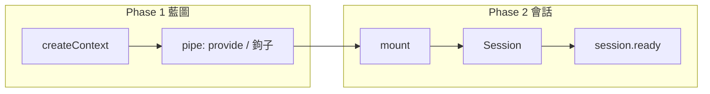

# 00 — 定位

## 0.1 產品

`@sandlada/document-context` 把一塊 DOM 子樹當成一份狀態與一份依賴表。

- 狀態是這份會話自己的，子節點讀不到別的會話的 state。
- 依賴沿宿主的祖先鏈向上找，近者勝。
- 會話的生死跟著宿主的連線走：移走節點會暫停或銷毀，而不是留下無人認領的訂閱。

RxJS 是狀態、錯誤與生命週期的串流媒介（peer dependency）。一次性的等待用 Promise。讀「當下這一筆」用同步的 `read`，因為狀態流本來就有當前值。

## 0.2 兩階段



Phase 1 只產生不可變藍圖：不碰 DOM、不發請求、不執行工廠、不註冊監聽。

Phase 2 從 `mount(blueprint)(host)` 開始。呼叫**立刻**得到 `Session`。`session.ready` 在種子落地、`starting` 期間的 `update` 重放、eager 依賴與首次 `onMount` 都結束後 fulfill。

瀏覽器、測試與 SSR 都走這兩個階段。SSR 的差別只在宿主不是 DOM 節點，以及不執行需要文件的鉤子（見 [05-ssr.md](./05-ssr.md)）。

## 0.3 設計原則

公共面是函式，不是容器類別。呼叫形狀固定為高階函式：**配置在前，被作用的資料在最後一段**。

1. **參數後置。** `mount(blueprint, options?)(host)`、`update(updater)(session)`、`inject<T>(token, options?)(target)`、`defineToken<T>(visibility)(name)`。最後一段才是這次要作用的值。
2. **Phase 1 可計算。** 藍圖是資料。依賴圖、eager 集合、鉤子清單可以在不碰 DOM、不執行工廠的情況下從藍圖算出來。同一份藍圖重複 `pipe`，得到結構相同的結果。
3. **Phase 2 的不純是邊界，不是常態。** IoC 必須寫入會話快取、監聽宿主、回答 `context-request`。這些副作用只發生在 `mount` 之後。藍圖運算子不做這些事。
4. **確定性。** 公開 token 同名即相等。單值 provider 後註冊者勝，鉤子順序固定為 FIFO 或 LIFO，singleton 先註冊者勝。本庫不自己產生隨機身分。誰先完成由呼叫順序與「進行中的 Promise 合併成同一個」決定。
5. **一種掛載。** 沒有另一套同步掛載 API。需要句柄時用回傳的 `Session`；需要「初始化做完了」時 `await session.ready`。
6. **一種提供。** `provide` 的工廠可以回傳值或 Promise。懶或 eager 用選項表達，不靠函式名字區分。
7. **宣告的依賴在工廠之前就位。** `uses` 列出的 token 由執行期按圖建立並等待；工廠裡拿到的是值。環在 `ready` 拒絕，而不是一直掛著。
8. **狀態從種子開始。** 沒有儲存水合，也沒有 payload 水合。`update` 的回傳值就是下一份狀態；`merge` 只是呼叫者可選的純函式。
9. **斷線有定義。** 先做一次微任務重掛確認，避免移動節點時誤銷毀。確認離開後，匿名會話銷毀，keyed 會話暫停並可在 TTL 內恢復。
10. **DOM 寫入留給呼叫者。** 本庫提供狀態與生命週期，不提供把 state 投影成屬性的 DSL。
11. **公開 token 是字串身分。** 多 script 同 Document 時不必共用 import；同名 `namespace:name` 即同一 token。見 [07-tokens.md](./07-tokens.md)。
12. **依賴是任意值。** `provide` 可以交出 function、class、symbol 或資料，以引用注入。見 [08-injection.md](./08-injection.md)。
13. **Phase 2 綁在 Application 上。** `createApplication(ports)` 裝出執行期殼層；藍圖運算子不綁定。見 [11-composition.md](./11-composition.md)。

## 0.4 不做的事

- 不做模板、路由、表單框架、CSS。
- 不做內建的 DOM 雙向綁定。
- 不做跨分頁同步。呼叫者若要寫 `localStorage` 或聽其他分頁，自己訂 `state$`。
- 不把裝飾器與 signals 列進這一版的公共面。
- 不做序列化，也不提供 `persist`、`codec` 或 payload 水合。狀態只活在會話記憶體裡。

## 0.5 一次典型呼叫

```ts
import { createContext, defineToken, mount, pipe, provide, subscribe$, update } from '@sandlada/document-context'

const countToken = defineToken<{ inc(): void }>('public')('app:count')

const blueprint = pipe(
    createContext({ count: 0 }),
    provide(countToken, ({ session }) => ({
        inc: () => update((state) => ({ ...state, count: state.count + 1 }))(session),
    })),
)

const host = document.querySelector('#app')
if (host === null) throw new Error('missing #app')

const session = mount(blueprint)(host)
await session.ready

subscribe$((state) => {
    host.textContent = String(state.count)
})(session)
```
