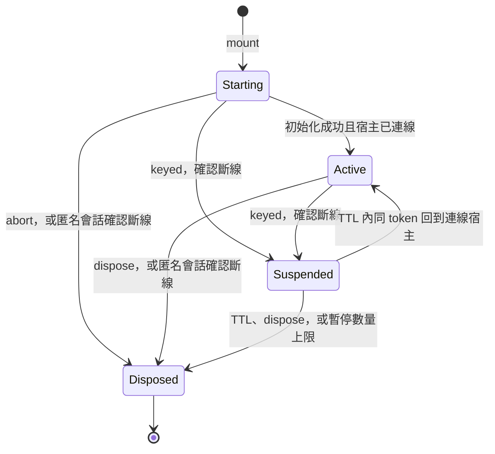
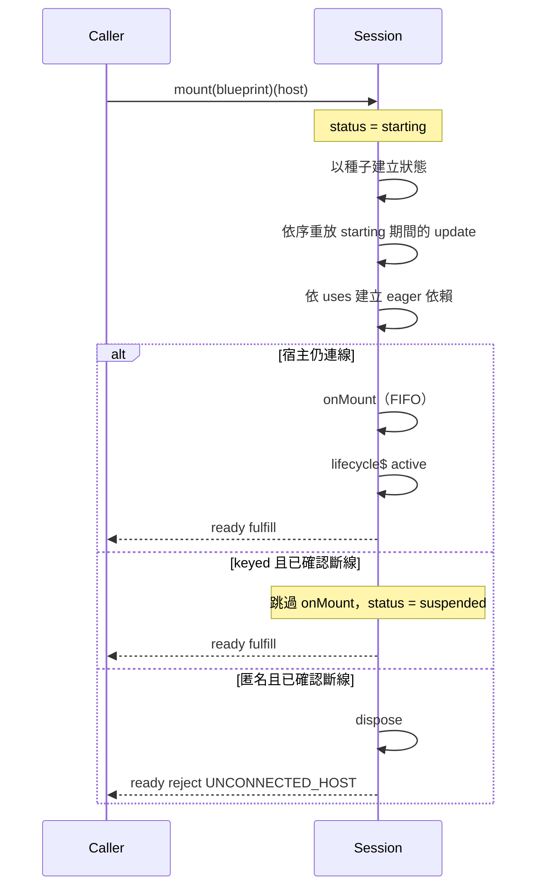

# 02 — 生命週期與鉤子

會話有四個狀態。呼叫 `mount` 的人立刻拿到物件；`ready` 描述初始化是否做完，不描述物件是否已經存在。



`lifecycle$` 的事件是 `active`、`suspended`、`resumed`、`adopted`、`disposed`。`disposed` 可以帶 `reason`：`explicit`、`disconnect`、`ttl`、`cap`、`conflict`。

## 2.1 初始化順序



`starting` 期間 `session$` 與 `sessionAt` 看不到這份會話。持有 `mount` 回傳值的人看得到，也可以 `update` 與 `inject`。

## 2.2 鉤子

| 鉤子 | 何時 | 順序 | 可以回傳 |
| :--- | :--- | :--- | :--- |
| `onMount` | 第一次進入 `active` | FIFO | 清理函式，或 Promise（`ready` 會等它） |
| `onSuspend` | `active → suspended` | FIFO | `void` |
| `onResume` | `suspended → active` | FIFO | `void` |
| `onAdopt` | 節點被 `adoptNode` 到另一個 Document，狀態仍是 `active` | FIFO | `void` |
| `onDispose` | 進入 `disposed` | LIFO | `void` 或 Promise |

鉤子的回傳值規則：**回傳值若是函式，即視為清理函式**；回傳 Promise 則等待它，其 resolved 值**不**當清理函式。非同步的 `onMount` 若仍需要清理，請在 Promise 內自行安排。

`onMount` 的清理函式只在最終銷毀時執行，順序在 `onDispose` 之前，兩者都是 LIFO。暫停不會跑這些清理。暫停時用 `onSuspend` 停下計時器與訂閱，`onResume` 再綁一次。

```ts
onMount((session) => {
    const node = session.host.native()
    const timer = setInterval(() => {
        node.textContent = String(read((s) => s.count)(session))
    }, 1000)
    return () => clearInterval(timer)
})

onSuspend(() => { /* 停掉只在畫面上才需要的工作 */ })
onResume((session) => {
    const node = session.host.native()
    node.textContent = String(read((s) => s.count)(session))
})
```

若會話在 `starting` 就進了 `suspended`（keyed，宿主在初始化完成前離開），首次 `onResume` 先跑當初跳過的 `onMount`，再跑 `onResume`。

`onMount` 拋錯或拒絕：`ready` 拒絕，已註冊的清理會執行，會話 `disposed`，不送出 `active`。其他鉤子拋錯只進 `errors$`。

伺服器掛載不跑 `onMount` / `onSuspend` / `onResume`。`onDispose` 會跑。見 [05-ssr.md](./05-ssr.md)。

## 2.3 斷線與恢復

宿主發出離開的訊號之後，執行期先等一個微任務。微任務結束時節點仍在文件裡，視為沒有離開（節點被移動）。確認離開之後：

- 匿名會話 → `disposed`，`reason: 'disconnect'`。
- keyed 會話 → `suspended`。狀態、scoped 依賴與尚未結束的 `state$` 訂閱都還在。TTL 內用同一個 token 掛到新的已連線宿主，走 `onResume`，狀態保留，不回到種子。
- TTL 到期 → `disposed`，`reason: 'ttl'`。`retention: 'pinned'` 的會話**不受 TTL 影響**。

同一 **Application** 上同時暫停的 keyed 會話有上限（預設 32，Application 級可調）。超過時最舊的一份銷毀，`reason: 'cap'`。`retention: 'pinned'` 的會話**不計入上限**。被上限清掉的 token 再次出現時是一份新會話，狀態從藍圖種子開始。

`onConflict: 'replace'` 銷毀舊會話再掛新的，不經過 `suspended`；舊會話以 `reason: 'conflict'` 銷毀。

`onConflict: 'reset'` 讓新會話的種子改用舊會話的**當前狀態**。其後的順序不變：**種子落地 → 重放 `starting` 期間的 `update` → eager 依賴**。也就是說 `reset` 只換掉「狀態從哪裡來」，不改變初始化流程本身。

兩者都**只**適用於同一個宿主上的衝突。跨宿主的同一 keyed token 是硬失敗（`KEYED_CONFLICT`），見 [09-mount-host.md](./09-mount-host.md) §9.4。

## 2.4 銷毀

`dispose(session)` 是同步的：中止 `abortSignal`、停掉對外的新工作、跑清理與 `onDispose`、讓 `state$` 與 `lifecycle$` 完成。

鉤子若回傳 Promise，同步階段把他們開工，不等待。`await session[Symbol.asyncDispose]()` 會等到這些 Promise 落定。環境沒有 Explicit Resource Management 時，用 `dispose(session)`。

`disposed` 之後 `update` 回傳 `false`，`inject` 拒絕 `DISPOSED_SESSION`，`read` 仍回傳最後一筆快照。
