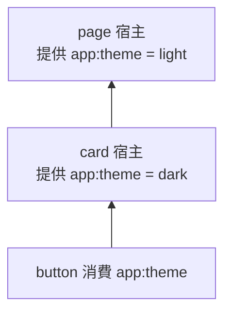

# 03 — DOM

DOM 在這套設計裡只有三件事：它是會話的宿主、它是依賴的作用域樹、它的連線決定會話要不要暫停。

## 3.1 宿主

瀏覽器裡 `mount` 的目標必須是已連線的 `Element`（含 SVG、MathML）。未連線拋 `UNCONNECTED_HOST`。文字節點與文件片段拋 `HOST_INVALID`。掛載對象的選型、嵌套宿主、伺服器占位與 `inject` 目標的差別見 [09-mount-host.md](./09-mount-host.md)。

建議在 Custom Element 的 `connectedCallback` 裡掛載。

```ts
class Counter extends HTMLElement {
    #session: Session<{ count: number }> | undefined

    connectedCallback() {
        this.#session = mount(blueprint, { token: 'app:counter' })(this)
    }

    disconnectedCallback() {
        // 匿名會話會自己銷毀。keyed 會話進入暫停，不必在這裡 dispose，
        // 除非這個元素確定不會再以同一個 token 出現。
    }
}
```

`session.host` 提供：

- `isConnected`
- `parent`：祖先宿主。走出 shadow root 時連到 `ShadowRoot.host`
- `native()`：底層元素
- `on(type, listener, options?)`：傳回解除函式，選項含 `signal`

本庫不代寫屬性、class 或表單值。

## 3.2 作用域

依賴解析從目標元素向上走，經過普通父節點與 shadow host。同一條鏈上近的單值提供者勝。

作用域鏈的走法是：取父節點；父節點是 shadow root 時改走其 `host`；直到沒有父節點為止。**鏈不跨 Document 邊界**——iframe 內的內容、還沒被 `adoptNode` 進當前文件的節點，都在鏈的盡頭，各自需要自己的 Application 與掛載。open 與 closed shadow 不影響鏈的走法；closed shadow 影響的是外部 JavaScript 能不能直接查進去。



`button` 上的 `inject(themeToken)` 得到 `dark`。

`sessionAt(element)` 回傳這條鏈上最近的、狀態為 `active` 且宿主仍連線的會話。`starting` 與 `suspended` 對這條查詢不可見。`session$(element)` 是同一規則的熱流：暫停時送 `null`，恢復時再送**同一個** Session 物件。

Keyed 身分寫在宿主的 `data-context-key`。本次掛載的 token 有兩個來源：明確傳入的 `mount` 選項，或宿主上既有的屬性值。**只給其一**時以它為準；**兩者都有但不同**時依 `onConflict` 處理（預設 `throw`）——屬性上已有的值**不會**被靜默覆蓋。會話最終銷毀且屬性仍等於自己的 token 時，移除該屬性。

## 3.3 跨 bundle

不同打包結果或多支 `<script>` 之間**不共享** JS 模組狀態，也**拿不到**另一邊 `defineToken` 回傳值的物件引用——公開 token 在 runtime 就是 **`namespace:name` 字串**，同名即同一身分；跨邊界只傳名字，不傳 import。私有 token 是物件引用，**不能**跨 script 對齊。詳見 [07-tokens.md](./07-tokens.md)。

跨 bundle 的依賴解析走 **DOM 上的 Context Protocol 事件**（`context-request` / `context-mount` / `context-dispose`）：冒泡、`composed`、單值停止冒泡、多值繼續冒泡、`detail.context` 承載 token。完整傳遞規則見 [10-events.md](./10-events.md)。

## 3.4 斷線由誰說了算

預設會跟著文件觀察連線。呼叫者也可以用 `attach` 自己轉發：

```ts
const hooks = attach({
    onConnect: () => {},
    onDisconnect: () => {},
    onAdopt: (owner) => {},
})(session)
```

觀察與 `attach` 說的是同一件事實。後到的那一次不再次觸發暫停或恢復。

`attach` 只轉發它**加入之後**的事實：會話建立之前發生的斷線不回溯影響已建立的會話。要從掛載前就接上連線訊號，請在 `mount` 之後立刻 `attach`。

節點被移進另一個 Document 時會話保持 `active`，跑 `onAdopt`，暫停表與 keyed 身分跟著走。不支援「在文件 A 暫停、在文件 B 恢復」。

## 3.5 元素目標的等待

`inject(token)(element)` 在鏈上還沒有 `active` 提供者時等待。等待在下列情況結束：

- 提供者進入 `active` 並回答
- 目標元素確認斷線（微任務重掛之後仍不在文件裡）
- 提供這份依賴的會話 `abortSignal` 已 abort（`dispose` 或掛載期取消）

確認斷線預設結束等待，避免拆掉的子樹還掛著 Promise。若呼叫者確定元素還會接回來，傳 `wait: true`，斷線不結束這次等待；會話銷毀仍會結束。

以 `Session` 為目標的 `inject` 預設不等待「也許以後會出現的祖先」。藍圖與已經 `active` 的祖先都沒有這個 token 時，拒絕 `UNKNOWN_SERVICE`。需要跟元素目標一樣等待時，傳 `wait: true`。

這條等待沒有自己的 `AbortSignal`。節點還在、只是這次呼叫不再需要結果時，用 `inject$` 並退訂。見 [04-promise-lazy.md](./04-promise-lazy.md)。
