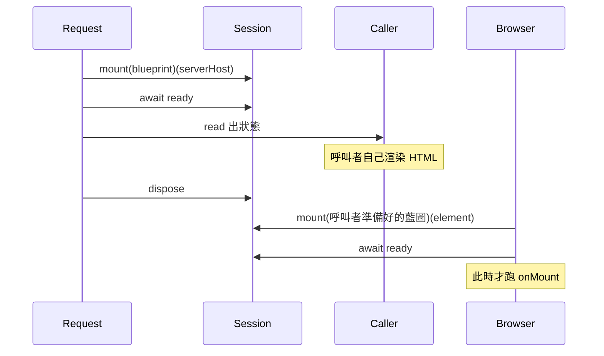

# 05 — SSR

伺服器與瀏覽器使用同一組動詞。伺服器沒有文件、沒有連線、沒有 `context-request`。它有藍圖、eager 依賴與記憶體中的狀態。本庫不把狀態寫進 HTML，也不從 HTML 讀回。



每個請求自己 `mount`、自己 `dispose`。singleton 不得活過這個請求。

每個請求**各自** `createApplication`；請求結束時先 `dispose(session)`，再釋放那個 Application 實例。singleton 槽與 keyed 暫存表都歸屬該 Application，因此不會跨請求殘留（[14-ports.md](./14-ports.md) §14.6、§14.7）。

## 5.1 伺服器上會發生什麼

`serverHost` 由 SSR 入口提供，不實作 DOM。`mount` 不檢查連線。形狀與 **每請求** `createApplication` 見 [09-mount-host.md](./09-mount-host.md) §9.3、[11-composition.md](./11-composition.md) §11.2。

會發生：

1. 以種子建立狀態
2. 重放 `starting` 期間的 `update`
3. 執行 eager 工廠
4. `ready` fulfill

不會發生：

- `onMount`、`onSuspend`、`onResume`
- 元素目標的晚綁定。伺服器上的 `inject` 以 `Session` 為目標。缺席即 `UNKNOWN_SERVICE`
- 跨請求保留暫停表
- 讀寫儲存、產生或解析 payload

```ts
const session = mount(blueprint)(serverHost)
await session.ready
const state = read((value) => value)(session)
dispose(session)
```

`state` 交給呼叫者的模板。字串格式、HTML 跳脫、放進哪個 `<script>`，都不是本庫的事。

## 5.2 瀏覽器接上之後

客戶端要帶上伺服器算出的資料時，呼叫者自己解析 HTML，再把那個值放進藍圖種子或 `starting` 期間的 `update`：

```ts
const restored = decode(document.getElementById('state')?.textContent ?? '')
const session = mount(pipe(createContext(restored)))(element)
await session.ready
```

伺服器 HTML 上的文字與屬性是否等於這份狀態，由渲染那份 HTML 的人負責。本庫不比對 DOM，也不在不一致時改寫節點。

客戶端若在 `onMount` 裡再發一次與伺服器重複的請求，應該在掛載前就把那份資料放進種子，而不是等本庫從文件裡取出。
