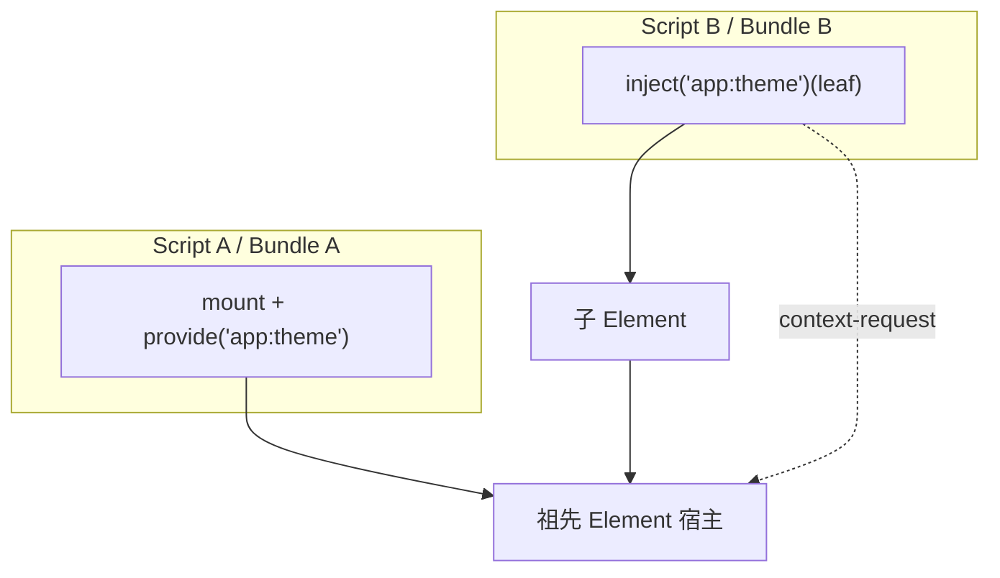

# 07 — Token 與多 script / 多 bundle

同一個 `Document` 裡常有多支 `<script>`、多份打包結果，或同頁載入兩份 `@sandlada/document-context`。它們**不會**共用同一個 JS 模組單例，因此也**拿不到**同一個 `defineToken` 回傳值的「物件引用」——除非那個值本來就是字串。

公開 token 的設計目標是 **散落可用（scatter-usable）**：身分在 runtime 是 **`namespace:name` 字串**，不是 per-import 的物件 id。

> 本文件一律以「token」稱呼身分。匯出的 TypeScript 型別名稱於**實作期**定案；行為契約（同名即同一身分、私有只認引用）不受影響。

定義 API 只有 **`defineToken<T>(visibility?)(name)`**。可見性在前，名字在最後一段。省略可見性時為 `'public'`。`'private'` 回傳引用身分的 `PrivateToken`。`definePrivateToken` 已退役。

## 7.1 公開 token：字串即身分

```ts
// script-a.js（bundle A）
const themeToken = defineToken<'dark' | 'light'>('public')('app:theme')

// script-b.js（bundle B，從未 import script-a）
const themeTokenB = defineToken<'dark' | 'light'>()('app:theme')

typeof themeToken === 'string'           // true
themeToken === themeTokenB               // true（都是 'app:theme'）
themeToken === 'app:theme'               // true
```

- `defineToken<T>()(name)` 與 `defineToken<T>('public')(name)` **冪等**：同名多次定義不是錯誤。
- 型別上的 `ServiceToken<T>` 是 branded string，**只服務 TypeScript**；runtime 沒有全域 registry，也不比較「是不是同一個 import」。
- `provide` / `inject<T>` / keyed `mount` 在字串形式上共用 **`validateTokenName`**；違規拋 `TOKEN_INVALID`。

因此：**不必**也**無法**在跨 script 之間傳遞「同一個 token 物件」。契約是 **同一個字串名字**（建議抽成共用的常數模組或型別宣告，見 §7.4）。

## 7.2 同一 Document、不同 Application

同頁可以有多個組合根（例如每支 script 各自 **`createApplication`**，或載入兩份 library 副本）。它們仍共享 **同一棵 DOM** 與 **Context Protocol 事件**（見 [03-dom.md](./03-dom.md) §3.3、[11-composition.md](./11-composition.md) §11.5）。

| 能力 | 跨 script / 跨 bundle |
| :--- | :--- |
| 祖先宿主上的 **scoped** 依賴 | 可以。消費者在子節點 `inject<T>('app:…')(element)`，沿 DOM 向上，由另一 bundle 掛載的會話透過 `context-request` 回答。 |
| 各 script 自己的 **Session 狀態** | 不共享。每個 `mount` 一份 state。 |
| **`lifecycle: 'singleton'`** | **每個 Application 實例** 一份，不跨組合根共享。跨 bundle 取 scoped 提供者，不要假設 singleton 已在本 bundle 註冊。 |
| **Keyed 身分** | 公開 token **字串**（或 `data-context-key`）。與哪支 script 定義無關。 |



Bundle B **不需要** import Bundle A 的 `themeToken` 變數；只要名字一致（或直接用合法裸字串 `'app:theme'`）。

## 7.3 私有 token：不能跨 script

```ts
const secretA = defineToken<string>('private')('internal:secret')
const secretB = defineToken<string>('private')('internal:secret')

secretA === secretB // false（不同物件）
```

- 第一段參數是 `'private'`；`name` 在最後一段，僅除錯，**不做**命名空間驗證。
- 身分是 **引用相等**，僅限 **同一 JS realm、同一模組圖** 內傳遞。
- **不得**作 keyed session，也不得指望另一支 script 的 `inject` 對上。
- 跨 script 共享機密實例時，用公開 token 提供服務，或在單一 bundle 內用 `defineToken<T>('private')(name)` 搭配 `provide` / `uses`。

## 7.4 TypeScript 與常數契約

編譯器看不到另一支 script 的 `defineToken` 回傳型別時，可以：

1. **共用常數**（推薦）：單一小型 `tokens.ts` 只 export 字串或 `defineToken` 結果，各 script 都 import 這個檔（若 build 允許）。
2. **宣告合併**：擴充 `ServiceRegistry`，讓 `inject('app:theme')` 帶出正確型別。
3. **顯式泛型**：`defineToken<MyType>('public')('app:theme')` 在每支 script 各寫一次；runtime 仍相容，型別由本地註解保證。裸字串注入寫成 `inject<MyType>('app:theme')(element)`。

```ts
declare module '@sandlada/document-context' {
    interface ServiceRegistry {
        'app:theme': 'dark' | 'light'
    }
}

// script-b 無需 import script-a
await inject<'dark' | 'light'>('app:theme')(element)
```

型別不一致是 **編譯期** 問題；只要 runtime 名字相同，解析行為一致。

## 7.5 反模式

| 做法 | 結果 |
| :--- | :--- |
| 在 script B 比較 token 且 A 用 `defineToken('private')(...)` | 永遠 false，解析失敗或拿不到 |
| 以為必須 singleton 全域共享跨 script 服務 | 錯。應在 **DOM 祖先** 上 `provide`，子樹 `inject` |
| 不同名字但「語意相同」 | 視為不同 token；`app:theme` 與 `vendor:theme` 不相通 |
| 不帶命名空間的裸字串（非 `a:b` 形） | `TOKEN_INVALID` |

## 7.6 與實作對齊的檢查清單

- 公開依賴：約定 **字串** `namespace:name`，文件與 code review 對齊即可。
- 跨 script 解析：消費者用 **元素目標** `inject`（或 `wait: true` 的 Session 目標），提供者已在祖先 **active**。事件規則見 [10-events.md](./10-events.md)。
- 僅限單 script 內部：才用 `defineToken<T>('private')(name)`。
- 整合測試參考：套件內 `cross-bundle.integration-test.ts`（兩個 Application、裸字串 `'app:…'` 解析）。
