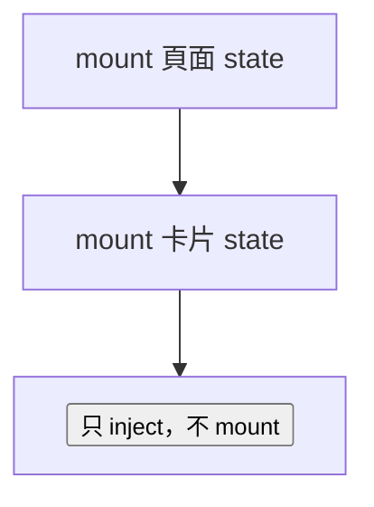

# 09 — 掛載對象

`mount(blueprint, options?)(target)` 的最後一段 **`target`** 決定這份會話綁在哪裡。狀態、scoped 依賴與 keyed 身分都掛在這個對象上；子樹的 `inject` 沿 DOM 向上找提供者，但**不會**自動繼承別的節點上的 state。

掛載對象與注入對象不是同一個概念。見 §9.9。

## 9.1 執行環境與允許的型別

| 環境 | `mount` 的 `target` | 連線檢查 |
| :--- | :--- | :--- |
| 瀏覽器 | 已連線的 `Element`（HTML、SVG、MathML） | **必須** `isConnected` |
| SSR / 測試 | 呼叫者提供的 **`serverHost`** | **不**檢查 |

兩邊共用同一個動詞 `mount` 與同一份藍圖。差別只在 `target` 的形狀與掛載後能做的事（例如瀏覽器才有 `context-request`、元素晚綁定）。SSR 細節見 [05-ssr.md](./05-ssr.md)。

```ts
type BrowserMountTarget = Element

interface ServerHost {
    readonly kind: 'server'
}

type MountTarget = BrowserMountTarget | ServerHost
```

`serverHost` 不是 DOM 節點。它沒有 `parent`、不派發 `context-mount`、不參與暫停表。每個 HTTP 請求自己 `mount`、自己 `dispose`。

## 9.2 瀏覽器宿主

**必須**是 `Element` 且已插入文件。未連線 → `UNCONNECTED_HOST`。`Text`、`DocumentFragment`、任意非元素節點 → `HOST_INVALID`。

**應該**在節點已連線之後再 `mount`：

- Custom Element：`connectedCallback` 裡掛載，`this` 就是宿主。
- 框架根：在容器元素插入 DOM **之後**再 `mount(blueprint)(container)`，不要在還沒 append 的離線節點上掛（除非刻意用 keyed 暫停流程，且接受 `starting` 期間斷線語意，見 [02-lifecycle.md](./02-lifecycle.md)）。

```ts
class AppRoot extends HTMLElement {
    #session: Session<AppState> | undefined

    connectedCallback() {
        this.#session = mount(appBlueprint, { token: 'app:root' })(this)
        void this.#session.ready
    }
}
```

`session.host` 是穩定代理：keyed 復甦換了底層節點，仍是同一個 `host` 物件。暫停期間不要在閉包裡長期保存 `native()`；恢復後再讀。見 [03-dom.md](./03-dom.md) §3.1。

## 9.3 伺服器宿主

由 SSR 或測試 harness 建立，通常每請求一個實例。`mount` 不讀 `document`，也不等待 DOM。

- `inject` 只能以 **`Session`** 為目標解析藍圖裡的依賴；沒有元素晚綁定。
- `singleton` 的生命週期邊界是這次請求，不是整個 Node 進程。
- 渲染 HTML 時，呼叫者自己 `read(session)`，與 `serverHost` 無額外欄位契約。
- **占位宿主的能力面最小**：沒有父鏈、沒有事件、沒有 `native()`、沒有 `on()`。需要這些能力的程式碼在伺服器上不成立——那是瀏覽器端的職責。

```ts
const serverHost: ServerHost = { kind: 'server' }
const session = mount(blueprint)(serverHost)
await session.ready
const state = read((s) => s)(session)
dispose(session)
```

## 9.4 一個宿主、一份會話

對**同一個**已連線宿主再次 `mount`（不同藍圖或不同 keyed 身分），依 `MountOptions.onConflict` 處理。預設 `throw`。

| 情況 | 預設 |
| :--- | :--- |
| 同一元素、同一 `token`、第二次 `mount` | 衝突（`onConflict`） |
| 同一 **Application**、**不同**元素、同一 `token`、都已連線 | `KEYED_CONFLICT` |
| 子樹需要多份 state | **多個宿主**（多個元素各 `mount` 一次），不是同一元素掛兩次 |

`onConflict: 'replace'` 與 `'reset'` **只**處理第一列（同宿主衝突）。第二列是硬失敗：`replace` 也不能讓兩個已連線宿主共用同一個 keyed token——那會讓「找回狀態」變成歧義。

一份會話的 state 只屬於掛載它的那個宿主。子按鈕若要自己的計數器，在按鈕元素上 `mount`；若要共用，在祖先上 `mount`，子節點用 `inject` 取服務、用 `sessionAt` / 祖先 state 讀共享狀態（共享 state 只在祖先那一份 Session 上）。

## 9.5 Keyed 身分寫在宿主上

`mount(blueprint, { token: 'app:cart' })(host)` 會把公開 token 字串正規化到宿主（例如 `data-context-key`）。規則與 `defineToken` 共用驗證。見 [07-tokens.md](./07-tokens.md)。

- **匿名**（不傳 `token`）：宿主離開文件並確認斷線 → 會話 **dispose**。
- **Keyed**：宿主離開 → **suspended**；TTL 內同一 `token` 掛到**新的**已連線宿主 → **onResume**，狀態保留。見 [02-lifecycle.md](./02-lifecycle.md) §2.3。

Keyed 恢復時，`target` 可以是另一個 `Element`，但 `token` 必須一致。

## 9.6 嵌套宿主（作用域樹）

祖先 `mount` 的會話在作用域鏈上提供 `provide`；子孫元素上的 `inject` 向上解析。近者勝。



**常見切分**

| 宿主 | 放什麼 |
| :--- | :--- |
| 應用根 `#app` | 全域 UI state、路由參數投影、少數 singleton 的 scoped 替代 |
| 路由段 / 布局容器 | 該段 layout state |
| 可重用 widget（CE 或區塊根） | widget 私有 state + `provide` |
| 葉子按鈕 | 通常 **不** `mount`；`inject` 服務即可 |

`provide` 掛在誰的藍圖上，就由**那個宿主**的會話在鏈上回答；與子節點是否也 `mount` 無關。

## 9.7 Shadow DOM

- 在 **custom element 內部** `mount(blueprint)(innerDiv)`：作用域從 `innerDiv` 向上，穿 shadow 邊界時經 `ShadowRoot.host` 接到 light DOM 祖先。
- 在 **custom element 本身** `mount(blueprint)(this)`：該 CE 作為宿主，shadow 內外子孫的 `inject` 都能沿鏈找到它（若它在祖先鏈上）。

Open / closed shadow 不影響本庫的鏈 walk 規則；只影響外部 JS 能否直接 `querySelector` 進 shadow。

## 9.8 `attach`：連線事實的第二來源

預設由文件觀察宿主連線。Canvas、原生嵌入層、或測試替身若沒有正常 `isConnected` 語意，在 **已有 Session** 之後用 `attach` 轉發 connect / disconnect / adopt：

```ts
const session = mount(blueprint)(host)
const hooks = attach({
    onConnect: () => {},
    onDisconnect: () => {},
    onAdopt: (owner) => {},
})(session)

// 停止轉發
hooks.detach()
```

`attach` **不**代替 `mount` 的 `target`；它只補連線信號。觀察與 `attach` 描述同一事實，後到者不重複觸發暫停/恢復。見 [03-dom.md](./03-dom.md) §3.4。

## 9.9 掛載對象 vs 注入對象

| | 掛載 `mount(...)(target)` | 注入 `inject(...)(target)` |
| :--- | :--- | :--- |
| 目的 | 建立 **Session**（state + 該宿主上的 provide） | 解析 **依賴 token** |
| 瀏覽器 `target` | 單一 **Element** 宿主 | `Element`、**Session**，或 `HostPort` |
| 典型用法 | 一次 per 宿主 | 可多次、多 token |
| 晚綁定 | 不適用 | 元素目標可早於提供者 `mount` |

伺服器上 `inject` **不得**用元素當目標；只用 `Session`。

## 9.10 反模式

| 做法 | 問題 |
| :--- | :--- |
| 在 `document.body` 還沒 append 的子節點上 `mount` | `UNCONNECTED_HOST`（除非刻意 keyed + 稍後復接） |
| 同一元素堆兩份匿名 `mount` 期望兩份 state | 第二份應衝突或覆蓋；應拆兩個宿主元素 |
| 在葉子節點 `mount` 卻期望整頁共享 state | 應把 `mount` 移到祖先 |
| SSR 用 `document.getElementById` 當 `serverHost` | 伺服器沒有文件；用 §9.3 的占位宿主 |
| 把 `serverHost` 當成可 `inject(element)` 的節點 | 元素晚綁定不存在於伺服器 |

## 9.11 與其它章節的分工

- 作用域、W3C 事件、跨 bundle：[03-dom.md](./03-dom.md)
- 斷線、暫停、鉤子：[02-lifecycle.md](./02-lifecycle.md)
- `MountOptions` 欄位表：[01-api.md](./01-api.md) §1.3
- Token / keyed 字串：[07-tokens.md](./07-tokens.md)
