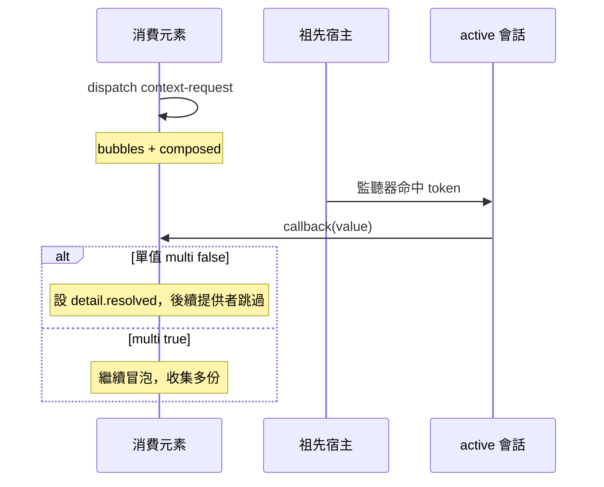

# 10 — 事件傳遞

本庫裡的「事件」分三條通道，用途不同，**不得**混用：

| 通道 | 媒介 | 典型用途 |
| :--- | :--- | :--- |
| **會話串流** | `state$` / `errors$` / `lifecycle$` | 同一份 Session 內的狀態、錯誤、生命週期 |
| **Context Protocol** | 宿主上的 `CustomEvent` | 跨 bundle、跨 script、晚綁定 `inject` |
| **宿主 DOM** | `session.host.on(...)` | 使用者 UI（click、input…） |

SSR 沒有文件，**只有**會話串流與同步 `mount` 路徑；Context Protocol 與 `host.on` 不成立。見 [05-ssr.md](./05-ssr.md)。

連線/斷線/跨 Document 的**事實**來自 MutationObserver 或 `attach` 回調，不經由 Context Protocol 事件對外宣告。見 [03-dom.md](./03-dom.md) §3.4、[09-mount-host.md](./09-mount-host.md) §9.8。

## 10.1 Context Protocol（規範性 DOM 事件）

跨 Application、跨 bundle 共享的唯一公共匯流排是 **W3C Context Protocol** 風格的 DOM 自訂事件。事件名與 `detail` 形狀是公共契約；其它框架只要派發/監聽相同事件，就能與本庫互操作。

| 事件名 | 誰派發 | 何時 | `bubbles` | `composed` |
| :--- | :--- | :--- | :--- | :--- |
| `context-request` | 消費者（`inject` 晚綁定路徑） | 需要沿祖先鏈找提供者 | `true` | `true` |
| `context-mount` | 提供者宿主 | 會話進入 **`active`** 之後 | `true` | `true` |
| `context-dispose` | 提供者宿主 | 會話進入 **`disposed`** | `true` | `true` |

`cancelable` 均為 `false`。

**欄位命名**：規範性 `detail` 使用社群欄位名 **`context`** 承載 token 字串（公開 token 的 `namespace:name`）。文件正文說 **token**；寫入 DOM 時仍叫 **`context`**，以便與其它 Context Protocol 實作對齊。

```ts
// 概念形狀（非公共 export 型別）
interface ContextRequestDetail {
    readonly context: string
    readonly callback: (value: unknown) => void
    readonly multi?: boolean
    readonly resolved?: boolean
}

interface ContextMountDetail {
    readonly context: string | null
}
```

`resolved` 是**單值請求的終止旗標**：第一個有效回應者把它設為 `true`，後續提供者看到它就跳過。nearest-wins 因此**不依賴 `stopPropagation()`**——第三方在中間節點停止冒泡不會讓依賴解析壞掉。`multi` 請求**不設**這個旗標：要收集全部回應。

### 10.1.1 `context-request` 的傳遞



1. 消費者在**自己的元素**上（或實作等價的 dispatch 起點）派發 `context-request`。
2. 事件沿 **composed 祖先鏈**向上冒泡（含 shadow 邊界）。
3. 路徑上 **`active`** 且註冊了該 token 的宿主監聽器呼叫 `detail.callback(value)`。
4. **單值**（`multi: false`）：第一個有效回應後把 `detail.resolved` 設為 `true`，後續提供者看到它就跳過（nearest-wins 與 [03-dom.md](./03-dom.md) 作用域一致）。
5. **多值**（`multi: true`）：不回應、不設 `resolved`，讓事件繼續冒泡收集；`injectAll` 按 [04-promise-lazy.md](./04-promise-lazy.md) §4.5 的 `direction` 排序合併。

只有 **`active`** 會話回答。`starting` 與 `suspended` **不**回答 `context-request`。

**單值與多值是兩個池子。** `multi: true` 的註冊只進多值池：它**不**回答單值請求，單值 `inject` 永遠拿到同一個 token 的**單值**註冊（[01-api.md](./01-api.md) §1.4）。因此同一個宿主上只有 `multi: true` 註冊時，單值 `inject` 會往鏈上更遠處找，而不是拿到多值池裡的某一份。

**`detail.callback` 的引數可能是 Promise。** 提供者的工廠可以是非同步的；值還沒准备好時，提供者以一個 Promise 呼叫 `detail.callback`。消費者以 `await value` 或 `Promise.resolve(value)` 取值——本庫內部的消費者就是這樣做的。

### 10.1.2 `context-mount` 的傳遞

會話**每次**進入 **`active`**（`onMount` 與初始化按 [02-lifecycle.md](./02-lifecycle.md) 跑完）後，在**該會話的宿主元素**上派發 `context-mount`。**恢復**（`suspended → active`）時**再派發一次**——沒有它，暫停期間累積的 pending `inject` 永遠醒不來。

用途：

- 喚醒已在元素上 **pending** 的 `inject` / `injectAll`（再派一輪 `context-request` 或等價重試）。
- `session$(element)` 等追蹤面更新（只認 **active** 且宿主仍連線的 Session）。

**不是**可重播的訂閱：若第三方在提供者 `active` **之前**只派發一次 `context-request` 且之後不再派發，本庫**不會**替它補發那一次。晚到的消費者必須自己再 `inject`（或訂 `inject$`），或在提供者 `mount` 之後才開始等待。

### 10.1.3 `context-dispose` 的傳遞

會話 **`disposed`** 時，宿主派發 `context-dispose`。`detail.context` 為 keyed token 字串；匿名會話可為 `null`。

- 追蹤最近會話的熱流（如 `session$`）在該宿主子樹上可能變為 `null`。
- **元素目標**上 pending 的 `inject` **不**因這個事件單獨終止；仍由斷線、`abortSignal` 或解析完成結束。見 [04-promise-lazy.md](./04-promise-lazy.md)。

### 10.1.4 互操作的最低要求

事件名與 `detail` 形狀是**公共契約**。第三方實作只要滿足下列四點，就能與本庫互相解析依賴：

1. 在自己的元素上派發 `context-request`（`bubbles: true`、`composed: true`），`detail.context` 放 token 字串、`detail.callback` 放接收函式。
2. 提供者在 `detail.callback(value)` 之後，把 `detail.resolved` 設為 `true`（單值請求）。
3. 提供者**不**用 `stopPropagation()` 表達 nearest-wins——那是 DOM 層級的副作用，會影響第三方監聽者。
4. `context-mount` / `context-dispose` 在對應的會話狀態轉換後派發。

與 W3C Context Protocol 線上格式的差異，**必須**寫在實作的文件裡：

| 項目 | 本庫 | 線上格式 | 影響 |
| :--- | :--- | :--- | :--- |
| `detail` 承載 token 的欄位 | `context` | `context` | 一致 |
| `cancelable` | `false` | 依實作 | 不影響傳遞；`cancelable` 只管 `preventDefault` |
| 終止條件 | `detail.resolved` 旗標 | 依實作 | 第三方若改用 `stopPropagation()`，nearest-wins 仍成立，但會影響其自身的冒泡行為 |
| `detail.callback` 的引數 | 值，或**值還沒准备好時的 Promise** | 值 | 提供者的工廠可以是非同步的；消費者以 `await` 或 `Promise.resolve(value)` 取值即可 |

事件名是 `context-request` / `context-mount` / `context-dispose`。**本代不派發**別的掛載／銷毀事件名；第三方不要依賴未列出的事件。

## 10.2 會話串流（RxJS）

`lifecycle$` / `errors$` / `state$` 是 **Session 物件**上的熱流或冷訂閱，**不**冒泡、**不**跨 bundle。

| 串流 | 傳遞範圍 | 與 DOM 事件的關係 |
| :--- | :--- | :--- |
| `state$` | 訂閱者 | 與 Context Protocol 無關 |
| `errors$` | 訂閱者 | 鉤子錯誤等；取消 `inject` 不寫入 |
| `lifecycle$` | 訂閱者 | 語意與 `context-mount` 相近但**不是**同一通道；時序見 02 |

`state$` 與 `lifecycle$` 在會話 `disposed` 時**完成**；`errors$` 在清理結算後完成。直接訂閱不需要再包 `takeUntil`；要提早結束就自己退訂。完整語意見 [13-reactivity.md](./13-reactivity.md)。

## 10.3 使用者 DOM：`host.on`

`session.host.on(type, listener, options?)` 是在**當前** `native()` 元素上註冊 DOM 監聽器，回傳解除函式。這是呼叫者自己的 UI 事件，不是 Context Protocol。

- 與 `context-request` **無**自動關聯。
- 暫停/復甦後應在 `onResume` 或新的 `native()` 上重新綁定，不要長期閉包舊節點。

## 10.4 Shadow DOM 與 composed

`context-request` / `context-mount` / `context-dispose` 均 **`composed: true`**，會穿過 open shadow 邊界，在 light DOM 祖先上與 shadow 內宿主之間連續傳遞。

作用域 walk 與事件冒泡使用同一條 **composed 祖先鏈**（`HostPort.parent`）。見 [03-dom.md](./03-dom.md) §3.2、[09-mount-host.md](./09-mount-host.md) §9.7。

## 10.5 跨 bundle

不同 **`createApplication`** / 不同 script **不**共享 JS 模組與 **singleton 槽**，**共享** DOM 事件與 token 字串。消費 bundle 派發 `context-request`，提供者 bundle 在祖先宿主上 `mount` 並在 `active` 後派發 `context-mount`。見 [07-tokens.md](./07-tokens.md)、[11-composition.md](./11-composition.md)。

## 10.6 反模式

| 做法 | 問題 |
| :--- | :--- |
| 用 `lifecycle$` 驅動跨 bundle 依賴解析 | 串流不跨 Session / 不跨 bundle |
| 手動派發 `context-mount` 冒充會話 active | 公共契約要求與真實 Session 狀態一致 |
| 在 SSR 期待 `context-request` | 伺服器無 DOM 事件匯流排 |
| 假設 `context-dispose` 會取消所有 pending inject | 元素 pending 仍看斷線與 abort |
| 單值請求卻期待多個祖先都 callback | 第一個有效回應者設 `detail.resolved`，後續提供者跳過 |
| 用 `stopPropagation()` 表達 nearest-wins | 會影響路徑上的第三方監聽者；用 `detail.resolved` |

## 10.7 與其它章節的分工

- 作用域 nearest-wins：[03-dom.md](./03-dom.md) §3.2
- 跨 bundle 與 token 字串：[07-tokens.md](./07-tokens.md)
- 晚綁定等待結束條件：[04-promise-lazy.md](./04-promise-lazy.md)、[03-dom.md](./03-dom.md) §3.5
- 鉤子與 `lifecycle$` 時序：[02-lifecycle.md](./02-lifecycle.md)
- 掛載在誰的宿主上：[09-mount-host.md](./09-mount-host.md)
