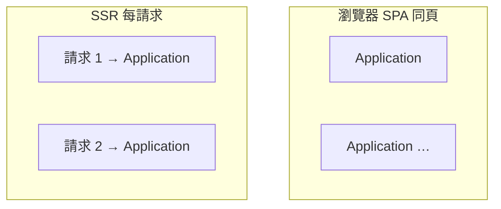

# 11 — 組合根與 `createApplication`

公共 API 分兩層：

| 層 | 內容 | 是否綁定執行環境 |
| :--- | :--- | :--- |
| **Phase 1** | `createContext`、`pipe`、`provide`、鉤子 | **否**。藍圖是純資料，與哪個 Application 無關 |
| **Phase 2** | `mount`、`inject`、`update`、`dispose`、`session$`… | **是**。必須在某一個 **Application 實例** 上呼叫 |

`createApplication` 的作用就是：**用一組 ports 裝出一個 Application，把 Phase 2 動詞全部綁到同一份執行期殼層上**。

它不是另一套語意，也不是 service locator 類別。形狀仍是 `verb(config)(target)`；只是這些 verb 掛在 `app` 物件上（或根入口 re-export 的同名函式，見 §11.4）。

## 11.1 回傳什麼

`createApplication(ports)` 裝出一個 **Application**：把 Phase 2 動詞全部綁到同一份執行期殼層上。

它不是另一套語意，也不是 service locator 類別。形狀仍是 `verb(config)(target)`；只是這些 verb 掛在 `app` 物件上（或根入口 re-export 的同名函式，見 §11.4）。

`Application` 上具備 [01-api.md](./01-api.md) 總表中的 Phase 2 動詞，以及 Phase 1 運算子（與根模組共用同一引用，不複製邏輯）。

`ports` 至少要有 **host adapter**（含連線性、排程、作用域傳輸、keyed 身分讀寫），SSR 另外加選填的 **ssr adapter**。完整的職責劃分、跨平台連線語意與 Application 級上限見 [14-ports.md](./14-ports.md)。

> 埠介面的確切簽章於**實作期**決定；本章與 [14-ports.md](./14-ports.md) 固定的是**職責與邊界**。

**同一次** `createApplication` 內共享：

- 宿主 → Session 索引
- keyed token → Session 暫存（TTL 內復甦）
- `lifecycle: 'singleton'` 槽（**每 Application 一份**，不是整頁 JS 單例）
- 同一套 `scopeTransport`（晚綁定、`context-request` 路徑）
- pending 注入表與暫停上限的計數

**不得**在 module 全域放上述 mutable 狀態；隔離邊界就是 Application 實例。

Application 本身**必須能被整體釋放**：釋放索引、暫存表、singleton 槽與它建立的監聽器，且**冪等**。SSR 每請求一個 Application，請求結束時先 `dispose(session)`，再釋放 Application。

## 11.2 何時呼叫幾次

同頁 Application 個數 **≥ 1**，由架構決定。只有 **SSR** 有硬規則：每個請求必須各自 `createApplication`，請求之間不得共用實例。



| 場景 | 建議 |
| :--- | :--- |
| 瀏覽器 SPA | **常見**整頁一個 Application（根入口預設 `app`）；**允許**同頁多個（微前端、team 邊界、刻意隔離 singleton）。與是否「多 bundle / 多 script」無關，同一 bundle 也可多次 `createApplication` |
| SSR | **每個請求** `createApplication` → `mount` → `read` → `dispose` → 丟棄實例 |
| 單元 / 整合測試 | 每個用例或每個 `describe` 可各建一個；ports 換成 fake |
| 同頁多份打包 / 多 script | 典型會各 script 各建 Application；singleton **不**跨 Application，DOM 事件與 token 字串仍共享 |

SSR 細節見 [05-ssr.md](./05-ssr.md)、[09-mount-host.md](./09-mount-host.md) §9.3。

## 11.3 `ports` 管什麼（宏觀）

**`host`** — 瀏覽器執行期的邊界：

- 把 `mount` / `inject` 的目標正規成 `HostPort`
- 排程（微任務、timeout；本庫不在動詞裡裸用 `setTimeout`）
- 作用域傳輸與 Context Protocol（[10-events.md](./10-events.md)）
- keyed 身分在宿主上的讀寫（`data-context-key` 等）

**`ssr`**（可選）— 提供 `serverHost` 占位與伺服器專用適配。沒有 DOM、沒有 `context-request`。

宏觀契約**不**內建 `persist` / storage registry；若實作仍提供 storage port，屬於實作細節，不在 [01-api.md](./01-api.md) 穩定面。

## 11.4 根入口與 `@sandlada/document-context/application`

套件根入口可以預先裝好一個 **`app`**：

```ts
import { mount, pipe, createContext } from '@sandlada/document-context'
```

這等價於使用**預設 ports** 的預設 Application 上的動詞。整頁若只用根入口，就共用這一份；同頁若還有自行 `createApplication` 的實例，根入口的 `mount` / `inject` **不得**與那些 Session 混用（見下方規則）。

內建 adapter 的 Application 另提供**便捷入口**（瀏覽器用、SSR 用各一個），使用者不必為了正常用一次而自組 adapter。

進階用法從子路徑自行裝配：

```ts
import { createApplication } from '@sandlada/document-context/application'

const app = createApplication({ host: myHostAdapter, ssr: mySsrAdapter })
const session = app.mount(blueprint)(element)
await session.ready
```

**規則**：對某個 `Session` 做 `update` / `inject` / `dispose` 的 Application，必須是 **mount 出該 Session 的那個** Application。跨實例操作同一 `Session` **必須被拒絕**（拋錯），不得靜默 no-op——靜默失敗會讓跨實例的 bug 難以追查。

## 11.5 與跨 bundle / token 的關係

- **Token 字串**跨 script 相等；**Application 狀態**不相等。
- Bundle A 的 `mount` 在祖先宿主上 `provide`；Bundle B 的 `inject(element)` 靠 **DOM 事件**解析，不要求 B 持有 A 的 `app` 引用。見 [07-tokens.md](./07-tokens.md)、[10-events.md](./10-events.md)。
- Bundle B 的 **`singleton`** 只存在於 B 的 Application；不能假定 A 已註冊過同一 token 的 singleton。

## 11.6 與 Phase 1 的關係

```ts
const blueprint = pipe(
    createContext({ count: 0 }),
    provide(apiToken, () => ({ get: () => {} })),
)

const sessionA = appA.mount(blueprint)(hostA)
const sessionB = appB.mount(blueprint)(hostB)
await sessionA.ready
await sessionB.ready
```

`mount` 是**同步**的：回傳 `Session` 句柄，初始化是否完成看 `session.ready`。同一份 **blueprint** 可以掛到不同 Application、不同宿主；得到兩份獨立 Session。`provide` 註冊在藍圖裡，**scoped** 依賴隨各自 Session 實例化。

## 11.7 反模式

| 做法 | 問題 |
| :--- | :--- |
| SSR 多請求共用一個 Application | singleton / keyed 表跨請求洩漏 |
| 用 A 的 `app.dispose(session)` 處理 B 的 `app.mount` 得到的 session | 索引不在同一殼層 |
| 以為整頁 SPA 只能有一個 Application | 常見一個，但允許多個；限制是「同一 Session 只屬一個 Application」 |
| 在 Phase 1 的 `provide` 工廠裡存 Application 全域 | 破壞可計算藍圖與測試隔離 |

## 11.8 與其它章節的分工

- 動詞表與錯誤：[01-api.md](./01-api.md)、[12-errors.md](./12-errors.md)
- 掛載對象：[09-mount-host.md](./09-mount-host.md)
- 事件匯流排：[10-events.md](./10-events.md)
- Token 與多 script：[07-tokens.md](./07-tokens.md)
- ports 職責與跨平台連線：[14-ports.md](./14-ports.md)

本節只回答：**為什麼需要 Application、ports 管什麼邊界、何時該有幾個實例**。

## 11.9 維護者：實作分層（非公共契約）

§11.1–§11.8 是使用者契約。以下供改 `packages/document-context` 時對齊，**不**作為 npm 穩定面。

| 保留 | 說明 |
| :--- | :--- |
| 依賴方向 | `domain` ← `application` ← `infrastructure` |
| 組合根 | 套件根入口（及測試裝配）**唯一**把 adapter 注入 `createApplication({ host, ssr? })` |
| Domain ports | 宿主、排程、作用域傳輸、連線性、keyed 身分；單元測試用 fake ports，不必起整頁 DOM（見 [14-ports.md](./14-ports.md)） |
| 敘事 | **函式式 API + 兩階段 + ports 組合根**（與 [00-overview.md](./00-overview.md) 一致） |

| 不再強調 | 說明 |
| :--- | :--- |
| 「六邊形架構」主標題 | 歷史用語見舊語料（git `4f0b70c` 的 `docs/next-version-deprecated/01-architecture.md`）；新 doc 不以 Hexagonal / Clean 作定位句 |
| 函式式 vs ports 二選一 | data-last 動詞與 ports **不衝突** |

| 禁止 | 說明 |
| :--- | :--- |
| `application` import `infrastructure` | 破壞可替換性與 SSR/測試邊界；DOM 細節只經 ports 進 Phase 2 |
| 在 module 全域放 mutable 狀態 | singleton 槽、keyed 暫存表、pending 表一律歸 Application 實例 |

實作清單與 agent 守則：repo 根 [`AGENTS.md`](../../AGENTS.md) §1、§3。
