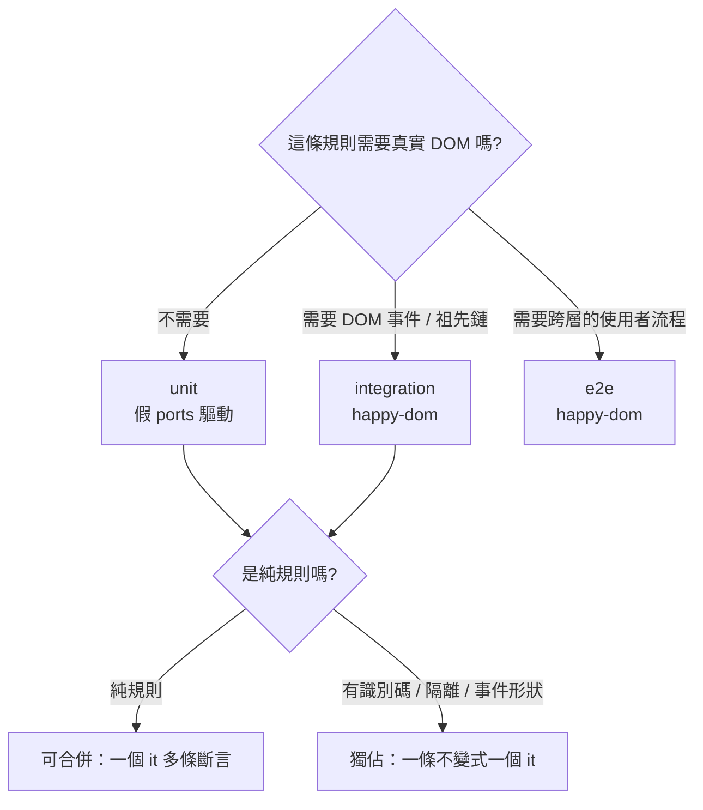
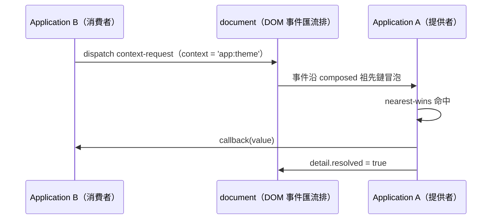

# 15 — 測試與驗證策略

本章是**可執行的驗證計畫**：測試怎麼分層、不變式怎麼編號、假排程器與假 ports 怎麼用、互操作怎麼驗、閘門怎麼跑。

讀者照本章寫出的測試矩陣，**不需要**再猜「這條規則該測在哪一層、用什麼替身」。

> 本章固定的是**測試契約**：分層、編號、必備案例、閘門。測試輔助模組的簽章、fake ports 的確切介面形狀於**實作期**決定。

---

## 15.1 測試分層與環境

三個 vitest project，各自有**獨立的 include glob** 與**獨立的環境**。測試檔名即分層依據，沒有第四種命名。

| 層 | 檔名樣式 | 環境 | 測什麼 | **不得**碰 |
| :--- | :--- | :--- | :--- | :--- |
| **unit** | `*.unit-test.ts` | `node` | `domain` / `application` 的純邏輯；假 ports 驅動的 Phase 2 行為 | 不得 import `infrastructure/dom`；不得讀 `document` / `window` |
| **integration** | `*.integration-test.ts` | `happy-dom` | DOM adapter、Context Protocol、跨 Application 解析 | 不得依賴真實瀏覽器的時序與排版 |
| **e2e** | `*.e2e-test.ts` | `happy-dom` | 端到端使用者流程：掛載 → 操作 → 觀察 DOM | 不得訪問網路；不得依賴真實計時器 |



### 15.1.1 共置與命名

- 測試與源檔 **1:1 共置**：同一個目錄、同名的基礎名，後綴換成 `.unit-test.ts` / `.integration-test.ts` / `.e2e-test.ts`。
- **例外**（不得建立對應測試檔）：
  - 純 re-export 的 `index.ts`
  - `*.d.ts`
  - 測試輔助模組（假 ports、假排程器、建構 fixture 的工具），放在 `src/**/testing/` 或 `src/testing/`。它們**沒有**同名測試檔，靠所有 suite 間接覆蓋。
- 一個源檔有多個測試檔是允許的（例如 `mount.ts` 同時有 `mount.unit-test.ts` 與 `mount.integration-test.ts`），但**不得**出現「一個測試檔測多個不相關源檔」的情況。

### 15.1.2 測試內部的紀律

- 每個 `it` **至少**一個斷言；斷言必須能對應到某一條不變式（§15.2）。
- 測試名**必須**以不變式編號開頭，便於反查：

```ts
it('[LC #3] 斷線後先經一次微任務重掛確認，節點仍在文件中則不暫停', () => {
    // ...
})
```

- 測試**不得**依賴執行順序：每個 `it` 自建藍圖與 Application，不共用 module 層級的可變狀態（呼應 [14-ports.md](./14-ports.md) `PORT #3`）。
- 測試**不得**用 `setTimeout` 等待：時間一律由假排程器推進（§15.3）。

---

## 15.2 不變式 ID 體系

### 15.2.1 ID 命名與分配

| 前綴 | 範圍 | 定義章 |
| :--- | :--- | :--- |
| `ERR #n` | 錯誤識別碼與出現位置 | [12-errors.md](./12-errors.md) §12.3 |
| `RX #n` | RxJS 串流語意 | [13-reactivity.md](./13-reactivity.md) §13.11 |
| `PORT #n` | ports 職責與邊界 | [14-ports.md](./14-ports.md) §14.10 |
| **`LC #n`** | **生命週期與鉤子** | 本章 §15.2.2 |
| **`SCOPE #n`** | **作用域、解析與注入生命週期** | 本章 §15.2.3 |
| **`API #n`** | **公共動詞語義** | 本章 §15.2.4 |

規則：

1. **編號只增不改。** 條目文字被修正時**保留原編號**，只更新文字；條目被刪除時標為「已廢止」，**不重排號碼**。
2. **一條不變式 = 一個可獨立定位的行為斷言。** 複合敘述要拆成多條。
3. **每條不變式至少對應一個具名測試**（§15.2.5）。沒有測試的不變式視為**未固定**，應刪掉或補測試。
4. 跨章引用寫成 `RX #7`、`LC #4` 這樣的**裸編號**，不要重述條文內容。

### 15.2.2 `LC #n` — 生命週期與鉤子

| # | 不變式 | 依據 |
| :--- | :--- | :--- |
| `LC #1` | `mount` **同步**回傳 `Session`；此刻狀態為 `starting`。 | [01-api](./01-api.md) §1.1、[02-lifecycle](./02-lifecycle.md) §2.1 |
| `LC #2` | `ready` 在種子落地、`starting` 期間的 `update` 重放、eager 依賴與首次 `onMount` 全部結束後 fulfill；初始化期間被確認斷線的 keyed 會話轉 `suspended` 並 fulfill，匿名會話以 `UNCONNECTED_HOST` 拒絕。 | [02-lifecycle](./02-lifecycle.md) §2.1 |
| `LC #3` | 斷線後**必須**先經一次微任務重掛確認；確認時節點仍在文件中視為未離開。 | [02-lifecycle](./02-lifecycle.md) §2.3 |
| `LC #4` | 匿名會話確認斷線即 `disposed`（`reason: 'disconnect'`）；keyed 會話轉 `suspended` 並保留狀態。 | [02-lifecycle](./02-lifecycle.md) §2.3 |
| `LC #5` | keyed 會話在 TTL 內以**同一 token** 掛到新的已連線宿主可恢復：狀態保留、不回到種子、`onResume` 執行。 | [02-lifecycle](./02-lifecycle.md) §2.3 |
| `LC #6` | TTL 到期 → `disposed`（`reason: 'ttl'`）；`retention: 'pinned'` 不受 TTL 影響。 | [02-lifecycle](./02-lifecycle.md) §2.3 |
| `LC #7` | 同一 Application 上同時暫停的 keyed 會話超過上限時，**最舊**的一份 `disposed`（`reason: 'cap'`）；計數**不**跨 Application 合併。 | [02-lifecycle](./02-lifecycle.md) §2.3、[14-ports](./14-ports.md) §14.6 |
| `LC #8` | 鉤子順序：`onMount` / `onSuspend` / `onResume` / `onAdopt` 為 FIFO，`onDispose` 為 LIFO；`onMount` 的清理函式只在最終銷毀時執行，排在 `onDispose` 之前，兩者皆 LIFO。 | [02-lifecycle](./02-lifecycle.md) §2.2 |
| `LC #9` | `onMount` 失敗 → `ready` 拒絕、會話 `disposed`、不送 `active`；其他鉤子失敗只進 `errors$`（`HOOK_ERROR`），**其餘鉤子繼續執行**。 | [02-lifecycle](./02-lifecycle.md) §2.2、[12-errors](./12-errors.md) §12.4 |
| `LC #10` | `dispose` **同步**中止 abort 邊界並讓 `state$` / `lifecycle$` 完成；`Symbol.asyncDispose` 額外等待非同步清理落定。 | [02-lifecycle](./02-lifecycle.md) §2.4 |
| `LC #11` | `suspended → active` 恢復時**重新派發** `context-mount`，pending 的 `inject` 因此得以往醒。 | [10-events](./10-events.md) §10.1.2 |
| `LC #12` | `starting` 期間的 `update` 依呼叫順序重放，排在種子落地之後、eager 之前。 | [02-lifecycle](./02-lifecycle.md) §2.1、[01-api](./01-api.md) §1.5 |
| `LC #13` | `onConflict: 'reset'` 只換掉「狀態從哪裡來」：舊會話的當前狀態作種子，其後順序不變。 | [02-lifecycle](./02-lifecycle.md) §2.3 |

### 15.2.3 `SCOPE #n` — 作用域、解析與注入生命週期

| # | 不變式 | 依據 |
| :--- | :--- | :--- |
| `SCOPE #1` | 依賴沿 composed 祖先鏈解析，**近者勝**；單值 `inject` **永遠** nearest-wins，不因存在 `multi` 註冊而改變。 | [03-dom](./03-dom.md) §3.2、[04-promise-lazy](./04-promise-lazy.md) §4.5 |
| `SCOPE #2` | 作用域鏈**不跨 Document 邊界**；父節點是 shadow root 時改走 `ShadowRoot.host`。 | [03-dom](./03-dom.md) §3.2 |
| `SCOPE #3` | 同一 Application 內的解析走**記憶體索引**，不經 DOM 事件；跨 Application 才走 `context-request`。 | [14-ports](./14-ports.md) §14.4 |
| `SCOPE #4` | 跨 Application 的 nearest-wins 由 DOM 冒泡順序決定；終止條件是 `detail.resolved` 旗標，**不得**依賴 `stopPropagation()`。 | [10-events](./10-events.md) §10.1.1、§10.1.4 |
| `SCOPE #5` | 只有 `multi: true` 的註冊被 `injectAll` / `injectAll$` 收集。 | [04-promise-lazy](./04-promise-lazy.md) §4.5 |
| `SCOPE #6` | `injectAll` 預設 `from-bottom-to-top`（近→遠）；`from-top-to-bottom` 反向；**同一宿主**的多筆 multi 註冊保持**藍圖註冊順序**。 | [04-promise-lazy](./04-promise-lazy.md) §4.5 |
| `SCOPE #7` | `uses` 宣告的依賴在工廠執行前建立完成；`use()` 同步取得已建立的值；解析不到 → `ready` 以 `UNKNOWN_SERVICE` 拒絕。 | [01-api](./01-api.md) §1.4、[04-promise-lazy](./04-promise-lazy.md) §4.3 |
| `SCOPE #8` | `uses` 圖有環 → `ready` 以 `CIRCULAR_DEPENDENCY` 拒絕，**環上的工廠不執行**。 | [04-promise-lazy](./04-promise-lazy.md) §4.3 |
| `SCOPE #9` | `scoped` 每 Session 一份；`singleton` 每 **Application** 一份且先註冊者勝（後者收到 `SINGLETON_CONFLICT`，會話照常 `active`）；`transient` / `prototype` 每次 `inject` 重新呼叫工廠。 | [08-injection](./08-injection.md) §8.1 |
| `SCOPE #10` | `scoped` / `singleton` 的進行中 Promise 合併為**同一個**；拒絕後清掉快取，下一次可重試。`transient` 不合併。 | [08-injection](./08-injection.md) §8.1 |
| `SCOPE #11` | keyed 身分寫在宿主上（瀏覽器預設 `data-context-key`），讀寫共用同一套名稱驗證；會話最終銷毀且屬性仍等於自己的 token 時移除該屬性。 | [03-dom](./03-dom.md) §3.2、[14-ports](./14-ports.md) §14.5 |
| `SCOPE #12` | 元素目標的 `inject` 在鏈上沒有 `active` 提供者時 pending；`Session` 目標在沒有 `wait: true` 時**立即**以 `UNKNOWN_SERVICE` 拒絕。 | [03-dom](./03-dom.md) §3.5、[04-promise-lazy](./04-promise-lazy.md) §4.3 |
| `SCOPE #13` | pending 注入請求數達到 Application 級上限（預設 1024）時，新的等待請求以 `PENDING_LIMIT_EXCEEDED` 拒絕。 | [04-promise-lazy](./04-promise-lazy.md) §4.5、[14-ports](./14-ports.md) §14.6 |
| `SCOPE #14` | 對某個 `Session` 操作的 Application **必須**是 mount 出該 Session 的那一個；跨 Application 操作**必須被拒絕**，不得靜默 no-op。 | [11-composition](./11-composition.md) §11.4 |

### 15.2.4 `API #n` — 公共動詞語義

| # | 不變式 | 依據 |
| :--- | :--- | :--- |
| `API #1` | 公共動詞一律 `operation(config)(target)`；例外只有四類：`createContext`、`pipe`、`defineToken`、`merge`。 | [01-api](./01-api.md) §1.1 |
| `API #2` | 公共面**不得**出現 `Sync` / `Async` 後綴的動詞；`$` 只表示 Observable。 | [01-api](./01-api.md) §1.1 |
| `API #3` | `update` **整份替換**狀態：回傳值裡沒有的鍵被刪除；回傳 `false` 表示會話已 `disposed` 且狀態未變。 | [01-api](./01-api.md) §1.5 |
| `API #4` | `update` 的 updater 拋錯 → 錯誤**原樣向外拋出**，狀態**不變**，快照不動。 | [01-api](./01-api.md) §1.5 |
| `API #5` | `update` 的 updater **必須是同步的**；回傳型別不含 `Promise`。 | [01-api](./01-api.md) §1.5 |
| `API #6` | `merge` 是純函式：不刪鍵、按鍵遞迴合併純物件、陣列 / `null` / 日期整顆替換、不合併 `__proto__` / `constructor` / `prototype`、遇循環引用拋錯且 `update` 不改變狀態。 | [01-api](./01-api.md) §1.5 |
| `API #7` | 快照**不可變**；`createContext(initial)` 在建立藍圖時**複製**初始狀態。 | [01-api](./01-api.md) §1.5 |
| `API #8` | `suspended` 期間 `update` **允許**，且 `state$` 訂閱者照常收到推送。 | [01-api](./01-api.md) §1.5、[13-reactivity](./13-reactivity.md) §13.2 |
| `API #9` | `read` **同步**回傳當下快照，不參與懶載入、不回傳 Promise；`disposed` 後回傳最後一筆。 | [01-api](./01-api.md) §1.5、[04-promise-lazy](./04-promise-lazy.md) §4.6 |
| `API #10` | `inject` 家族**不接受** `AbortSignal`，也**沒有** `timeoutMs`；取消不是失敗。 | [01-api](./01-api.md) §1.4、[04-promise-lazy](./04-promise-lazy.md) §4.4 |
| `API #11` | `inject$` / `injectAll$` 送出一筆後 `complete()`；元素目標上的空多值集合**永不結案**；`Session` 目標上立即以 `[]` 結束。 | [13-reactivity](./13-reactivity.md) §13.6 |
| `API #12` | `defineToken` **冪等**；公開 token 的 runtime 身分是 `namespace:name` 字串；`definePrivateToken` 已退役。 | [07-tokens](./07-tokens.md) §7.1 |
| `API #13` | 非法 token 名 → `TOKEN_INVALID`；**私有 token 不走這條驗證**。 | [12-errors](./12-errors.md) §12.4 |
| `API #14` | 瀏覽器中對未連線元素 `mount` 拋 `UNCONNECTED_HOST`；對非元素（文字節點、文件片段）拋 `HOST_INVALID`。 | [09-mount-host](./09-mount-host.md) §9.2 |
| `API #15` | `suspensionTtlMs: Infinity` 未搭配 `retention: 'pinned'` → `mount` 拋 `INVALID_OPTIONS`。 | [01-api](./01-api.md) §1.3 |
| `API #16` | `MountOptions.signal` **只在** `starting` 期間生效；abort → 會話 `disposed`、`ready` 以 `signal.reason` 拒絕。 | [01-api](./01-api.md) §1.3 |
| `API #17` | 同一宿主的衝突依 `onConflict`（`throw` / `replace` / `reset`）處理；**跨宿主**的同一 keyed token 是硬失敗 `KEYED_CONFLICT`，`replace` / `reset` 都不適用。 | [09-mount-host](./09-mount-host.md) §9.4 |
| `API #18` | 對已 `disposed` 的會話 `inject` 拒絕 `DISPOSED_SESSION`；`update` 回傳 `false` 而非拋錯。 | [12-errors](./12-errors.md) §12.4 |
| `API #19` | 注入目標只有 `Element`（瀏覽器）與 `Session`；SSR 上**不得**以元素為目標。 | [09-mount-host](./09-mount-host.md) §9.9 |
| `API #20` | `session.ready` fulfill **不**表示此後狀態不再變。 | [06-glossary](./06-glossary.md) |

### 15.2.5 不變式 → 測試對照表

下表是**實作期要填滿的計畫**。檔名欄給的是**預定檔名**（實作落地後即為實際路徑）；測試名欄給的是 `it` 名的前綴片段。每一條不變式**至少**要被一列涵蓋。

| 不變式 | 驗證方式 | 預定測試檔 | 測試名片段 |
| :--- | :--- | :--- | :--- |
| `LC #1` | runtime | `src/application/api/mount.unit-test.ts` | `mount 同步回傳 Session 且 status 為 starting` |
| `LC #2` | runtime | `src/application/api/mount.unit-test.ts` | `ready 在 eager 與 onMount 之後才 fulfill` |
| `LC #2` | runtime | `src/application/api/mount.unit-test.ts` | `初始化期間確認斷線的 keyed 會話轉 suspended 並 fulfill` |
| `LC #3` | runtime | `src/application/lifecycle/disconnect.unit-test.ts` | `斷線後先做一次微任務重掛確認` |
| `LC #3` | runtime | `src/infrastructure/dom/observer.integration-test.ts` | `斷線由排程埠上的重檢確認` |
| `LC #3` | runtime | `src/infrastructure/dom/observer.integration-test.ts` | `搬家不算斷線` |
| `LC #4` | runtime | `src/application/lifecycle/disconnect.unit-test.ts` | `匿名會話確認斷線即 dispose` |
| `LC #4` | runtime | `src/application/lifecycle/disconnect.unit-test.ts` | `keyed 會話確認斷線轉 suspended 並保留狀態` |
| `LC #5` | runtime | `src/application/lifecycle/resume.unit-test.ts` | `TTL 內同 token 回到新宿主可恢復且狀態保留` |
| `LC #6` | runtime | `src/application/lifecycle/resume.unit-test.ts` | `TTL 到期以 reason ttl 銷毀` |
| `LC #6` | runtime | `src/application/lifecycle/resume.unit-test.ts` | `pinned 不受 TTL 影響` |
| `LC #7` | runtime | `src/application/lifecycle/resume.unit-test.ts` | `暫停上限淘汰最舊的一份` |
| `LC #7` | runtime | `src/application/lifecycle/resume.unit-test.ts` | `暫停上限不跨 Application 合併計數` |
| `LC #8` | runtime | `src/application/lifecycle/hooks.unit-test.ts` | `onMount FIFO / onDispose LIFO` |
| `LC #8` | runtime | `src/application/lifecycle/hooks.unit-test.ts` | `清理函式排在 onDispose 之前且不因暫停執行` |
| `LC #9` | runtime | `src/application/lifecycle/hooks.unit-test.ts` | `onMount 失敗使 ready 拒絕且會話 disposed` |
| `LC #9` | runtime | `src/application/lifecycle/hooks.unit-test.ts` | `onSuspend 失敗只進 errors$ 且其餘鉤子繼續` |
| `LC #10` | runtime | `src/application/api/dispose.unit-test.ts` | `dispose 同步中止 abort 邊界` |
| `LC #10` | runtime | `src/application/api/dispose.unit-test.ts` | `asyncDispose 等待非同步清理` |
| `LC #11` | runtime | `src/infrastructure/dom/context-protocol.integration-test.ts` | `恢復時重新派發 context-mount` |
| `LC #12` | runtime | `src/application/api/update.unit-test.ts` | `starting 期間的 update 依序重放` |
| `LC #13` | runtime | `src/application/api/mount.unit-test.ts` | `reset 以舊當前狀態作種子且順序不變` |
| `SCOPE #1` | runtime | `src/infrastructure/dom/scope-transport.integration-test.ts` | `單值注入近者勝` |
| `SCOPE #1` | runtime | `src/infrastructure/dom/scope-transport.integration-test.ts` | `存在 multi 註冊時單值注入仍 nearest-wins` |
| `SCOPE #2` | runtime | `src/infrastructure/dom/scope-transport.integration-test.ts` | `作用域鏈不跨 Document 邊界` |
| `SCOPE #3` | runtime（契約） | `src/application/application/isolation.unit-test.ts` | `同 Application 解析不產生 context-request 事件` |
| `SCOPE #4` | runtime | `src/infrastructure/dom/context-protocol.integration-test.ts` | `單值請求以 detail.resolved 終止` |
| `SCOPE #4` | runtime | `src/integration/third-party-stop-propagation.integration-test.ts` | `第三方 stopPropagation 不破壞本庫解析` |
| `SCOPE #4` | runtime | `src/integration/cross-bundle.integration-test.ts` | `兩個 Application 在同一份 Document 雙向解析字串 token` |
| `SCOPE #4` | runtime | `src/integration/cross-bundle.integration-test.ts` | `跨 Application 的 nearest-wins 由冒泡順序決定` |
| `SCOPE #4` | runtime | `src/integration/cross-bundle.integration-test.ts` | `私有 token 不跨 Application` |
| `SCOPE #5` | runtime | `src/application/api/inject-all.unit-test.ts` | `injectAll 只收集 multi 註冊` |
| `SCOPE #6` | runtime | `src/application/api/inject-all.unit-test.ts` | `預設近到遠 / from-top-to-bottom 反向` |
| `SCOPE #6` | runtime | `src/application/api/inject-all.unit-test.ts` | `同一宿主的多筆 multi 保持註冊順序` |
| `SCOPE #7` | runtime | `src/application/api/provide.unit-test.ts` | `uses 在工廠執行前建立完成` |
| `SCOPE #7` | runtime | `src/application/api/provide.unit-test.ts` | `uses 解析不到時 ready 以 UNKNOWN_SERVICE 拒絕` |
| `SCOPE #8` | runtime | `src/application/api/provide.unit-test.ts` | `uses 有環時 ready 拒絕且環上工廠不執行` |
| `SCOPE #9` | runtime | `src/application/scopes/lifecycle.unit-test.ts` | `scoped 每 Session 一份` |
| `SCOPE #9` | runtime | `src/application/scopes/lifecycle.unit-test.ts` | `singleton 每 Application 一份且先註冊者勝` |
| `SCOPE #9` | runtime | `src/application/scopes/lifecycle.unit-test.ts` | `重複 singleton 的 errors$ 收到 SINGLETON_CONFLICT` |
| `SCOPE #9` | runtime | `src/application/scopes/lifecycle.unit-test.ts` | `transient 每次注入重新呼叫工廠` |
| `SCOPE #10` | runtime | `src/application/scopes/lifecycle.unit-test.ts` | `進行中的 Promise 合併為同一個` |
| `SCOPE #10` | runtime | `src/application/scopes/lifecycle.unit-test.ts` | `拒絕後清快取可重試` |
| `SCOPE #11` | runtime | `src/infrastructure/dom/host-adapter.integration-test.ts` | `keyed 身分寫回宿主並在銷毀時移除` |
| `SCOPE #11` | runtime | `src/infrastructure/dom/host-adapter.integration-test.ts` | `非法 key 名以 TOKEN_INVALID 拒絕` |
| `SCOPE #12` | runtime | `src/application/api/inject.unit-test.ts` | `Session 目標無提供者時立即拒絕` |
| `SCOPE #12` | runtime | `src/infrastructure/dom/late-binding.integration-test.ts` | `元素目標在提供者出現前保持 pending` |
| `SCOPE #13` | runtime | `src/application/api/inject.unit-test.ts` | `pending 溢位以 PENDING_LIMIT_EXCEEDED 拒絕` |
| `SCOPE #14` | runtime | `src/application/application/isolation.unit-test.ts` | `跨 Application 操作同一 Session 被拒絕` |
| `API #1` | runtime | `src/domain/model/blueprint.unit-test.ts` | `藍圖運算子為 data-last 且例外只有四類` |
| `API #2` | 靜態 | 建置期匯出面檢查 | `公共面不得出現 Sync 後綴的動詞` |
| `API #3` | runtime | `src/application/api/update.unit-test.ts` | `update 整份替換並刪除未寫回的鍵` |
| `API #3` | runtime | `src/application/api/update.unit-test.ts` | `disposed 會話的 update 回傳 false` |
| `API #4` | runtime | `src/application/api/update.unit-test.ts` | `updater 拋錯原樣外拋且狀態不變` |
| `API #5` | 型別 | `typecheck:test` | `updater 回傳型別不含 Promise` |
| `API #6` | runtime | `src/application/api/merge.unit-test.ts` | `merge 遞迴合併且不刪鍵` |
| `API #6` | runtime | `src/application/api/merge.unit-test.ts` | `merge 遇循環引用拋錯且 update 不改狀態` |
| `API #7` | runtime | `src/domain/model/blueprint.unit-test.ts` | `createContext 複製初始狀態` |
| `API #8` | runtime | `src/application/api/update.unit-test.ts` | `suspended 期間仍可更新且訂閱者收到推送` |
| `API #9` | runtime | `src/application/api/read.unit-test.ts` | `read 同步回傳當下快照` |
| `API #9` | runtime | `src/e2e/counter-flow.e2e-test.ts` | `掛載 → 注入 → 更新 → DOM 反映 → 銷毀` |
| `API #3` | runtime | `src/e2e/counter-flow.e2e-test.ts` | `按鈕事件透過 host.on 觸發狀態更新` |
| `API #10` | 型別 | `typecheck:test` | `inject 家族不接受 signal 與 timeoutMs` |
| `API #11` | runtime | `src/application/api/inject-all.unit-test.ts` | `Session 目標的空多值立即以 [] 結束` |
| `API #11` | runtime | `src/infrastructure/dom/late-binding.integration-test.ts` | `元素目標的空多值永不結案` |
| `API #12` | runtime | `src/domain/model/token.unit-test.ts` | `defineToken 冪等且 runtime 為字串` |
| `API #13` | runtime | `src/domain/model/token.unit-test.ts` | `非法公開名以 TOKEN_INVALID 拒絕` |
| `API #14` | runtime | `src/infrastructure/dom/host-adapter.integration-test.ts` | `未連線元素拋 UNCONNECTED_HOST` |
| `API #14` | runtime | `src/infrastructure/dom/host-adapter.integration-test.ts` | `非元素拋 HOST_INVALID` |
| `API #15` | runtime | `src/application/api/mount.unit-test.ts` | `Infinity 未搭配 pinned 拋 INVALID_OPTIONS` |
| `API #16` | runtime | `src/application/api/mount.unit-test.ts` | `starting 期間 abort 使 ready 以 signal.reason 拒絕` |
| `API #17` | runtime | `src/application/api/mount.unit-test.ts` | `跨宿主同 keyed token 拋 KEYED_CONFLICT` |
| `API #17` | runtime | `src/application/api/mount.unit-test.ts` | `replace 銷毀舊會話且不經過 suspended` |
| `API #18` | runtime | `src/application/api/inject.unit-test.ts` | `對 disposed 會話注入以 DISPOSED_SESSION 拒絕` |
| `API #19` | runtime | `src/infrastructure/ssr/index.integration-test.ts` | `SSR 上不支援元素目標` |
| `API #19` | runtime | `src/infrastructure/ssr/index.integration-test.ts` | `SSR 上以 Session 為目標可以解析` |
| `LC #9` | runtime | `src/infrastructure/ssr/index.integration-test.ts` | `伺服器不跑 onMount / onSuspend / onResume 但跑 onDispose` |
| `PORT #3` | runtime | `src/infrastructure/ssr/index.integration-test.ts` | `每個請求各自一個 Application 且互不共享狀態` |
| `RX #7` | runtime | `src/infrastructure/ssr/index.integration-test.ts` | `釋放是冪等且釋放後沒有殘留` |
| `API #20` | runtime | `src/application/api/read.unit-test.ts` | `ready 後狀態仍可變` |
| `RX #1` | runtime | `src/application/streams/state.unit-test.ts` | `state$ 為熱流且新訂閱立即取得當前快照` |
| `RX #2` | runtime | `src/application/streams/state.unit-test.ts` | `推送同步發生且引用相同不推送` |
| `RX #3` | runtime | `src/application/streams/state.unit-test.ts` | `disposed 時 state$ 與 lifecycle$ 完成` |
| `RX #4` | runtime | `src/application/streams/errors.unit-test.ts` | `errors$ 緩衝上限 32 且首訂排空附記賬` |
| `RX #4` | runtime | `src/application/streams/errors.unit-test.ts` | `errors$ 永不以錯誤結束` |
| `RX #5` | runtime | `src/application/streams/lifecycle.unit-test.ts` | `lifecycle$ 只背靠當前狀態那一筆` |
| `RX #6` | runtime | `src/application/api/inject-all.unit-test.ts` | `inject$ 為冷流且 resolve-once` |
| `RX #7` | runtime | `src/application/streams/state.unit-test.ts` | `銷毀後無活動訂閱` |
| `RX #8` | 靜態 + runtime | 排程埠檢查 / `src/application/scheduling.unit-test.ts` | `時間行為經排程埠且狀態推送不經排程` |
| `RX #9` | runtime | `src/infrastructure/dom/session-stream.integration-test.ts` | `session$ 只認 active` |
| `RX #9` | runtime | `src/infrastructure/dom/session-stream.integration-test.ts` | `恢復送回同一物件` |
| `RX #10` | runtime | `src/application/api/inject.unit-test.ts` | `取消不寫入 errors$` |
| `PORT #1` | 靜態 | 匯入邊界規則 | `domain 不得 import application / infrastructure` |
| `PORT #1` | runtime | `src/index.unit-test.ts` | `根入口在 Node 環境匯入不觸及 DOM 全域` |
| `PORT #1` | runtime | `src/index.unit-test.ts` | `Node 上呼叫瀏覽器專屬路徑拋明確錯誤` |
| `PORT #2` | 靜態 | 匯入邊界規則 | `application 不得 import infrastructure` |
| `PORT #3` | runtime | `src/application/application/isolation.unit-test.ts` | `兩個 Application 的 singleton 槽互不影響` |
| `PORT #4` | 靜態 | 原始碼掃描 | `動詞裡不得裸用 setTimeout / queueMicrotask` |
| `PORT #5` | runtime | `src/application/application/isolation.unit-test.ts` | `同 Application 走記憶體索引` |
| `PORT #6` | runtime | `src/application/application/isolation.unit-test.ts` | `keyed 暫存表與 pending 表歸 Application` |
| `PORT #7` | runtime | `src/application/application/ports-contract.unit-test.ts` | `非 DOM 平台的連線語意由 adapter 自訂` |
| `PORT #8` | runtime | `src/application/application/ports-contract.unit-test.ts` | `每個 adapter 都可被假實作替換` |

**驗證方式**三種：

| 方式 | 適用 | 手段 |
| :--- | :--- | :--- |
| `runtime` | 可觀察的行為 | vitest 測試 |
| `靜態` | 結構性禁令 | 原始碼掃描或 lint 規則（不得 import、不得裸用計時器、不得出現 `Sync` 後綴） |
| `型別` | 型別層面的禁令 | `typecheck:test` 下的型別斷言 |

### 15.2.6 獨佔 vs 可合併

| 情況 | 要求 |
| :--- | :--- |
| 同一錯誤識別碼的**不同出現位置**（throw / `ready` 拒絕 / Promise 拒絕 / `errors$`） | **各自獨佔**一個測試；不得合併成「錯誤碼對照表」單一測試 |
| 跨 Application / 跨 bundle / 第三方互操作 | **獨佔** |
| DOM 事件形狀（事件名、`detail` 欄位、`bubbles` / `composed` / `cancelable`） | **獨佔** |
| Application 級隔離（singleton 槽、keyed 暫存表、pending 表、兩種上限） | **獨佔** |
| 三種注入生命週期（`scoped` / `singleton` / `transient`） | 每種**各一個** `it`（不得三合一），但可放在同一 `describe` |
| 純值語意（`merge` 的鍵規則、快照不可變、token 名稱驗證） | **可合併**：同一 `describe` 內多個 `it`，每個 `it` 對應一條不變式 |
| 一條不變式橫跨多個套件（例如 `SCOPE #4` 同時涉及 protocol 與第三方） | **拆成每個套件各一個 `it`**，編號相同；允許一條不變式被多個測試覆蓋 |

兩條硬規則：

1. **不得**用一個含多個斷言的「大海嘯測試」獨占一條不變式——每條不變式都要能被單獨定位與單獨失敗。
2. **不得**有一條不變式完全沒有測試。發現沒有測試時，先補測試；補不上就刪掉該條不變式。

---

## 15.3 假排程器

庫內所有時間行為都經排程埠（[13-reactivity](./13-reactivity.md) §13.8、[14-ports](./14-ports.md) §14.3）：斷線的微任務重掛確認、keyed 會話的暫停 TTL、pending 注入的批次喚醒、觀察者的重檢。

因此 **TTL 到期、暫停上限、pending 批量喚醒全部靠假時鐘推進**，不得依賴真實 `setTimeout`。

### 15.3.1 職責清單

| 能力 | 說明 | 可否退化 |
| :--- | :--- | :--- |
| **微任務佇列** | FIFO；flush 期間新加入的任務在同一次 flush 內跑完 | **不可退化** |
| **逾時佇列** | 依到期時間排序；`advance(ms)` 只執行**已到期**者 | **不可退化** |
| **影格佇列** | 保留給使用者側高頻渲染自組 | 可退化為微任務（對應 `PORT` 契約中「沒有時退化為微任務」） |
| **時鐘** | 可查詢「現在」；時間**只**由 `advance` / `advanceTo` 推進 | **不可退化** |
| **取消** | 每個排程回傳取消函式；取消後該任務永不執行 | **不可退化** |
| **可觀測** | 查詢佇列長度（斷言「排了多少個 pending」） | 建議提供 |

額外規則：

- 假排程器**不得**使用 `setTimeout`、`setInterval`、`queueMicrotask`、`Date.now()`、`performance.now()`。
- 逾時的延遲值只影響「什麼時候到期」，不影響「有沒有到期」。
- 時間推進**必須**顯式：測試不得寫「等一下就會好」。

### 15.3.2 使用方式（示意）

```ts
// 示意：假排程器的確切介面形狀於實作期決定
const clock = createFakeClock()

clock.microtask(() => {})
clock.timeout(() => {}, 5000)
clock.frame(() => {})

clock.advance(4999)          // 只推進時間，不執行到期任務
clock.advance(1)             // 到期的逾時任務在此刻執行
clock.advanceTo(10000)       // 推進到絕對時間點
await clock.flushMicrotasks() // 跑完微任務佇列（含 flush 期間新加入的）
clock.pendingTimeouts()      // 觀察佇列長度
```

> **兩種 microtask 不要搞混。** 假排程器的微任務佇列與 JavaScript 語意的 microtask 是**兩件事**。`await Promise.resolve()` 只推進 JS microtask，**不會**推進假排程器的佇列；要推進後者必須呼叫 flush 驅動。

### 15.3.3 典型案例

| 案例 | 做法 | 對應不變式 |
| :--- | :--- | :--- |
| TTL 到期 | `clock.advance(ttl - 1)` → 仍 `suspended`；`clock.advance(1)` → `disposed`，`reason: 'ttl'` | `LC #6` |
| 重掛確認 | 切斷連線 → `await clock.flushMicrotasks()` → 節點仍在文件中則**不**暫停 | `LC #3` |
| 暫停上限 | 連續掛起 33 份 keyed 會話 → 第 1 份 `disposed`，`reason: 'cap'` | `LC #7` |
| pending 批次喚醒 | 提供者進入 `active` → `await clock.flushMicrotasks()` → 元素上的 pending `inject` 醒來 | `SCOPE #12` |
| `onMount` 回傳 Promise | 測試端持有 deferred → 手動 resolve → `await session.ready` 才 fulfill | `LC #2` |
| 觀察者重檢 | 拔掉節點 → flush 微任務 → 觸發暫停或銷毀 | `LC #3` |

---

## 15.4 假 ports

ports 的**職責**由 [14-ports.md](./14-ports.md) §14.1 定義；本節只規定**測試替身的最低能力**。因為 `PORT #8` 要求每個 adapter 都可被假實作替換，假實作**不得**比真實 adapter 更寬鬆——否則會出現「假測試過、真環境錯」。

| Fake | 取代哪個埠 | **至少**要能驅動的場景 |
| :--- | :--- | :--- |
| **fake host adapter** | host adapter | 把掛載對象正規成內部宿主表徵；`native()` 可取回；`on()` 可註冊與解除；父鏈可改（`setParent`）；可觸發 adopt |
| **fake connectivity** | connectivity | 切換「連線 / 不連線」並**只在值真的改變時**通知；SSR 語意恆為連線；支援「先斷後接」的順序測試 |
| **fake scheduler** | scheduler | §15.3 的全部能力 |
| **fake scope transport** | scope transport | 同一 Application 內的記憶體索引；註冊 / 撤銷提供者；單值 nearest-wins 查詢；多值依 `direction` 排序；pending 計數與喚醒；**不**派發真實 DOM 事件 |
| **fake tokens** | tokens | keyed 身分的讀寫（記憶體 map）；名稱驗證沿用**同一套**規則；銷毀時清除自己的 token |
| **fake ssr host** | ssr | `serverHost` 占位：恆連線、無父鏈、無事件、無 `native()` |

### 15.4.1 假實作的紀律

1. 假實作**不得**查 `document`、不得建立 `MutationObserver`、不得派發真實 `CustomEvent`、不得讀真實屬性。
2. 假實作**不得**使用真實計時器。
3. 假實作的可觀察行為**不得**比真實 adapter 寬鬆。例如 fake transport 的 nearest-wins 結果**必須**與真實 DOM 傳輸一致；fake connectivity **不得**在值未改變時發出通知。
4. 假實作**不得**放 module 層級的可變狀態；狀態歸 fake 實例（呼應 `PORT #3`）。
5. fake 的**介面簽章**於實作期決定，但**必須**能被 `createApplication({ host })` 取代——這是 `PORT #8` 的測試點。
6. 假實作放在 `src/**/testing/`，**不**有對應的測試檔；它們由所有 suite 間接覆蓋。

> 使用者面向的「假 Application / 假 ports」配方見 [18-recipes.md](./18-recipes.md) §18.9；本章只規定**測試作者**必須覆蓋的行為，不重複示範寫法。

---

## 15.5 互操作與跨 bundle 測試

### 15.5.1 兩個 Application 在同一個 Document

場景：**同一個 `document`** 內建立兩個 `createApplication` 實例（模擬兩支 script / 兩份 bundle），用**字串 token** 雙向解析。



必備案例：

| 案例 | 期望 | 對應不變式 |
| :--- | :--- | :--- |
| A 提供 `'app:theme'`，B 在 A 的子元素上 `inject('app:theme')` | 解析到 A 的值 | `SCOPE #3`、`SCOPE #4` |
| B 提供 `'app:size'`，A 在 B 的子元素上 `inject('app:size')` | 解析到 B 的值（**雙向**） | `SCOPE #4` |
| 兩邊都提供 `'app:theme'` | 各自鏈上**最近**者勝，不互相覆蓋 | `SCOPE #1` |
| A 的 singleton `'app:cfg'` | B **看不到**（singleton 不跨 Application） | `SCOPE #9` |
| 兩邊的 keyed 暫存表 | 互不干擾 | `PORT #6` |
| 消費者完全**不** import 提供者的 token 變數 | 只靠字串解析成功 | `API #12` |

### 15.5.2 第三方實作 conformance

第三方視為一個**只依賴事件契約**的最小實作：它**不得** import 本庫的內部模組，只能用公開 API 或純 DOM 事件。

conformance 套件的每一條測試對照 [10-events.md](./10-events.md) §10.1.4 的四條最低要求：

| 要求 | 測試 | 通過條件 |
| :--- | :--- | :--- |
| 1. 在自己的元素上派發 `context-request`（`bubbles: true`、`composed: true`），`detail.context` 放 token 字串、`detail.callback` 放接收函式 | 第三方作為**消費者**，在本庫提供的祖先上解析到值 | 第三方拿到正確的值 |
| 2. 單值請求在 `detail.callback(value)` 之後把 `detail.resolved` 設為 `true` | 第三方作為**提供者**；本庫在更遠的祖先也提供同名 token | 本庫的消費者拿到**第三方**（較近）的值，且事件**仍然冒泡到文件根** |
| 3. 提供者**不**用 `stopPropagation()` 表達 nearest-wins | 第三方在路徑中間 `stopPropagation()`；本庫的消費者仍在**第三方之外**解析到值 | 本庫解析**不**因第三方停止冒泡而失敗 |
| 4. `context-mount` / `context-dispose` 在對應的會話狀態轉換後派發 | 第三方監聽這兩個事件；本庫掛載 / 銷毀 | 第三方在正確的時點收到事件，且 `detail.context` 是 token 字串或 `null` |

補充案例：

- 第三方只派發**一次** `context-request` 且發生在提供者 `active` **之前** → 本庫**不會**補發（[10-events](./10-events.md) §10.1.2）；此處斷言的是「不補發」這個**已知限制**，不是行為契約。
- 第三方使用**不同**的事件名 → 彼此不互相解析（[10-events](./10-events.md) §10.6）。

conformance 套件的放置位置：`src/integration/` 或 `src/e2e/`，**不得**放在 `src/domain/`（它依賴 DOM）。

---

## 15.6 Context Protocol 事件測試

事件形狀是**公共契約**（[10-events.md](./10-events.md) §10.1）。逐項斷言：

| 斷言 | 期望 |
| :--- | :--- |
| 事件名 | 只有 `context-request` / `context-mount` / `context-dispose` 三個；**不**派發別的掛載 / 銷毀事件名 |
| `context-request` 的 `bubbles` / `composed` / `cancelable` | `true` / `true` / `false` |
| `detail.context` | 承載 token 字串（`namespace:name`） |
| `detail.callback` | 接收函式 |
| **nearest-wins 靠 `detail.resolved`** | 第一個有效回應者把它設為 `true`；後續提供者看到它就**跳過** |
| **不得用 `stopPropagation()`** | nearest-wins 成立**且**事件仍然冒泡到 `document`（證明沒有靠停止冒泡達成） |
| **`multi` 請求不設旗標** | `detail.resolved` 保持未設定；提供者**不**回應；事件繼續冒泡以收集多份 |
| **`composed: true` 穿 shadow 邊界** | 在 shadow 內部 dispatch，light DOM 祖先上的監聽者收到事件 |
| 只有 `active` 回答 | `starting` 與 `suspended` 的會話**不**回應 `context-request` |
| `context-mount` 的時點 | 會話**每次**進入 `active` 之後派發；恢復時**再**派發一次（`LC #11`） |
| `context-dispose` 的時點 | 會話進入 `disposed` 時派發；`detail.context` 為 keyed token 字串，匿名會話可為 `null` |
| `context-dispose` 的效果 | **不**單獨終止元素目標上的 pending `inject`（[10-events](./10-events.md) §10.1.3） |

`detail.resolved` 的兩條斷言是本代最重要的互操作保險：**旗標存在**、**停止冒泡不存在**。缺任何一條，第三方實作就可能在真實環境裡壞掉而測試全綠。

---

## 15.7 SSR 測試

| 案例 | 期望 | 對應不變式 |
| :--- | :--- | :--- |
| 兩個請求各建一個 Application | 兩個 `Application` 實例，**互不共享**狀態 | `PORT #3`、`PORT #6` |
| singleton 不跨請求 | 請求 2 拿到**新的** singleton 實例 | `SCOPE #9` |
| keyed 暫存表不跨請求 | 請求 2 沒有請求 1 的暫停中的 keyed 會話 | `PORT #6` |
| pending 表不跨請求 | 請求 1 的 pending 請求不會在請求 2 被喚醒 | `PORT #6` |
| 請求結束的順序 | **先** `dispose(session)`，**再**釋放 Application | [14-ports](./14-ports.md) §14.7 |
| 釋放是冪等 | 釋放兩次不拋錯 | [14-ports](./14-ports.md) §14.7 |
| 釋放後無殘留 | 索引、暫存表、singleton 槽、監聽器都已清空 | `RX #7` |
| 伺服器不跑的鉤子 | `onMount` / `onSuspend` / `onResume` **不**執行；`onDispose` **執行** | [02-lifecycle](./02-lifecycle.md) §2.2 |
| 元素目標不存在 | SSR 上 `inject` 只能以 `Session` 為目標；缺席即 `UNKNOWN_SERVICE` | `API #19` |
| 暫停不參與 | `serverHost` 不進暫停表 | [09-mount-host](./09-mount-host.md) §9.3 |

---

## 15.8 決定性要求

| 要求 | 理由 | 手段 |
| :--- | :--- | :--- |
| **不得**使用真實計時器 | 真實時間讓 TTL、上限、批次喚醒變成競態 | 假排程器（§15.3）+ 靜態掃描 |
| **不得**訪問網路 | 網路延遲與失敗不可預測 | 本庫**不發**任何網路請求（不做 persist）；需要 mock 的第三方呼叫必須 stub |
| **不得**依賴執行順序 | 測試順序會變，隱性相依會讓失敗難以重現 | 每個 `it` 自建藍圖與 Application；不共用 module 級可變狀態 |
| **不得**依賴真實時間 | `Date.now()` 與真實時鐘讓快照與 TTL 不可重現 | 時間由假排程器提供 |
| **不得**依賴 happy-dom 未保證的瀏覽器行為 | 假通過比沒測更危險 | §15.9 的清單 |
| 需要隨機時 | 隨機讓失敗不可重現 | 注入固定種子，或改用確定性的計數器 |

---

## 15.9 已知限制與 Playwright 待辦

happy-dom **不是**真實瀏覽器。以下案例**不得**在 happy-dom 裡寫「假通過」的斷言；未覆蓋前，以 `// TODO(PW-n)` 標記在測試檔頭。

| # | 案例 | happy-dom 現況 | 處理 | Playwright 覆蓋 |
| :--- | :--- | :--- | :--- | :--- |
| `PW-1` | **closed shadow root** 的外部可及性與 `composed` 事件穿越 | 支援與真實瀏覽器不同（外部取得方式、事件 retargeting） | 本代**不**斷言 closed shadow 行為；作用域鏈走法以 open shadow 覆蓋 | ✅ `test/browser/pw-1-closed-shadow.spec.ts` |
| `PW-2` | `adoptNode` 跨 Document 後的 `isConnected` 與 `onAdopt` 時序 | 連線事實的更新時機與真實瀏覽器不同 | 只斷言「會話保持 `active` 並跑 `onAdopt`」這條**契約**（[03-dom](./03-dom.md) §3.4），時序細節留待 | ✅ `test/browser/pw-2-adopt-node.spec.ts` |
| `PW-3` | focus / visibility（`:focus-within`、`document.visibilityState`、`focus` 事件） | 覆蓋不完整 | 本代生命週期**不**依賴 focus；相關斷言不寫 | 不依賴 |
| `PW-4` | 真實 `requestAnimationFrame` 的時序 | 無真實影格迴圈 | 只用微任務退化路徑（`PORT` 契約允許）；影格時序留待 | ✅ `test/browser/pw-4-5-lifecycle-microtask.spec.ts` |
| `PW-5` | `MutationObserver` 的真實批次與 microtask checkpoint | 批次時機與瀏覽器不同 | 斷線語意以**假 connectivity** 驅動，不依賴真實 observer 時序 | ✅ `test/browser/pw-4-5-lifecycle-microtask.spec.ts` |
| `PW-6` | iframe 內的另一份 Document | 跨 Document 的鏈規則只能靠「不跨邊界」斷言 | 鏈不跨 Document 的規則由 `SCOPE #2` 覆蓋 | ✅ `test/browser/pw-6-cross-iframe.spec.ts` |

> Playwright 端到端真實瀏覽器測試已建立於 `test/browser/*.spec.ts`，執行指令為 `pnpm run test:browser` 或 `pnpm run test:e2e:browser`。

---

## 15.10 執行與閘門

### 15.10.1 執行順序

```bash
pnpm run typecheck        # 1. 來源型別
pnpm run typecheck:build  # 2. 建置用 tsconfig
pnpm run typecheck:test   # 3. 測試型別
pnpm test                 # 4. unit → integration → e2e
pnpm run build            # 5. 產物
```

順序的理由：型別錯誤會讓後面的失敗訊息失真（測試編譯不過時，執行期失敗沒有診斷價值）；產物檢查必須在測試全綠之後，否則會把「實作錯」與「打包錯」混在一起。

> 目前 repo 根腳本仍指向凍結的舊套件；下一代落地後翻轉（見 [`AGENTS.md`](../../AGENTS.md) §2 與 [`TASK.md`](../../TASK.md) N3）。

### 15.10.2 必須覆蓋的路徑

| 路徑 | 要求 |
| :--- | :--- |
| `src/domain/**` | 全部單元測試 |
| `src/application/**` | 全部單元測試；生命週期與作用域的每條不變式都有對應測試 |
| `src/infrastructure/dom/**` | 全部整合測試；Context Protocol 事件形狀逐項斷言 |
| `src/infrastructure/ssr/**` | 全部整合測試 |
| `src/testing/**`（或 `src/**/testing/**`） | 不需獨立測試檔，由使用它的 suite 間接覆蓋 |
| `src/index.ts` | 一個 smoke 測試：根入口匯入**不**觸及 DOM 全域（配合 [16-packaging.md](./16-packaging.md) §16.3） |

### 15.10.3 失敗時的定位順序

| 症狀 | 先看 |
| :--- | :--- |
| 型別錯誤 | `typecheck` 輸出 → 對應不變式條文 |
| 單元測試失敗 | 假排程器佇列狀態 → 假 ports 的當前值 → 對應 `LC` / `SCOPE` / `API` 條文 |
| 整合測試失敗 | DOM 事件序列（事件名 + `detail` + 是否冒泡到 `document`）→ 連線事實 → 對應 `SCOPE #4` |
| e2e 失敗 | 先確認是不是 happy-dom 限制（§15.9）→ 再看事件序列 |
| 建置失敗 | 匯出地圖與入口設定（[16-packaging.md](./16-packaging.md) §16.1） |
| 產物驗證失敗 | 逐子路徑比對 §16.5 的清單 |

定位的共同第一步：**先確認是哪一條不變式**，再找實作。沒有對應不變式的失敗，代表契約有缺口——補條文或補測試，不要直接改實作去迎合斷言。

---

## 15.11 與其他章節的分工

| 問題 | 章節 |
| :--- | :--- |
| 公共動詞的清單與選項 | [01-api.md](./01-api.md) |
| 生命週期狀態機、鉤子順序、暫停與恢復 | [02-lifecycle.md](./02-lifecycle.md) |
| 作用域鏈、連線性、晚綁定等待 | [03-dom.md](./03-dom.md) |
| 懶載入、eager、`uses`、取消、多值排序 | [04-promise-lazy.md](./04-promise-lazy.md) |
| SSR 的行為差異 | [05-ssr.md](./05-ssr.md) |
| 術語 | [06-glossary.md](./06-glossary.md) |
| token 字串身分與多 script | [07-tokens.md](./07-tokens.md) |
| 三種注入生命週期 | [08-injection.md](./08-injection.md) |
| 掛載對象與衝突處理 | [09-mount-host.md](./09-mount-host.md) |
| Context Protocol 事件契約與互操作最低要求 | [10-events.md](./10-events.md) |
| Application 與組合根 | [11-composition.md](./11-composition.md) |
| 錯誤識別碼與出現位置 | [12-errors.md](./12-errors.md) |
| `RX #n` 不變式 | [13-reactivity.md](./13-reactivity.md) §13.11 |
| `PORT #n` 不變式與埠職責 | [14-ports.md](./14-ports.md) §14.10 |
| 匯出地圖、體積預算、發布閘門 | [16-packaging.md](./16-packaging.md) |
| 舊線到 `0.1.x` 的破壞性變更對照 | [17-migration.md](./17-migration.md) |
| 使用者範例（含「測試：假 Application / 假 ports」配方） | [18-recipes.md](./18-recipes.md) §18.9 |
