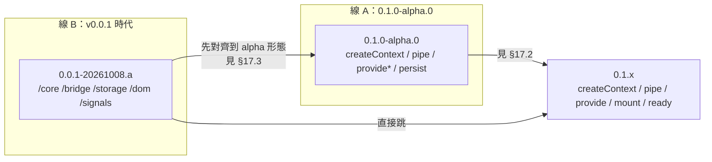

# 17 — 遷移指南

本章回答兩個問題：**我從哪一代 API 遷過來？** 與 **具體要改哪些行？**

- **舊 API 名稱**以 `packages/document-context-deprecated/src/` 的實際原始碼（`0.1.0-alpha.0`）與 `packages/site/src/content/docs/0.0.1-20261008.a/` 的 v0.0.1 快照為準。本章不憑記憶寫舊名字。
- **新 API 語意**以 `docs/next-version/` 的其餘章節為準。本章**不重述**語意，只給對照、路徑與驗證方式。

> 這一代是**從零重寫**。沒有相容層、沒有 deprecated 包、沒有 runtime feature flag。舊 API 要麼有直接的替代路徑，要麼由呼叫者自己承接。

> **與 CHANGELOG 的對應**：套件 CHANGELOG 裡的每一條 `BREAKING` **必須**對應本章的一節。線 A 的條目對應 §17.2.1 的表格列；線 B 的條目對應 §17.3.2 的表格列。版本階段與破壞性變更的界線見 [16-packaging.md](./16-packaging.md) §16.6。

---

## 17.1 兩條遷移線

| 線 | 來源版本 | 目標 | 典型呼叫者 | 難度 |
| :--- | :--- | :--- | :--- | :--- |
| **A** | `0.1.0-alpha.0`（套件 `@sandlada/document-context-deprecated`） | `0.1.x` | 已用過 async `mount` / `provide` / `persist` 的專案 | 中。動詞骨架接近，改的是語意與選項 |
| **B** | `0.0.1`（快照 `0.0.1-20261008.a`） | `0.1.x` | 用過 `withBridge` / `withStorage` / `withProvider` / `withHook` 的專案 | 高。模組路徑、運算子與「雙向綁定」整組都換掉了 |



**線 B 的專案可以選擇先走線 A 的中間形態**（把 `with*` 換成 `provide*` / `persist`），再套用線 A 的清單；但那個中間形態的套件已經凍結，**不值得為了遷移而安裝**。實務上直接對照 `0.1.x` 比較省事。

---

## 17.2 線 A：從 `0.1.0-alpha.0` 遷移

### 17.2.1 破壞性變更對照表

| 舊 API（`0.1.0-alpha.0`） | 新 API（`0.1.x`） | 為什麼改 | 怎麼驗證 |
| :--- | :--- | :--- | :--- |
| `await mount(bp)(host)` → `Promise<Session>` | `const s = mount(bp)(host)` → `Session`（**同步**）＋ `await s.ready` | 句柄同步可得，初始化完成由 `ready` 表達；避免「為了拿句柄而 await」 | `mount` 後立刻 `s.status === 'starting'`；`await s.ready` 後 `s.status === 'active'` |
| `mountSync(bp)(host)` | **移除**。改用 `mount(bp)(host)` | 只有一種掛載途徑；`mount` 本身已是同步的（[00-overview](./00-overview.md) §0.3.5） | 移除所有 `mountSync` 呼叫後，型別檢查不應有未使用的 import |
| `injectSync(token)(session)` | **移除**。同步讀狀態用 `read(selector)(session)`；需要依賴用 `await inject(token)(target)` | 同步注入依賴在 async 時代是二等公民，且會撞到 `ASYNC_SERVICE_NOT_READY` | 舊的 `injectSync` 呼叫改成 `await inject(...)`，並確認所在函式已是 `async` |
| `injectAllSync(token)(session)` | **移除**。改用 `await injectAll(token)(target)` | 同上 | 同上 |
| `selectSync(selector)(session)` | `read(selector)(session)` | 讀取「當下這筆」是唯一的同步讀取語意；`Sync` 後綴整體退役（[01-api](./01-api.md) §1.1） | 舊 `selectSync` 呼叫逐字替換為 `read` |
| `select$(selector)(session)` | `session.state$.pipe(map(selector))` | 庫內**不**再提供投影動詞；投影是呼叫者用 RxJS 組合的事 | 確認 `map` 由 `rxjs` 匯入 |
| `provideSync(token, factory)` | `provide(token, factory)` | 一種提供、工廠可同步可非同步（[00-overview](./00-overview.md) §0.3.6） | 舊 `provideSync` 改名為 `provide`；工廠回傳值不必再包 `Promise.resolve` |
| `provide(token, asyncFactory)` | `provide(token, factory)`，工廠回傳 `T \| Promise<T>` | 同上 | 舊的非同步工廠可不改動，直接沿用 |
| `provide` 選項 `eager: boolean` | `provide` 選項 `eager: boolean`（不變） | 懶 / eager **一直**是用選項表達，不是用函式名字區分（[00-overview](./00-overview.md) §0.3.6） | 從 `provideSync` 遷到 `provide` 時，`eager` 的意義不變 |
| `lifecycle: 'singleton' \| 'scoped' \| 'transient'` | `lifecycle: 'singleton' \| 'scoped' \| 'transient' \| 'prototype'` | `'prototype'` 是 `'transient'` 的**別名**（Spring prototype / .NET Transient）（[08-injection](./08-injection.md) §8.1） | 舊的 `'transient'` 值不變；新寫法兩者皆可 |
| 工廠簽章 `(session) => T` | 工廠簽章 `({ session, use }) => T \| Promise<T>` | `use(token)` 讓**宣告式依賴**在工廠前就位，不需工廠自己 `await inject`（[04-promise-lazy](./04-promise-lazy.md) §4.3） | 把工廠第一個參數改成解構；用到 `session` 的地方改成 `session` 解出來的欄位 |
| `update(updater)` = **shallow merge**（`{ ...current, ...resolved }`） | `update(updater)` = **整份替換**（未回傳的鍵被刪除） | 與 React `useState` 一致；「保留哪些欄位」由呼叫者明寫，避免 merge 語意造成的隱性狀態 | 見 §17.6 陷阱 #1：逐一檢查每個 `update` 呼叫 |
| `update({ count: 1 })`（物件） | 同樣是整份替換 | 同一條規則 | 同上 |
| `persist({ storage, key, version })(bp)` | **移除** | 序列化與持久化不在本代（[00-overview](./00-overview.md) §0.4、[08-injection](./08-injection.md) §8.3） | 見 §17.5 步驟 8 |
| `serialize(options?)(session)` → `string` | **移除** | 同上；SSR payload 水合也不做（[05-ssr](./05-ssr.md) §5.1） | 同上 |
| `defineToken<T>(name)` | `defineToken<T>('public')(name)` | 可見性是**第一段**參數，名字在最後一段；省略可見性時為 `'public'`（[07-tokens](./07-tokens.md) §7.1） | `typeof token === 'string'` 仍成立 |
| `defineToken<T>(name, 'private')` | `defineToken<T>('private')(name)` | 同上 | 私有 token 仍以引用辨識，不可跨 script |
| `definePrivateToken<T>(name)` | `defineToken<T>('private')(name)` | `definePrivateToken` **已退役** | 舊名稱在匯出清單中不再出現 |
| `getSessionSync(element)` | `sessionAt(element)` | 「最近會話」是查詢，不是快照；`Sync` 後綴退役 | 舊呼叫改名；回傳型別仍是 `Session \| null` |
| `session$(element)` | `session$(element)`（不變） | 唯一保留下來的 `$` 動詞 | 只在 `active` 且宿主仍連線時送非 `null` |
| `onResuscitate(handler)` | `onResume(handler)` | 「復甦」改稱「恢復」，與 `suspended → active` 的狀態名對齊（[02-lifecycle](./02-lifecycle.md) §2.2） | 事件名一併改 |
| `onMount` / `onSuspend` / `onDispose` / `onAdopt` | 同名保留 | — | 順序規則未變：`onMount` FIFO、`onDispose` LIFO |
| `session.abort$`（Observable） | `session.abortSignal`（`AbortSignal`） | 平台標準，可直接餵給 `fetch`；單一 abort 邊界（[13-reactivity](./13-reactivity.md) §13.7） | `abort$.subscribe(...)` → `signal.addEventListener('abort', ...)` |
| `session.isConnected` / `isSuspended` / `isDisposed`（三個布林） | `session.status`（`'starting' \| 'active' \| 'suspended' \| 'disposed'`） | 單一狀態欄位，四態可窮舉 | 三個布林合併成一個 `switch` |
| `lifecycle$` 事件 `mounted` / `resuscitated` | `lifecycle$` 事件 `active` / `resumed` | 事件名對齊狀態名 | 見 §17.2.2 下方的事件名對照 |
| `attach(config)(session)` → `HostHooks`（`connect` / `disconnect` / `adopt`） | `attach(config)(session)` → `{ detach(): void }` | 方向反轉：舊版由呼叫者**轉發**連線事實；新版由 `attach` **接收**事實並回傳解除句柄（[03-dom](./03-dom.md) §3.4） | 舊的 `hooks.connect()` 呼叫點刪掉，改為在 Custom Element 的生命週期回呼中直接轉發 |
| `inject(token, { signal, timeoutMs })` | `inject(token, { wait? })` | 不給每次注入配 signal / timeout，避免「會話生命」與「每次注入」各走一套時鐘（[04-promise-lazy](./04-promise-lazy.md) §4.4） | 需要取消時改用 `inject$` 並退訂 |
| `injectAll(token, { direction: 'bottomUp' \| 'topDown' })` | `injectAll(token, { direction: 'from-bottom-to-top' \| 'from-top-to-bottom' })` | 方向值改為自描述字串 | 兩個值都要改；語意不變 |
| `MountOptions.onConflict: 'evict'` | `MountOptions.onConflict: 'replace'` | 命名統一；行為仍是「銷毀舊會話再掛新的」 | 舊值 `'evict'` 會是型別錯誤 |
| `MountOptions.observer` | **移除** | 觀察者集中化，沒有 per-mount 開關（[14-ports](./14-ports.md) §14.2） | 移除該選項 |
| `MountOptions.ssrPayload: 'auto' \| 'off'` | **移除** | SSR 不產生也不解析 payload（[05-ssr](./05-ssr.md) §5.1） | 移除該選項 |
| `MountOptions.suspensionTtlMs` 預設 `50` | 預設 `5000` | 舊值太短，片段替換容易錯過恢復窗口 | 需要舊行為時明確寫 `suspensionTtlMs: 50` |
| `createApplication({ host, storage, ssr })` | `createApplication({ host, ssr? })` | storage 不屬本代（[11-composition](./11-composition.md) §11.3） | 移除 `storage` 埠 |
| `@sandlada/document-context/infrastructure/storage` | **移除** | 同上 | 移除匯入 |
| `merge(base, patch)` | **不存在** → 新增 | 深合併是純函式，屬於呼叫者 | 見 §17.6 陷阱 #1 |

### 17.2.2 錯誤碼對照

| 舊 code（`0.1.0-alpha.0`） | 新 code（`0.1.x`） | 說明 |
| :--- | :--- | :--- |
| `UNCONNECTED_NODE` | `UNCONNECTED_HOST` | 掛載對象從「node」改稱「host」 |
| `KEYED_SESSION_CONFLICT` | `KEYED_CONFLICT` | 縮短；跨宿主與同宿主兩種情形共用此碼 |
| `UNKNOWN_SERVICE` | `UNKNOWN_SERVICE` | 保留，但**觸發條件變了**：以 `Session` 為目標時，預設**立即拒絕**（舊版會等待）；需要等待請傳 `{ wait: true }` |
| `CIRCULAR_DEPENDENCY` | `CIRCULAR_DEPENDENCY` | 保留。`uses` 圖有環時由 `ready` 拒絕 |
| `DISPOSED_SESSION` | `DISPOSED_SESSION` | 保留 |
| `TOKEN_INVALID` | `TOKEN_INVALID` | 保留 |
| `HOST_INVALID` | `HOST_INVALID` | 保留 |
| `SINGLETON_CONFLICT` | `SINGLETON_CONFLICT` | 保留 |
| `HOOK_ERROR` | `HOOK_ERROR` | 保留 |
| `ASYNC_SERVICE_NOT_READY` | **移除** | `*Sync` 同步注入層不存在了，不會再撞到「同步路徑碰到非同步服務」 |
| `INVALID_STORAGE_DATA` | **移除** | 沒有持久化，也沒有還原階段的資料校驗 |
| `RESOLUTION_TIMEOUT` | **移除** | `timeoutMs` 選項不存在了 |
| — | `INVALID_OPTIONS` | **新增**。例如 `suspensionTtlMs: Infinity` 未搭配 `retention: 'pinned'` |
| — | `MOUNT_ABORTED` | **新增**。`MountOptions.signal` 在 `starting` 期間 abort，`ready` 以 `signal.reason` 拒絕 |
| — | `PENDING_LIMIT_EXCEEDED` | **新增**。同一 Application 的 pending 注入數量超過上限 |

> 識別碼、觸發條件與出現位置以 [12-errors](./12-errors.md) 為單一事實來源。本表只給遷移對照。

### 17.2.3 生命週期事件名對照

| 舊 `lifecycle$` 事件 | 新 `lifecycle$` 事件 | 備註 |
| :--- | :--- | :--- |
| `mounted` | `active` | 新版**沒有** `starting` 事件；當前狀態用 `session.status` 讀 |
| `suspended` | `suspended` | — |
| `resuscitated` | `resumed` | 改名 |
| `adopted` | `adopted` | — |
| `disposed` | `disposed` | 新版帶 `reason`：`explicit` / `disconnect` / `ttl` / `cap` / `conflict` |

新版 `lifecycle$` **只背靠當前狀態那一筆**，不重播歷史（[13-reactivity](./13-reactivity.md) §13.4）。

---

## 17.3 線 B：從 v0.0.1 時代的老 API 遷移

### 17.3.1 模組路徑對照

| v0.0.1 | `0.1.0-alpha.0` | `0.1.x` |
| :--- | :--- | :--- |
| `@sandlada/document-context/core` | 根 barrel 或 `/application` | 根 barrel 為主；子路徑於實作期決定（[11-composition](./11-composition.md) §11.4） |
| `@sandlada/document-context/bridge` | **已移除** | **無對應**。DOM 投影改由呼叫者自己寫 |
| `@sandlada/document-context/storage` | `/infrastructure/storage` | **已移除** |
| `@sandlada/document-context/dom` | `/infrastructure/dom` | `/infrastructure/dom` |
| `@sandlada/document-context/signals` | **已移除** | **不在公共面**。signals 不屬本代（[00-overview](./00-overview.md) §0.4） |

v0.0.1 的子路徑導覽（`/core`、`/bridge`、`/storage`、`/dom`、`/signals`）在 `0.1.0-alpha.0` 就已經移除一次；`0.1.x` 只是**再收斂** storage 與 signals。

### 17.3.2 運算子對照

| v0.0.1 | `0.1.0-alpha.0` | `0.1.x` | 替代路徑 |
| :--- | :--- | :--- | :--- |
| `withBridge({ properties, events })` | 已移除 | 已移除 | 手寫 `state$` → DOM。見 [18-recipes](./18-recipes.md) §18.1、§18.3 |
| `withStorage(options)` | `persist(options)` | 已移除 | 自己訂 `state$` 寫儲存，自己把結果放回 `createContext` 種子 |
| `withProvider(token, factory)` | `provideSync(token, factory)` | `provide(token, factory)` | — |
| `withAsyncProvider(token, factory)` | `provide(token, factory)` | `provide(token, factory)` | — |
| `withHook('mount', fn)` | `onMount(fn)` | `onMount(fn)` | — |
| `withHook('suspend', fn)` | `onSuspend(fn)` | `onSuspend(fn)` | — |
| `withHook('resuscitate', fn)` | `onResuscitate(fn)` | `onResume(fn)` | 改名 |
| `withHook('dispose', fn)` | `onDispose(fn)` | `onDispose(fn)` | — |
| `withHook('adopt', fn)` | `onAdopt(fn)` | `onAdopt(fn)` | — |
| `mount(bp, { key })`（**同步**） | `await mount(bp, { token })`（非同步） | `mount(bp, { token })` ＋ `await s.ready`（同步 + ready） | `key` → `token` |
| `mountAsync(bp)` | `mount(bp)` | `mount(bp)` | — |
| `select(selector)` | `selectSync(selector)` | `read(selector)` | — |
| `subscribe(listener)` → 回傳取消函式 | `subscribe$(listener)` → 回傳 `Subscription` | `subscribe$(listener)` → 回傳 `Subscription` | 舊的取消函式改為 `subscription.unsubscribe()` |
| `inject(token)`（同步） | `injectSync(token)` | 已移除 | `await inject(token)(target)` |
| `injectAsync(token)` | `inject(token)` | `inject(token)` | — |
| `injectAll(token)` | `injectAllSync(token)` | 已移除 | `await injectAll(token)(target)` |
| `injectAllAsync(token)` | `injectAll(token)` | `injectAll(token)` | — |
| `createToken(name)` | `defineToken(name)` | `defineToken('public')(name)` | — |
| `getElementSession(el)` | `getSessionSync(el)` | `sessionAt(el)` | — |
| `readErrorStream(session)` | `session.errors$` | `session.errors$` | — |
| `toSignal(session)` | 已移除 | 不在公共面 | 自己寫 adapter（RxJS `toSignal` 或框架自己的） |
| `provideClass` / `injectDecorator` / `registerMountPlugin` | 已移除 | 已移除 | `provide` 交付任意值；需要 class 就提供建構函式（[08-injection](./08-injection.md) §8.2） |
| `ContextRequestEvent` / `CONTEXT_REQUEST_EVENT` | DOM 事件常數 | 事件名仍是 `context-request` | 事件名與 `detail` 形狀是公共契約（[10-events](./10-events.md) §10.1） |

### 17.3.3 三代 `mount` 形態的差異

這是最容易搞混的一點：

| 版本 | 形態 | 取得句柄 | 初始化完成 |
| :--- | :--- | :--- | :--- |
| v0.0.1 | `mount(bp, { key })(el)` | **同步** | 同步就緒（`mountAsync` 另有 async 版） |
| `0.1.0-alpha.0` | `await mount(bp)(el)` | 非同步 | Promise fulfill |
| `0.1.x` | `mount(bp)(el)` | **同步** | `await s.ready` |

v0.0.1 與 `0.1.x` 的 `mount` 都是同步的，但**意義不同**：

- v0.0.1 的同步 `mount` 完成的是「掛載動作」，沒有初始化階段的概念。
- `0.1.x` 的同步 `mount` 完成的是「**取得句柄**」；初始化（種子落地、`starting` 期間的 `update` 重放、eager 依賴、首次 `onMount`）由 `s.ready` 表達。

因此 v0.0.1 時代「掛載完就能用」的直覺**不能**直接沿用。新的最小可用單位是：

```ts
const session = mount(blueprint)(host)
await session.ready
```

---

## 17.4 移除清單速查

一覽「**在 `0.1.0-alpha.0` 存在、`0.1.x` 沒有**」的符號。

| 移除的符號 | 替代 | 備註 |
| :--- | :--- | :--- |
| `mountSync` | `mount` | `mount` 已是同步 |
| `injectSync` | `await inject` / `read` | 依賴用 `await inject`；狀態用 `read` |
| `injectAllSync` | `await injectAll` | — |
| `selectSync` | `read` | — |
| `select$` | `session.state$.pipe(map(...))` | — |
| `provideSync` | `provide` | — |
| `persist` | 呼叫者自訂 | 訂 `state$` 寫儲存 |
| `serialize` | 呼叫者自訂 | 呼叫者決定格式與跳脫 |
| `definePrivateToken` | `defineToken<T>('private')(name)` | 退役 |
| `getSessionSync` | `sessionAt` | — |
| `session.abort$` | `session.abortSignal` | — |
| `session.isConnected` / `isSuspended` / `isDisposed` | `session.status` | — |
| `onResuscitate` | `onResume` | — |
| `lifecycle$` 的 `mounted` / `resuscitated` | `active` / `resumed` | — |
| `MountOptions.observer` | — | 觀察者集中化 |
| `MountOptions.ssrPayload` | — | SSR 不做 payload |
| `InjectOptions.signal` / `timeoutMs` | `inject$` ＋ 退訂 / `{ wait: true }` | — |
| `direction: 'bottomUp' \| 'topDown'` | `'from-bottom-to-top' \| 'from-top-to-bottom'` | — |
| `onConflict: 'evict'` | `onConflict: 'replace'` | — |
| `createApplication` 的 `storage` 埠 | — | storage 不屬本代 |
| `./infrastructure/storage` 子路徑 | — | 同上 |
| `toSignal` | 呼叫者自訂 | signals 不在公共面 |
| 錯誤碼 `ASYNC_SERVICE_NOT_READY` / `INVALID_STORAGE_DATA` / `RESOLUTION_TIMEOUT` | — | 對應能力已移除 |

---

## 17.5 遷移步驟 checklist

照順序做。每一步都給「怎麼驗證做對了」。

| # | 動作 | 怎麼驗證做對了 |
| :--- | :--- | :--- |
| 1 | **盤點**：列出專案用到的每一個舊動詞與選項 | 對照 §17.4 的移除清單逐項打勾；清單外的符號查 §17.2.1 / §17.3.2 |
| 2 | **換依賴**：升到 `0.1.x`，並確認 `rxjs` 是**直接**依賴 | `pnpm why rxjs` 顯示為直接依賴而非僅 peer；匯入 `rxjs` 的 `map` / `distinctUntilChanged` 不報錯 |
| 3 | **改 token 定義**：`defineToken<T>(name)` → `defineToken<T>('public')(name)`；`definePrivateToken` → `defineToken<T>('private')(name)` | `typeof token === 'string'` 的斷言仍成立；`definePrivateToken` 在匯出清單中消失 |
| 4 | **改 `mount`**：`await mount(bp)(host)` → `const s = mount(bp)(host)` ＋ `await s.ready` | 所有 `mount` 呼叫點後面都有對應的 `await s.ready`（或明確註解為不需要） |
| 5 | **改 `provide`**：`provideSync` → `provide`；工廠第一個參數改為 `({ session, use })` | 型別檢查沒有「factory 期望 session，實際是 tools」的錯誤 |
| 6 | **修 `update` 語意**：所有 `update` 改為整份回傳 | 見 §17.6 陷阱 #1 的逐項檢查法；建議在每個 `update` 旁加一行註解說明保留哪些欄位 |
| 7 | **改選項**：`direction`、`onConflict`、`observer`、`ssrPayload`、`signal` / `timeoutMs` | 型別檢查找不到 `string` 不在允許清單的選項值 |
| 8 | **拆掉持久化**：移除 `persist` / `serialize`，改成自己訂 `state$` 寫儲存、自己把讀到的值放進 `createContext` 種子 | 重新整理頁面後狀態**沒有**自動還原（這是預期行為）；自己的還原路徑可測 |
| 9 | **改錯誤碼分支**：`UNCONNECTED_NODE` → `UNCONNECTED_HOST`；`KEYED_SESSION_CONFLICT` → `KEYED_CONFLICT` | 全庫搜尋舊碼字串，結果為空 |
| 10 | **改生命週期事件**：`mounted` → `active`；`resuscitated` → `resumed`；`abort$` → `abortSignal` | 型別檢查通過（若事件型別是字面量聯集，會直接報錯） |
| 11 | **調整 keyed 掛載**：`key` → `token`；確認 `suspensionTtlMs`（新預設 5000）與 `onConflict` | 片段替換情境下，狀態在 TTL 內被保留；逾時後回到種子 |
| 12 | **檢查 `inject` 等待規則**：以 `Session` 為目標的 `inject` 現在預設立即拒絕 | 原本「靠等待拿到祖先提供者」的呼叫改為傳 `{ wait: true }`，或改用元素目標 |
| 13 | **清掉 `*Sync` 用法** | 全庫搜尋 `Sync` 只剩下與本庫無關的命名 |
| 14 | **跑測試**：至少覆蓋「掛載 → 更新 → 讀取 → 銷毀」與 keyed 恢復 | 見 [18-recipes](./18-recipes.md) §18.9 的測試姿勢 |

---

## 17.6 行為陷阱清單

這些是**編譯期抓不到**、但行為會變的地方。每一項都建議在遷移後主動驗一次。

| # | 陷阱 | 症狀 | 修法 | 規格 |
| :--- | :--- | :--- | :--- | :--- |
| 1 | **`update` 從 shallow merge 變成整份替換** | 舊碼 `update((s) => ({ count: s.count + 1 }))` 只回傳一個欄位；新版其餘欄位**全部消失** | 改成 `update((s) => ({ ...s, count: s.count + 1 }))`，或用 `merge(s, { count: s.count + 1 })` | [01-api](./01-api.md) §1.5 |
| 2 | **直接傳物件也整份替換** | `update({ count: 1 })` 會刪掉其它鍵 | 同上，或顯式列出全部欄位 | [01-api](./01-api.md) §1.5 |
| 3 | **`mount` 變成同步** | 舊碼 `const s = await mount(bp)(host)` 改成同步後，`s` 立刻可用但**尚未初始化**；eager 依賴可能還沒建立 | 一律補 `await s.ready`；需要「初始化前就能 `update`」的話，`starting` 期間的 `update` 會被排隊重放 | [02-lifecycle](./02-lifecycle.md) §2.1 |
| 4 | **`state$` 在會話銷毀時完成** | 對 `0.1.0-alpha.0` 而言**這不是變化**：舊版的 `state$` 在銷毀時本來就完成（`subscribe$` 另外套了 `takeUntil(abort$)`）。但相對 **v0.0.1** 是變化：v0.0.1 的 `subscribe()` 回傳取消函式，文件沒有承諾銷毀時自動解除 | 直接訂 `session.state$` 即可，不需再包一層 `takeUntil`；要提早結束就自己退訂 | [13-reactivity](./13-reactivity.md) §13.2 |
| 5 | **`state$` 推送是同步的** | 在 `state$` 的回呼裡再 `update` 會造成**同步遞迴** | 在回呼裡攤平：用 `setTimeout`、微任務，或 RxJS 的 `debounceTime` / `audit` | [13-reactivity](./13-reactivity.md) §13.9 |
| 6 | **`read` 沒有記憶化承諾** | 舊的 `selectSync` 對每個 curried reader 快取「上一筆 state → 結果」；新 `read` 每次都重新計算 | 需要記憶化就在呼叫端自己加一層（見 [18-recipes](./18-recipes.md) §18.4） | [01-api](./01-api.md) §1.1 |
| 7 | **`inject` 的目標決定等待規則** | 以 `Session` 為目標時，舊版會等；新版**預設立即拒絕** `UNKNOWN_SERVICE` | 需要等就傳 `{ wait: true }`，或改用元素目標 | [04-promise-lazy](./04-promise-lazy.md) §4.3、§4.5 |
| 8 | **`injectAll` 的空集合永不結案** | 元素目標上沒有任何 `multi` 註冊時，Promise 不會 fulfill | 需要「拿不到就放棄」時，改以 `Session` 為目標（空結果會 fulfill `[]`），或自行 `inject$` ＋ 退訂 | [04-promise-lazy](./04-promise-lazy.md) §4.5 |
| 9 | **`inject` 沒有 `signal` / `timeoutMs`** | 舊碼靠 `timeoutMs` 避免無限等待 | 用 `inject$` ＋ 退訂；或以 `session.abortSignal` 綁定外部 I/O | [04-promise-lazy](./04-promise-lazy.md) §4.4 |
| 10 | **`provide` 的工廠參數變了** | 舊的 `(session) => ...` 收到的是 session；新的 `({ session, use })` 收到的是工具包 | 把第一個參數改成解構；需要 session 就解出 `session` | [01-api](./01-api.md) §1.4 |
| 11 | **`uses` 宣告錯會讓 `ready` 拒絕** | 宣告了但作用域鏈上解析不到的 token → `ready` 以 `UNKNOWN_SERVICE` 拒絕 | 確認 token 拼字與提供者位置；`uses` 只能在同一份作用域鏈上解析 | [04-promise-lazy](./04-promise-lazy.md) §4.3 |
| 12 | **`errors$` 的初始化期錯誤是緩衝的** | 晚一步訂閱就看不到掛載期的錯誤 | 在 `mount` 之後**立刻**訂 `errors$` | [13-reactivity](./13-reactivity.md) §13.3 |
| 13 | **keyed 會話跨宿主是硬失敗** | 兩個已連線宿主搶同一個 token → 後一次 `mount` 拋 `KEYED_CONFLICT`；`replace` / `reset` 不適用 | 確保同一時間只有一個宿主持有該 token | [09-mount-host](./09-mount-host.md) §9.4 |
| 14 | **singleton 不跨 Application** | 同頁兩份 script 各自 `createApplication`，其中一份註冊的 singleton 另一份看不到 | 跨 script 共用服務請用**祖先 DOM 上的 scoped provider**，不要依賴 singleton | [07-tokens](./07-tokens.md) §7.2 |
| 15 | **`sessionAt` / `session$` 只認 `active`** | `starting` 與 `suspended` 的會話查不到，回傳 `null` | 持有 `Session` 句柄的呼叫端不受影響（可直接 `read`） | [03-dom](./03-dom.md) §3.2 |
| 16 | **暫停不是靜止** | keyed 會話 `suspended` 期間仍可 `update`，`state$` 訂閱者照常收到推送 | 別把 `suspended` 當成「已停止」；要停止用 `onSuspend` | [01-api](./01-api.md) §1.5、[02-lifecycle](./02-lifecycle.md) §2.3 |
| 17 | **同一 Application 才共用索引** | 拿 A 的 `app.update` 去操作 B 的 `app.mount` 得到的 session，結果**未定義** | 每份 session 都用 mount 出它的那個 Application 的動詞 | [11-composition](./11-composition.md) §11.8 |

---

## 17.7 與其它章節的分工

- **公共 API 總表**（動詞、回傳型別、掛載選項）：[01-api.md](./01-api.md)
- **生命週期、鉤子、暫停與恢復**：[02-lifecycle.md](./02-lifecycle.md)
- **Promise、懶載入、`uses`、等待規則**：[04-promise-lazy.md](./04-promise-lazy.md)
- **SSR 行為與請求邊界**：[05-ssr.md](./05-ssr.md)
- **Token 身分與跨 script**：[07-tokens.md](./07-tokens.md)
- **依賴生命週期與值的種類**：[08-injection.md](./08-injection.md)
- **掛載對象、keyed 身分、巢狀宿主**：[09-mount-host.md](./09-mount-host.md)
- **事件通道與 Context Protocol**：[10-events.md](./10-events.md)
- **Application 邊界與組合根**：[11-composition.md](./11-composition.md)
- **錯誤識別碼（規範源）**：[12-errors.md](./12-errors.md)
- **RxJS 語意（規範源）**：[13-reactivity.md](./13-reactivity.md)
- **ports 職責與 Application 級上限**：[14-ports.md](./14-ports.md)
- **測試分層、假排程器與假 ports**：[15-testing.md](./15-testing.md)
- **版本策略、棄用政策與匯出地圖**：[16-packaging.md](./16-packaging.md)
- **可直接複製的用法配方**：[18-recipes.md](./18-recipes.md)

本章只回答：**從舊版線走過來時要改哪些行、怎麼驗證、以及哪些地方會靜靜地改變行為**。
