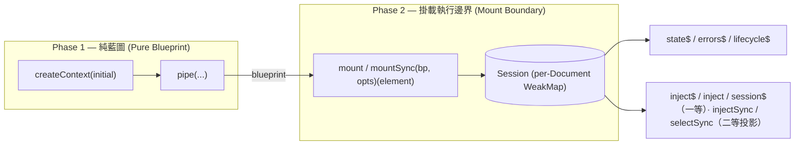

# 00 — 定位與總覽 (Overview)

## 0.1 一句話定位

`@sandlada/document-context` 是一個以 **物理 DOM 節點為宿主** 的 **函式優先（function-first）IoC/DI 與響應式狀態庫**（`container` 為禁用詞，見 [15-glossary.md](./15-glossary.md) `Container (banned)`；請以 Application 實例 / Session / ancestry-chain 表述）。它把瀏覽器原生 DOM 樹當作作用域階層，把狀態暴露為 RxJS `Observable`，**以異步流為一等契約**（同步動詞為二等投影，見 §0.2 #6 與 §0.3），並以嚴格六邊形分層保證核心可在無 DOM 環境（SSR / Node / 邊緣 runtime）中安全載入與執行。

## 0.2 六大核心支柱

1. **空間即作用域（Physical DOM as Scope Hierarchy）**
   DOM 的物理嵌套即 IoC 作用域階層。依賴解析沿祖先鏈向上回溯，不需要在 JS 堆中手動維護虛擬作用域樹。

2. **零洩漏生命週期對齊（Zero-Leak Lifecycle Co-location）**
   容器、狀態與訂閱的生命週期與物理 DOM 節點共存亡。節點脫離文檔自動觸發清理，並支援寬限期復甦（resuscitation）。

3. **框架無關的原生公共契約（Framework-Agnostic Lingua Franca）**
   以 W3C Community Context Protocol（`context-request` 事件）作為跨 bundle、跨框架、跨 Shadow DOM 的統一分發媒介。

4. **RxJS 第一公民（RxJS as First-Class Reactive Core）**
   狀態、錯誤、生命週期一律以 `Observable` 表達；所有內部訂閱以 `takeUntil(abort$)` 收斂，訂閱生命週期與 Session 綁定。

5. **嚴格分層的純核心（Strictly Layered Pure Core）**
   domain 零 DOM、零 I/O；application 負責編排與公共 API；infrastructure 實作被驅動埠。SSR 安全與可測性是架構的自然結果，而非理想口號。

6. **晚綁定解析（Late-Binding Resolution）**
   `inject` 與 `mount` 的順序完全無關：缺席是 pending 而非錯誤；`inject$` / `inject` / `session$(el)` 以 lazy、可中斷（全 async 面接受 `AbortSignal`）、可等待的 async-first 語意主導解析（見 [09b-late-binding.md](./09b-late-binding.md)）。同步動詞僅為熱快照投影，身分為**二等**（不列入穩定契約；`0.1.x` 全程 `@deprecated`，`0.2.0` 全面移除；見 [03-application-api.md](./03-application-api.md) §3.1.1 與 [13-decisions.md](./13-decisions.md) D-71、D-114）。

## 0.3 兩階段執行模型

- **Phase 1**：`createContext` 與 `pipe` 組裝出的藍圖是 100% 純不可變資料，零 DOM、零 I/O、零監聽器。
- **Phase 2**：`mount(blueprint, options)(element)` 在物理宿主上激活 runtime Session，注入被驅動埠的實作（adapter），建立訂閱與觀察者。
- **API 梯隊（Async-First）**：異步流（`inject$` / `session$` / `select$`…）為一等契約；同步動詞（`injectSync` / `injectAllSync` / `provideSync` / `selectSync` / `getSessionSync` / `mountSync`）為**熱快照投影**，身分二等——不列入穩定契約；`0.1.x` 全程 `@deprecated`，`0.2.0` 全面移除（見 [03-application-api.md](./03-application-api.md) §3.1.1、[13-decisions.md](./13-decisions.md) D-71、D-114）。接受此雙面性的笨重是**刻意的取捨**：換取一致的 async-first 解析模型與未來的移除自由。

## 0.4 與 v0.0.1 的差異

| 面向 | v0.0.1 | v0.1.0 |
| :--- | :--- | :--- |
| 架構 | 功能模組（core/bridge/storage/dom/signals） | 分層（domain/application/infrastructure） |
| 核心與 DOM | core 直接持有 `HTMLElement` | domain 零 DOM，經 `HostPort` 抽象 |
| Token / 身分 | key 為字串、token 允許 symbol/object 混用 | 統一 Token 系統：公開 branded string（可序列化、散落可用）／私有 token；強制命名空間 |
| 響應式 | RxJS 為選用（僅錯誤流） | RxJS 為強制第一公民，`state$`/`errors$`/`lifecycle$` |
| 解析時序 | 同步：`inject` 要求宿主已掛載 | 晚綁定：`inject` / `mount` 順序無關（async-first；缺席 = pending） |
| API 梯隊 | 同步為主 | 異步流一等；同步投影二等（`0.1.x` 全程 `@deprecated`，`0.2.0` 全面移除） |
| 子包 | 按功能（`/core`、`/bridge`…） | 按層（`/domain`、`/application`、`/infrastructure/*`） |
| 投影 | `withBridge` DSL | **全面移除（非目標）**：不做 DOM 投影 / 雙向綁定（見 [08-projection.md](./08-projection.md)） |
| 宿主綁定 | `withHook` 運算子 + 手動 | `attach` 純函式生命週期鉤子 |
| 儲存 | `withStorage` 內建策略 | 極簡 `StoragePort` 契約；策略上移至 application |
| SSR | 未系統化 | 載入安全 + 水合契約（儲存 / payload / 藍圖種子） |
| 訊號 | TC39 `toSignal` | 延後（P1） |
| 裝飾器 | `@provide` / `@inject` | 延後（P1） |

## 0.5 讀者指引

- 想理解「為何這樣分層」→ 讀 [01-architecture.md](./01-architecture.md)。
- 想理解核心型別與不變式 → 讀 [02-domain-model.md](./02-domain-model.md)。
- 想直接寫程式 → 讀 [03-application-api.md](./03-application-api.md) 與 [04-reactivity-rxjs.md](./04-reactivity-rxjs.md)。
- 想理解「先 inject、後 mount」的晚綁定解析 → 讀 [09b-late-binding.md](./09b-late-binding.md)。
- 想整合宿主組件（Custom Element / Astro / 框架）→ 讀 [05-lifecycle-host.md](./05-lifecycle-host.md)。
- 想持久化 / SSR → 讀 [06-storage.md](./06-storage.md) 與 [07-ssr-hydration.md](./07-ssr-hydration.md)。
- 想了解「為何不做投影 / 雙向綁定」與替代配方 → 讀 [08-projection.md](./08-projection.md)。
- 想從 v0.0.1 遷移 → 讀 [11-migration.md](./11-migration.md)。
- 想查決策與取捨理由 → 讀 [13-decisions.md](./13-decisions.md)。
- 想了解打包、相容性與發佈 → 讀 [14-packaging-release.md](./14-packaging-release.md)。

## 0.6 非目標（Non-goals）

- 不產生 UI、不做模板引擎 / 渲染器（`serialize` 只回傳字串）。
- 不做路由、表單驗證框架、CSS 框架。
- **不做 DOM 投影 / 雙向綁定**（無 `project` / `twoWay` / `collectAttributes`）：狀態 → DOM 由使用者以 `subscribe$` / `select$` + DOM API 自行組合；DOM → 狀態由使用者以 `addEventListener` + `update` 自行組合（配方見 [08-projection.md](./08-projection.md)）。
- 不內建 signals 橋接與裝飾器（P1）。
- 不設模組全域可變 registry；身分與狀態不依賴全域狀態。
- 不做跨標籤衝突合併（採 LWW；`last` 定義為 `(ts, seq, tabId)` 全序，詳見 [06-storage.md](./06-storage.md) §6.3；CRDT / rebase 由自訂 `StoragePort` 承擔）。

## 0.7 決策登錄

所有設計取捨以 [13-decisions.md](./13-decisions.md) 為 **單一事實來源**；打包與相容性規格見 [14-packaging-release.md](./14-packaging-release.md)；術語見 [15-glossary.md](./15-glossary.md)。
