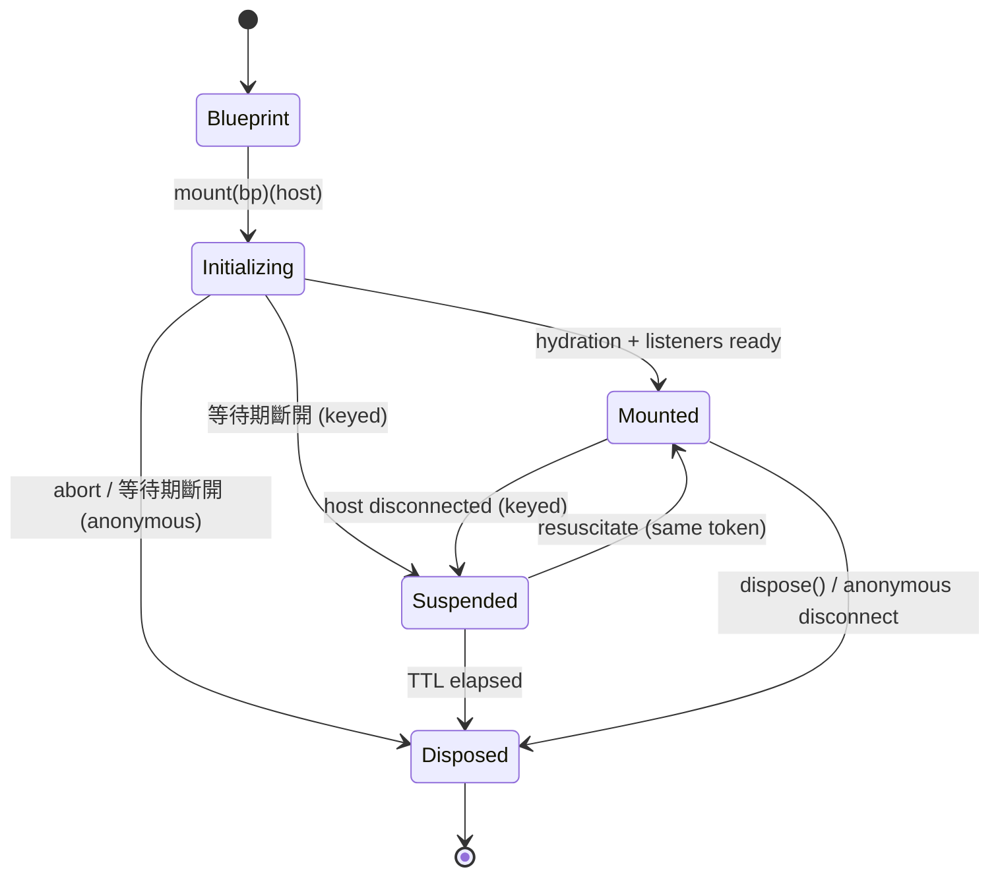

# 02 — 領域模型與契約 (Domain Model)

domain 是本庫的複雜度所在。本節定義純資料模型、四維生命週期狀態機、錯誤分類學，以及被驅動埠的精確形狀。

> 本節取捨的理由與決策編號見 [13-decisions.md](./13-decisions.md)（單一事實來源）。

## 2.1 核心型別

```ts
// domain/model/blueprint.ts
export interface ContextBlueprint<S extends Record<PropertyKey, unknown> = Record<PropertyKey, unknown>> {
    readonly initial: Readonly<S>
    readonly providers: ReadonlyMap<Token, ServiceRegistration>
    readonly hooks: ReadonlyArray<HookRegistration>
    readonly storage: Readonly<StorageOptions> | null
}

// domain/model/service.ts
export type ServiceLifecycle = 'singleton' | 'scoped' | 'transient'

export interface ServiceRegistration<T = unknown> {
    readonly token: Token
    readonly factory: (session: Session) => T | Promise<T>
    readonly lifecycle: ServiceLifecycle
    readonly async: boolean
    readonly multi: boolean
    readonly eager: boolean
}
```

- `ContextBlueprint` 保持 **100% 純不可變**，`pipe` 的每個運算子以結構共享產生新藍圖。
- 註冊預設值：`lifecycle: 'scoped'`、`multi: false`、`eager: false`（`ProvideOptions` 見 [03-application-api.md](./03-application-api.md)）。
- 同一藍圖內 **同 token 的單值註冊後者覆蓋前者**（運算子組合友善）；`multi: true` 註冊依序 **累加**，僅由 `injectAll`（Promise）/ `injectAll$`（流）/ `injectAllSync`（同步・二等）取用。
- `eager: true` 的服務於 `mount` / `mountSync` 建立期（`onMount` 之前）實例化；存在非同步 eager 服務時，`mountSync` 拋 `ASYNC_SERVICE_NOT_READY`（改用 `mount`）。
- 服務型別的事實來源是 `ServiceToken<T>` 與 `ServiceRegistry`（見 [02b-tokens.md](./02b-tokens.md)）；本版 **不做** 跨運算子的服務型別累積推導。

## 2.2 Token

Token 系統（可序列化、SSR 安全、散落可用）的完整規格見 [02b-tokens.md](./02b-tokens.md)。摘要：

```ts
// 公開：branded string，runtime 即 string（可序列化，跨 bundle/realm/文件等價）
declare const ServiceType: unique symbol
export type ServiceToken<T> = string & { readonly [ServiceType]?: T }

// 私有：frozen branded 物件，引用即身分（不可序列化，僅同 realm）
export interface PrivateToken<T> {
    readonly [PrivateServiceType]?: T
    readonly name: string
}

// 統一 union（埠與簽名接受；keyed/序列化路徑只接受 ServiceToken）
export type Token = ServiceToken<any> | PrivateToken<any> | string

// ServiceRegistry 宣告合併提供字串 token 的型別安全（與 ServiceToken<T> 並存）
declare module '@sandlada/document-context' {
    interface ServiceRegistry {
        'app:user': User
    }
}
```

## 2.3 Session（不透明句柄）

```ts
// domain/model/session.ts
declare const SessionBrand: unique symbol

export interface Session<S extends Record<PropertyKey, unknown> = Record<PropertyKey, unknown>, Host = unknown> {
    readonly [SessionBrand]: true
    readonly host: HostPort<Host>
    readonly token: string | null
    readonly isConnected: boolean
    readonly isSuspended: boolean
    readonly isDisposed: boolean
    readonly abortSignal: AbortSignal

    readonly state$: Observable<S>
    readonly errors$: Observable<DocumentContextError>
    readonly lifecycle$: Observable<LifecycleEvent>
    readonly abort$: Observable<void>

    readonly [Symbol.dispose]: () => void
    readonly [Symbol.asyncDispose]: () => Promise<void>
}

export type LifecycleEvent =
    | { readonly type: 'mounted' }
    | { readonly type: 'suspended' }
    | { readonly type: 'resuscitated' }
    | { readonly type: 'adopted', readonly owner: unknown }
    | { readonly type: 'disposed' }
```

- `Session` 是 domain 概念；具體 `Native` 透過泛型參數 `Host` 顯露（預設由公共 API 綁定為 `HTMLElement`）。
- `host` 是 **穩定代理（facade）**：`Session` 持有的 `HostPort` 參考永不失效，內部委派至「當前宿主」；keyed 復甦時代理換向新宿主，既有綁定（訂閱、`attach`）自然跟隨。
- `native()` 於 `Suspended` 期間指向已脫離的舊節點；復甦後指向新節點。需要跨復甦延續的原生引用，一律於 `onResuscitate` 或復甦後重新讀取。
- `abortSignal` 與 `abort$` 同源：Session 進入銷毀時即時 `abort()`。

## 2.4 作用域模型

- **作用域鏈**：`host.parent` 由 `HostPort` 提供；解析沿祖先鏈回溯。
- **作用域分配**：`singleton`（每個 Document 一份，存於 per-Document registry；同名衝突首個註冊者勝出）、`scoped`（綁定單一 Session 子樹）、`transient`（每次呼叫新實例）。
- **狀態不跨 Session**：`selectSync` / `update` 一律作用於單一 Session；子樹元件以 `getSessionSync(element)` 取得最近 Session 後操作（見 [03-application-api.md](./03-application-api.md)）。

```
Session(scoped) ─┬─ service A (scoped, cached in session)
                 ├─ service B (singleton, cached in document registry)
                 └─ child Session ── resolve(token) ──▶ walk host.parent
```

## 2.5 四維生命週期狀態機

```
1. 物理 DOM 宿主生命週期  Unconnected → Connected → Adopted → Disconnected → GC
2. 會話狀態機            Blueprint → Initializing → Mounted ⇄ Suspended → Disposed（Resuscitated 為事件）
3. 依賴與服務解析        singleton ⇋ scoped ⇋ transient | lazy/eager | InFlight → Resolved → Evicted
4. 狀態 / 儲存           Seed → Hydration → Reactive → Suspended（狀態照常演進） → Poisoned
```

### 2.5.1 Session 狀態機



- 匿名 Session（無 token）在 disconnect 後直接銷毀，不進 Suspended。
- **藍圖以首次掛載為準**：同宿主同身分重複 `mount` 回傳快取 Session，不做藍圖引用比對；替換藍圖請先 `dispose` 再掛載。
- 身分衝突（同宿主不同 token、同 token 雙活躍、`options.token` 與 `data-context-key` 矛盾）依 `onConflict` 處理（`throw` 預設 / `evict` / `reset`，見 [05-lifecycle-host.md](./05-lifecycle-host.md) §5.5）。
- DOM 組合下 `mount` 要求宿主已連線，否則 `UNCONNECTED_NODE`；`ssr` 組合不受此限。
- `Suspended` 期間：`state$` / 訂閱 / storage 照常演進，同步投影（`selectSync` / `injectSync` / `update`）仍可用（scoped 保持）——但元素目標解析不命中（不可見）；復甦時沿用原藍圖與狀態（不重跑水合）；使用者自建的 DOM 綁定請於 `onResuscitate` 後重讀 `native()` 並重綁（見 [08-projection.md](./08-projection.md)）。
- `Disposed` 後：狀態 store 進入毒化保護——`update()` 回傳 `false`、`selectSync` 回傳最後快照、`subscribe$` 回傳已完成的空流、`inject*` 拋 `DISPOSED_SESSION`。
- 鉤子（`onMount` / `onSuspend` / `onResuscitate` / `onAdopt` / `onDispose`）與事件的完整標註（狀態圖 + 時序圖 + 總覽表）見 [05-lifecycle-host.md](./05-lifecycle-host.md) §5.1.1 / §5.2。

### 2.5.2 服務非同步狀態機

```
Idle → InFlight → Resolved     (Promise Coalescing；快取依 lifecycle)
              ├→ Rejected     (立即剔除快取，允許重試自癒)
              └→ Aborted      (abort$ 觸發，清理懸掛 Promise)
```

## 2.6 被驅動埠（Ports）

共用型別：`export type MaybePromise<T> = T | Promise<T>`（`StoragePort` 與 `ScopeTransportPort` 共用）。

### 2.6.1 `HostPort`

```ts
// domain/ports/host.ts
export type HostLifecycleEvent =
    | { readonly type: 'connect' }
    | { readonly type: 'disconnect' }
    | { readonly type: 'adopt', readonly owner: unknown }

export interface HostPort<Native = unknown> {
    readonly token: string | null
    readonly isConnected: boolean
    readonly parent: HostPort<Native> | null
    readonly lifecycle$: Observable<HostLifecycleEvent>

    // 原生事件傳輸（input 等；回傳解除函式）
    on(type: string, listener: (event: unknown) => void, options?: {
        readonly capture?: boolean
        readonly passive?: boolean
        readonly once?: boolean
        readonly signal?: AbortSignal
    }): () => void

    // 逃生口
    native(): Native
}
```

- `native()` 是統一逃生口，讓使用者拿回真實節點執行 `focus()`、`setAttribute()`、`scrollTo()`、`getBoundingClientRect()` 等（本庫不代管 DOM 寫入，見 [08-projection.md](./08-projection.md)）。
- `token` 為正規化後的 keyed 身分（由 `mount` 選項或 `data-context-key` 決定；寫回與移除規則見 [05-lifecycle-host.md](./05-lifecycle-host.md) §5.5）。

### 2.6.2 `StoragePort`

```ts
// domain/ports/storage.ts
export type StorageError =
    | { readonly kind: 'unavailable' }
    | { readonly kind: 'corrupt', readonly raw: string }
    | { readonly kind: 'quota' }
    | { readonly kind: 'unknown', readonly cause: unknown }

export type StorageResult<T> =
    | { readonly ok: true, readonly value: T }
    | { readonly ok: false, readonly error: StorageError }

export interface StoragePort {
    read(key: string): MaybePromise<StorageResult<string | null>>
    write(key: string, value: string): MaybePromise<StorageResult<void>>
    remove(key: string): MaybePromise<StorageResult<void>>
    observe$(key: string): Observable<string | null>   // 僅外部變更
}
```

- 契約允許 `MaybePromise`（同步為預設，非同步以支援 IndexedDB）。
- adapter 只處理 `string`；序列化與版本封裝（`{ v, d }`）在 application 層完成（見 [06-storage.md](./06-storage.md)）。
- `observe$` 僅在 **外部變更**（跨標籤、其他來源）時發射，自身寫入不回流。

### 2.6.3 `SchedulerPort`

```ts
// domain/ports/scheduler.ts
export interface SchedulerPort {
    microtask(task: () => void): void
    timeout(task: () => void, ms: number): () => void   // 回傳取消函式
    frame(task: () => void): () => void                 // 動畫幀；可退化為 microtask
}
```

`Clock` 與 `Document` 身分分別併入 `SchedulerPort` 與 `HostPort`，不另立埠。

### 2.6.4 `ScopeTransportPort`

```ts
// domain/ports/scope-transport.ts
export interface ScopeResolution<T = unknown> {
    readonly value: MaybePromise<T>
    readonly unsubscribe: () => void
}

export interface ScopeTransportPort {
    // 同步投影（二等）：當下命中即回傳；缺席回傳 null（不等待）
    request<T>(
        token: Token,
        from: HostPort,
        options?: { readonly subscribe?: boolean, readonly direction?: 'bottomUp' | 'topDown' }
    ): ScopeResolution<T> | null
    requestAll<T>(
        token: Token,
        from: HostPort,
        options?: { readonly direction?: 'bottomUp' | 'topDown' }
    ): ReadonlyArray<ScopeResolution<T>>

    // 晚綁定：冷串流；缺席 = pending，由 context-mount / 集中觀察者喚醒重試；首次命中後 complete
    watch<T>(
        token: Token,
        from: HostPort,
        options?: { readonly direction?: 'bottomUp' | 'topDown', readonly signal?: AbortSignal }
    ): Observable<ScopeResolution<T>>
    watchAll<T>(
        token: Token,
        from: HostPort,
        options?: { readonly direction?: 'bottomUp' | 'topDown', readonly signal?: AbortSignal }
    ): Observable<ReadonlyArray<ScopeResolution<T>>>
}
```

- `bottomUp`（預設）：由最近的作用域向外；`topDown`：由最外層向內。
- `requestAll` 回傳 0..N 筆（不外拋 `null`）；`request` 僅解析單值。
- `watch` / `watchAll` 為冷串流且 resolve-once（首次命中後 `complete()`）；缺席為 pending，喚醒機制見 [09b-late-binding.md](./09b-late-binding.md)；`signal` abort 即取消（`complete()`、pending 條目移除）。
- `value` 允許 `MaybePromise`：非同步提供者的 in-flight Promise 直接傳遞，application 以 `inject` await；同步路徑觸及未就緒 Promise 時拋 `ASYNC_SERVICE_NOT_READY`。
- DOM adapter 以 W3C Context Protocol 實作（見 [09-infrastructure.md](./09-infrastructure.md)）。

## 2.7 錯誤分類學

```ts
// domain/model/errors.ts
export type DocumentContextErrorCode =
    | 'UNKNOWN_SERVICE'
    | 'CIRCULAR_DEPENDENCY'
    | 'DISPOSED_SESSION'
    | 'UNCONNECTED_NODE'
    | 'ASYNC_SERVICE_NOT_READY'
    | 'KEYED_SESSION_CONFLICT'
    | 'TOKEN_INVALID'
    | 'SINGLETON_CONFLICT'
    | 'INVALID_STORAGE_DATA'
    | 'RESOLUTION_TIMEOUT'

export class DocumentContextError extends Error {
    readonly code: DocumentContextErrorCode
    readonly details: Readonly<Record<string, unknown>>
    readonly resolutionGuide: string
}
```

致命 / 非致命分類以本表為 **單一事實來源**（其他章節不複列）：

| code | 觸發 | 處置 |
| :--- | :--- | :--- |
| `UNKNOWN_SERVICE` | 同步 Session 路徑找不到可解析的單值註冊（含「僅有 `multi` 註冊的 token 被單值 `inject`」）；元素目標的 async 解析無此錯誤（缺席 = pending） | 致命（throw） |
| `CIRCULAR_DEPENDENCY` | 解析途中重入同一 token | 致命 |
| `DISPOSED_SESSION` | 對已銷毀 Session 呼叫 `injectSync`；或以已銷毀 Session 為目標的 `inject$` / `inject` | 致命 |
| `UNCONNECTED_NODE` | DOM 組合下 `mount` 宿主未連線；或等待期結束時仍未連線（僅匿名會話——keyed 轉 `Suspended`） | 致命 |
| `ASYNC_SERVICE_NOT_READY` | 同步路徑觸及尚未就緒的非同步服務或水合（`injectSync` 對非同步服務；`mountSync` 遇非同步 eager 服務或非同步儲存） | 致命 |
| `KEYED_SESSION_CONFLICT` | 身分衝突：同宿主不同 token、同 token 雙活躍宿主、`options.token` 與 `data-context-key` 矛盾 | 致命 |
| `TOKEN_INVALID` | `defineToken` / `mount` 身分正規化驗證失敗 | 致命 |
| `SINGLETON_CONFLICT` | 同 Document 對同名 singleton 重複註冊（首個註冊者勝出，後續忽略） | 非致命（`errors$`） |
| `INVALID_STORAGE_DATA` | 儲存資料毀損、遷移失敗、或版本過新 | 非致命（安全降級至藍圖種子；版本過新時不覆寫） |
| `RESOLUTION_TIMEOUT` | `inject$` / `inject` 系列顯式設置 `timeoutMs` 且逾時仍為 pending | 致命（以串流 error / Promise rejection 呈現） |

- 非致命錯誤推送至 `session.errors$`，**不** 中斷清理流程。
- 致命錯誤直接拋出；`details` 與 `resolutionGuide` 於拋出點附帶。
- **取消與終止不屬錯誤分類學**：`AbortSignal` abort 為消費者主動停止——Observable 以 `complete()`、Promise 以 `signal.reason` 拒絕（預設平台 `AbortError`）；目標 Session 死亡則以 `DISPOSED_SESSION` 終止（見 [09b-late-binding.md](./09b-late-binding.md) §9b.2 與 03 §3.3.1）。取消不推送 `errors$`。

## 2.8 領域不變式（必須測試守護）

1. domain 在無 DOM 環境可載入與執行（node 環境測試）。
2. Blueprint 運算子零副作用、零工廠執行。
3. DOM 卸載不得在微任務重掛檢查前過早銷毀 keyed Session。
4. Disposed Session 的 `update()` 靜默回傳 `false`（其餘動詞行為見 §2.5.1）。
5. in-flight Promise 拒絕後立即剔除快取（自癒重試）。
6. 每個埠都有 `native()` / 對等逃生口，且不洩漏 adapter 實作型別。
7. `mount` 幂等以宿主為粒度；藍圖以首次掛載為準（不做引用比對）。
8. `update` 一律 shallow merge，以物件展開（CreateDataProperty）語意實作，禁用 `Object.assign`（原型安全）。
9. `errors$` 初始化期錯誤緩衝（≤ 32 筆），首次訂閱排空後轉純熱流。
10. 元素目標的 `inject$` / `injectAll$` / `inject` / `injectAll` 與 `mount` 順序無關；缺席 = pending，只有顯式 `timeoutMs` 才產生 `RESOLUTION_TIMEOUT`。
11. `inject$` / `injectAll$` 為冷串流且 resolve-once：首次解析後 `complete()`。
12. pending registry 以 `WeakRef` 追蹤宿主、微任務批次喚醒、無輪詢（見 [09b-late-binding.md](./09b-late-binding.md)）。
13. 取消與終止冪等：unsubscribe / `signal` / `timeoutMs` / 目標 Session 死亡多通道競爭時，先到者勝出且僅結案一次；條目即時移除、無殘留計時器與監聽。
14. 核心以流 / Promise 路徑實作：同步動詞僅為熱快照投影（二等，可隨時移除）；domain 與 application 內部不得以同步動詞實現功能——驗證以 parity 測試與移除演練（見 [10-testing.md](./10-testing.md) §10.5）。
