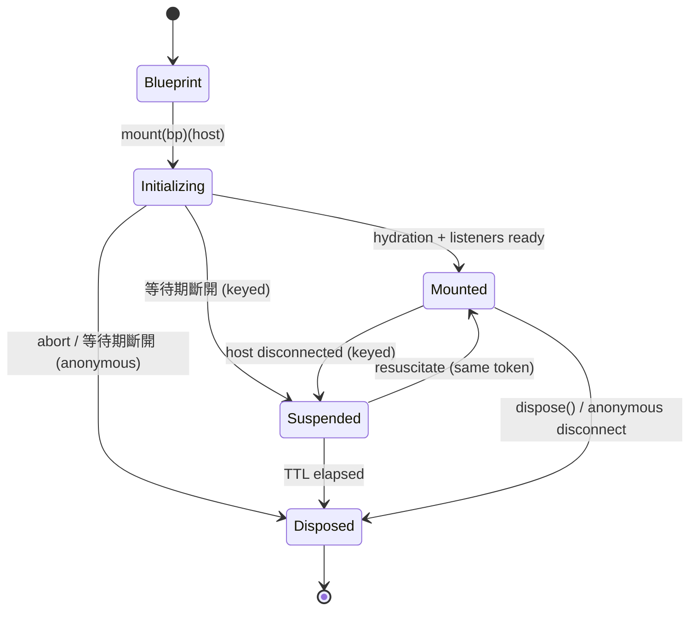

# 02 — 領域模型與契約 (Domain Model)

domain 是本庫的複雜度所在。本節定義純資料模型、四維生命週期狀態機、錯誤分類學，以及被驅動埠的精確形狀。

> 本節取捨的理由與決策編號見 [13-decisions.md](./13-decisions.md)（單一事實來源）。

## 2.1 核心型別

```ts
// domain/model/blueprint.ts
export interface ContextBlueprint<S extends Record<PropertyKey, unknown> = Record<PropertyKey, unknown>> {
    readonly initial: Readonly<S>
    readonly providers: ReadonlyMap<Token, ServiceRegistration>
    readonly hooks: ReadonlyArray<HookRegistration>
    readonly storage: Readonly<StorageOptions> | null
}

// domain/model/service.ts
export type ServiceLifecycle = 'singleton' | 'scoped' | 'transient'

export interface ServiceRegistration<T = unknown> {
    readonly token: Token
    readonly factory: (session: Session) => T | Promise<T>
    readonly lifecycle: ServiceLifecycle
    readonly async: boolean
    readonly multi: boolean
    readonly eager: boolean
}
```

- `ContextBlueprint` 保持 **100% 純不可變**，`pipe` 的每個運算子以結構共享產生新藍圖。
- 註冊預設值：`lifecycle: 'scoped'`、`multi: false`、`eager: false`（`ProvideOptions` 見 [03-application-api.md](./03-application-api.md)）。
- 同一藍圖內 **同 token 的單值註冊後者覆蓋前者**（運算子組合友善）；`multi: true` 註冊依序 **累加**，僅由 `injectAll`（Promise）/ `injectAll$`（流）/ `injectAllSync`（同步・二等）取用。
- `eager: true` 的服務於 `mount` / `mountSync` 建立期（`onMount` 之前）實例化；存在非同步 eager 服務時，`mountSync` 拋 `ASYNC_SERVICE_NOT_READY`（改用 `mount`）。
- 服務型別的事實來源是 `ServiceToken<T>` 與 `ServiceRegistry`（見 [02b-tokens.md](./02b-tokens.md)）；本版 **不做** 跨運算子的服務型別累積推導。

## 2.2 Token

Token 系統（可序列化、SSR 安全、散落可用）的完整規格見 [02b-tokens.md](./02b-tokens.md)。摘要：

```ts
// 公開：branded string，runtime 即 string（可序列化，跨 bundle/realm/文件等價）
declare const ServiceType: unique symbol
export type ServiceToken<T> = string & { readonly [ServiceType]?: T }

// 私有：frozen branded 物件，引用即身分（不可序列化，僅同 realm）
export interface PrivateToken<T> {
    readonly [PrivateServiceType]?: T
    readonly name: string
}

// 統一 union（埠與簽名接受；keyed/序列化路徑只接受 ServiceToken）
export type Token = ServiceToken<any> | PrivateToken<any> | string

// ServiceRegistry 宣告合併提供字串 token 的型別安全（與 ServiceToken<T> 並存）
declare module '@sandlada/document-context' {
    interface ServiceRegistry {
        'app:user': User
    }
}
```

## 2.3 Session（branded handle；欄位公開可讀、不可構造，僅經 `mount` 取得）

```ts
// domain/model/session.ts
declare const SessionBrand: unique symbol

export interface Session<S extends Record<PropertyKey, unknown> = Record<PropertyKey, unknown>, Host = unknown> {
    readonly [SessionBrand]: true
    readonly host: HostPort<Host>
    readonly token: string | null
    readonly isConnected: boolean
    readonly isSuspended: boolean
    readonly isDisposed: boolean
    readonly abortSignal: AbortSignal

    readonly state$: Observable<S>
    readonly errors$: Observable<DocumentContextError>
    readonly lifecycle$: Observable<LifecycleEvent>
    readonly abort$: Observable<void>

    readonly [Symbol.dispose]?: () => void
    readonly [Symbol.asyncDispose]?: () => Promise<void>
}

// ERM 為可選掛載：缺席時符號未掛載，改用顯式 `dispose(session)`；`await using` 需 `ESNext.Disposable` lib（見 [14-packaging-release.md](./14-packaging-release.md) §14.4）。`dispose() ≡ Session[Symbol.dispose]` 僅於符號存在時成立。

export type LifecycleEvent =
    | { readonly type: 'mounted' }
    | { readonly type: 'suspended' }
    | { readonly type: 'resuscitated' }
    | { readonly type: 'adopted', readonly owner: unknown }
    | { readonly type: 'disposed' }
```

- `Session` 是 domain 概念；具體 `Native` 透過泛型參數 `Host` 顯露（domain 保持 `unknown`，公共面預設綁定為 `HTMLElement`，見 §2.6.1）。
- `host` 是 **穩定代理（facade）**：`Session` 持有的 `HostPort` 參考永不失效，內部委派至「當前宿主」；keyed 復甦時代理換向新宿主，既有綁定（訂閱、`attach`）自然跟隨。facade 存活不等於宿主存活：不得以輪詢 facade / `isConnected` 觀測 Session-target 死亡；死亡經 `abort$` 訂閱鏈結結算為 `DISPOSED_SESSION`（見 [09b-late-binding.md](./09b-late-binding.md) §9b.2）。
- `native()` 於 `Suspended` 期間取 deref-or-throw 語意：deref 命中返舊（detached）節點並標註，失配拋指定碼（碼號見 §2.7）；facade 於進入 `Suspended` 時將強 native 降為 `WeakRef`，復甦時重取新 host，故留存釘住的是狀態而非 DOM 子樹。需要跨復甦延續的原生引用，一律於 `onResuscitate` 或復甦後重新讀取。
- `abortSignal` 與 `abort$` 同源：Session 進入銷毀時即時 `abort()`。

## 2.4 作用域模型

- **作用域鏈**：`host.parent` 由 `HostPort` 提供；解析沿祖先鏈回溯。
- **作用域分配**：`singleton`（每個 Document 一份，存於 per-Document registry；同名衝突首個註冊者勝出，輸家 mount session 的 `errors$` 於 `mounted` 之前收 `SINGLETON_CONFLICT`，`details={token, winner:'first-registration', factoryMismatch:boolean}`）、`scoped`（綁定單一 Session 子樹，生命週期值一律寫全稱 `lifecycle:'scoped'`）、`transient`（每次呼叫新實例）。`Scope` 僅指 ancestry-range，不指生命週期值。
- **狀態不跨 Session**：`selectSync` / `update` 一律作用於單一 Session；子樹元件以 `getSessionSync(element)` 取得最近 Session 後操作（見 [03-application-api.md](./03-application-api.md)）。規範句：state never crosses Session；service resolution walks ancestors；singletons span Document（與術語表雙寫）。
- **註冊表拓撲**：`singleton registry: Map<tokenString, instance>` 與 `keyed registry: Map<tokenString, WeakRef<Session>>` 為兩個 map、共享鍵空間但查詢空間獨立；same string MAY denote both（spaces independent）；MUST NOT assume cross-visibility（keyed session 不提供 service，singleton 不 resuscitate）。詳見 [02b-tokens.md](./02b-tokens.md) §2b.9 dual-use 規則。

```
Session(scoped) ─┬─ service A (scoped, cached in session)
                 ├─ service B (singleton, cached in document registry)
                 └─ child Session ── resolve(token) ──▶ walk host.parent
```

## 2.5 四維生命週期狀態機

```
1. 物理 DOM 宿主生命週期  Unconnected → Connected → Adopted → Disconnected → GC
2. 會話狀態機            Blueprint → Initializing → Mounted ⇄ Suspended → Disposed（轉換動詞 `resuscitate`；事件 `resuscitated`；過程 `resuscitation`，見 §2.5.1）
3. 依賴與服務解析        正交積：lifecycle {singleton, scoped, transient} × mode {lazy, eager} × resolution {Idle → InFlight → Resolved | Rejected | Aborted}（lifecycle / mode 為靜態分類，僅 resolution 遷移；`Evicted` 退役，改稱 rejected-cache-drop）
4. 狀態 / 儲存           Seed → Hydration → Reactive → Suspended（狀態照常演進） → Poisoned
```

### 2.5.1 Session 狀態機



- 匿名 Session（`token: null`；無 keyed 身分；無跨宿主復甦；同宿主重掛回傳快取；斷開即 Disposed 不經 Suspended）。
- **藍圖以首次掛載為準**：同宿主同身分重複 `mount` 回傳快取 Session，不做藍圖引用比對；替換藍圖請先 `dispose` 再掛載。除非其 host 已 observed-disconnect 待 re-check（此時同 token 第二 mount 走 resuscitate，見 [05-lifecycle-host.md](./05-lifecycle-host.md) §5.5）；跨 host 併發雙 Initializing 首達 Mounted 勝、敗方拒 `KEYED_SESSION_CONFLICT`。
- 身分衝突（同宿主不同 token、同 token 雙活躍、`options.token` 與 `data-context-key` 矛盾）依 `onConflict` 處理（`throw` 預設 / `evict` / `reset`，見 [05-lifecycle-host.md](./05-lifecycle-host.md) §5.5）。genuine dual-active（一對 connected host 同 token）一律拋 `KEYED_SESSION_CONFLICT`，無視 `onConflict`；`onConflict` 僅同 host swap 與 key 矛盾。
- DOM 組合下 `mount` 要求宿主已連線，否則 `UNCONNECTED_NODE`；`ssr` 組合不受此限。
- `Suspended` 期間：service-plane 全活（scoped 緩存留、transient 可調、lazy 可首建、`state$` / `subscribe$` / `errors$` / storage 照常演進）；僅 element-target 解析路徑盲（無新命中；`session$` 吐 null，見 [03-application-api.md](./03-application-api.md) §3.3.1）。同步投影（`selectSync` / `injectSync` / `update`）仍可用（scoped 保持）；復甦時沿用原藍圖與狀態（不重跑水合；`02 §2.5.1` 為規範源，術語表為鏡像）；使用者自建的 DOM 綁定請於 `onResuscitate` 後重讀 `native()` 並重綁（見 [08-projection.md](./08-projection.md)）。
    - 留存：Suspended 條目由 Application 擁有的 per-Document Suspended 表持強引用槽 `{ref, weak}`；釋放點為 resuscitate / dispose / TTL-expiry 三者其一。有界：`maxSuspendedPerDocument` 預設 100，溢出 oldest-first 經完整 dispose 路逐出為 Disposed（`onDispose` LIFO + `lifecycle$ disposed` 且 `details.evicted='suspended-cap'`，`errors$` 不另推）；被逐出 token 的 resuscitate 變 fresh-mount。
    - `Infinity` 門：`suspensionTtlMs: Infinity` 僅當 `retention:'pinned'` 明式 opt-in 並存時生效，owner 為 mounter，Application-teardown 全清 pinned 條目；裸 `Infinity` 無 flag 即拋配置錯（碼見 §2.7）。
    - 註 (i)：Suspended 期首建的 lazy / transient 工廠勿 capture `native()`（當時為 detached，見 §2.3 deref-or-throw）。註 (ii)：`subscribe$` 回調 Suspended 期照推，背壓與可見性歸呼叫者（見 [08-projection.md](./08-projection.md) recipes）。
- 單例 server 範圍：單例按請求（按 Application 實例），永不跨請求共享（見 [07-ssr-hydration.md](./07-ssr-hydration.md) §7.7 與 [09-infrastructure.md](./09-infrastructure.md) §9.7）。
- `Disposed` 後：狀態 store 進入毒化保護——`update()` 回傳 `false`、`selectSync` 回傳最後快照、`subscribe$` 回傳已完成的空流、`inject*` 拋 `DISPOSED_SESSION`。
- 鉤子（`onMount` / `onSuspend` / `onResuscitate` / `onAdopt` / `onDispose`）與事件的完整標註（狀態圖 + 時序圖 + 總覽表）見 [05-lifecycle-host.md](./05-lifecycle-host.md) §5.1.1 / §5.2。

### 2.5.2 服務非同步狀態機

```
Idle → InFlight → Resolved     (Promise Coalescing；快取依 lifecycle)
              ├→ Rejected     (立即剔除快取，允許重試自癒)
              └→ Aborted      (abort$ 觸發，清理懸掛 Promise)
```

- `CIRCULAR_DEPENDENCY` 嚴格為 sync-only：同步工廠重入 / `injectSync` 路徑重入同一 token 即拋；一切 async 重入一律 coalesced wait，無 chain 規則（v0.1.0 無 chain 身分管道；same-chain async 偵測記 P1，見 [12-roadmap.md](./12-roadmap.md)）。
- Async 環（A↔B 經 `await inject` 互等）為設計上的 deadlock-until-`timeoutMs`：唯一規範出口為顯式 `timeoutMs` → `RESOLUTION_TIMEOUT`；預設無限即預設掛起（hang 為規範行為，非 bug）。factory-plane 建議配 `timeoutMs`，但不改預設語義。

## 2.6 被驅動埠（Ports）

共用型別：`export type MaybePromise<T> = T | Promise<T>`（`StoragePort` 與 `ScopeTransportPort` 共用；thenable 判定一律 duck-typing，以 `typeof x.then === 'function'` 判定，禁 `instanceof Promise`）。

### 2.6.1 `HostPort`

```ts
// domain/ports/host.ts
export type HostLifecycleEvent =
    | { readonly type: 'connect' }
    | { readonly type: 'disconnect' }
    | { readonly type: 'adopt', readonly owner: unknown }

export interface HostPort<Native = unknown> {
    readonly token: string | null
    readonly isConnected: boolean
    readonly parent: HostPort<Native> | null
    readonly lifecycle$: Observable<HostLifecycleEvent>

    // 原生事件傳輸（input 等；回傳解除函式）
    on(type: string, listener: (event: unknown) => void, options?: {
        readonly capture?: boolean
        readonly passive?: boolean
        readonly once?: boolean
        readonly signal?: AbortSignal
    }): () => void

    // 逃生口
    native(): Native
}
```

- `native()` 是統一逃生口，讓使用者拿回真實節點執行 `focus()`、`setAttribute()`、`scrollTo()`、`getBoundingClientRect()` 等（本庫不代管 DOM 寫入，見 [08-projection.md](./08-projection.md)）。公共面預設 `Native=HTMLElement`（domain 保持 `unknown`，公共簽名一律顯式參數化）；範例一律顯式收窄（`as HTMLElement` + import）。
- `token` 為正規化後的 keyed 身分（由 `mount` 選項或 `data-context-key` 決定；寫回與移除規則見 [05-lifecycle-host.md](./05-lifecycle-host.md) §5.5）。
- 判定一律 duck-typing，全 corpus 禁 `instanceof` 作宿主 / thenable 判定：thenable 以 `typeof x.then === 'function'` 判定；宿主以 `nodeType` / `ownerDocument` / `isConnected` 判定。`connect` = `HostPort` 事件；`mounted` = Session `lifecycle$` 事件；`context-mount` = 宿主派發的 DOM CustomEvent（因果鏈見 [05-lifecycle-host.md](./05-lifecycle-host.md) §5.2）。

### 2.6.2 `StoragePort`

```ts
// domain/ports/storage.ts
export type StorageError =
    | { readonly kind: 'unavailable' }
    | { readonly kind: 'corrupt', readonly raw: string }
    | { readonly kind: 'quota' }
    | { readonly kind: 'unknown', readonly cause: unknown }

export type StorageResult<T> =
    | { readonly ok: true, readonly value: T }
    | { readonly ok: false, readonly error: StorageError }

export interface StoragePort {
    read(key: string): MaybePromise<StorageResult<string | null>>
    write(key: string, value: string): MaybePromise<StorageResult<void>>
    remove(key: string): MaybePromise<StorageResult<void>>
    observe$(key: string): Observable<string | null>   // 僅外部變更
}
```

- 契約允許 `MaybePromise`（同步為預設，非同步以支援 IndexedDB）。
- adapter 只處理 `string`；序列化與版本封裝（`{ v, d }`）在 application 層完成（見 [06-storage.md](./06-storage.md)）。
- `observe$` 僅在 **外部變更**（跨標籤、其他來源）時發射，自身寫入不回流。

### 2.6.3 `SchedulerPort`

```ts
// domain/ports/scheduler.ts
export interface SchedulerPort {
    microtask(task: () => void): void
    timeout(task: () => void, ms: number): () => void   // 回傳取消函式
    frame(task: () => void): () => void                 // 動畫幀；可退化為 microtask
}
```

`Clock` 與 `Document` 身分分別併入 `SchedulerPort` 與 `HostPort`，不另立埠。無 `requestAnimationFrame` 時 `frame` MUST 退化為 microtask（scheduler contract 測試見 [10-testing.md](./10-testing.md) §10.5）。

### 2.6.4 `ScopeTransportPort`

```ts
// domain/ports/scope-transport.ts
export interface ScopeResolution<T = unknown> {
    readonly value: MaybePromise<T>
    readonly unsubscribe: () => void
}

export interface ScopeTransportPort {
    // 同步投影（二等）：當下命中即回傳；缺席回傳 null（不等待）；單值一律 nearest-wins，無 direction
    request<T>(
        token: Token,
        from: HostPort,
        options?: { readonly subscribe?: boolean }  // P1 保留；v0.1.0 僅容忍不消費（D-86、D-115）
    ): ScopeResolution<T> | null
    requestAll<T>(
        token: Token,
        from: HostPort,
        options?: { readonly direction?: 'bottomUp' | 'topDown' }
    ): ReadonlyArray<ScopeResolution<T>>

    // 晚綁定：冷串流；缺席 = pending，由 context-mount / 集中觀察者喚醒重試；首次命中後 complete；單值一律 nearest-wins，無 direction
    watch<T>(
        token: Token,
        from: HostPort,
        options?: { readonly signal?: AbortSignal }
    ): Observable<ScopeResolution<T>>
    watchAll<T>(
        token: Token,
        from: HostPort,
        options?: { readonly direction?: 'bottomUp' | 'topDown', readonly signal?: AbortSignal }
    ): Observable<ReadonlyArray<ScopeResolution<T>>>
}
```

- 單值（`request` / `watch`）一律 nearest-wins，無 `direction`；farthest-wins 請經 `injectAll` + `topDown` + 取末。multi（`requestAll` / `watchAll`）保留 `direction`：`bottomUp`（預設，由最近的作用域向外）；`topDown`（由最外層向內）；同 scope 以註冊序 tiebreak，深度按 composed ancestor chain（經 `HostPort.parent` 跳數）量。
- `requestAll` 回傳 0..N 筆（不外拋 `null`）；`request` 僅解析單值。
- `watch` / `watchAll` 為冷串流且 resolve-once：`single first-emit / multi first-non-empty; empty never settles`（單值首次發射 / 多值首次非空後 complete；空數組永不結案）。空過濾職責在 port 層（transport 永不產出空 complete / 空發射）；同步 `requestAll` 空快照合法（同步為當下快照，不違反 async first-non-empty 規則）。缺席為 pending，喚醒機制見 [09b-late-binding.md](./09b-late-binding.md)；`signal` abort 即取消（`complete()`、pending 條目移除）。
- 晚綁定 handoff 歸屬：domain 擁有狀態機 + port 背後 store；infra 只做 per-Document 註冊 + 事件喚醒 + 微任務批處理；handoff = `ScopeTransportPort.watch` / `watchAll` + `SchedulerPort.microtask`（fake-transport 合約見 [10-testing.md](./10-testing.md) §10.2）。
- 接受集：`type LateTarget<S = unknown, Native = HTMLElement> = Session<S, Native> | HostPort<Native> | Native`，三者皆可，以 `toHost` 正規化（與 [02b-tokens.md](./02b-tokens.md) §2b.8 及 [03-application-api.md](./03-application-api.md) §3.3.1 逐字同句）。
- `value` 允許 `MaybePromise`：非同步提供者的 in-flight Promise 直接傳遞，application 以 `inject` await；同步路徑觸及未就緒 Promise 時拋 `ASYNC_SERVICE_NOT_READY`。
- DOM adapter 以 W3C Context Protocol 實作（見 [09-infrastructure.md](./09-infrastructure.md)）。

## 2.7 錯誤分類學

```ts
// domain/model/errors.ts
export type DocumentContextErrorCode =
    | 'UNKNOWN_SERVICE'
    | 'CIRCULAR_DEPENDENCY'
    | 'DISPOSED_SESSION'
    | 'UNCONNECTED_NODE'
    | 'ASYNC_SERVICE_NOT_READY'
    | 'KEYED_SESSION_CONFLICT'
    | 'TOKEN_INVALID'
    | 'HOST_INVALID'
    | 'SINGLETON_CONFLICT'
    | 'INVALID_STORAGE_DATA'
    | 'HOOK_ERROR'
    | 'RESOLUTION_TIMEOUT'

export class DocumentContextError extends Error {
    readonly code: DocumentContextErrorCode
    readonly details: Readonly<Record<string, unknown>>
    readonly resolutionGuide: string
}
```

致命 / 非致命分類以本表為 **單一事實來源**（其他章節不複列）：

| code | 觸發 | `details` | 處置 |
| :--- | :--- | :--- | :--- |
| `UNKNOWN_SERVICE` | 同步路徑找不到可解析的單值註冊（含「僅有 `multi` 註冊的 token 被單值同步取用」即時錯）；async 平面（元素與 Session 目標）一律 pending，只有顯式 `timeoutMs` 才產生 `RESOLUTION_TIMEOUT`；ssr 例外：server Session-target 真缺席（訂閱時非同 session in-flight）fast-reject `UNKNOWN_SERVICE`（server 無 element-target late binding，見 [07-ssr-hydration.md](./07-ssr-hydration.md) §7.7） | `{token}` | 致命（throw / reject） |
| `CIRCULAR_DEPENDENCY` | 同步解析途中重入同一 token（sync-only；async 重入一律 coalesced wait，見 §2.5.2） | `{token}` | 致命 |
| `DISPOSED_SESSION` | 對已銷毀 Session 呼叫 `injectSync`；或以已銷毀 Session 為目標的 `inject$` / `inject` | `{}` | 致命 |
| `UNCONNECTED_NODE` | DOM 組合下 `mount` 宿主未連線；或等待期結束時仍未連線（僅匿名會話——keyed 轉 `Suspended`） | `{connected:boolean}` | 致命 |
| `ASYNC_SERVICE_NOT_READY` | 同步路徑觸及尚未就緒的非同步服務或水合（`injectSync` 對非同步服務；`mountSync` 遇非同步 eager 服務或非同步儲存；in-flight `mount` 窗口內 `mountSync` 以 `details.phase:'Initializing'` 指到可 `await` 續的 promise） | `{phase?:string}` | 致命 |
| `KEYED_SESSION_CONFLICT` | 身分衝突：同宿主不同 token、同 token 雙活躍宿主、`options.token` 與 `data-context-key` 矛盾 | `{token, hosts?:number}` | 致命 |
| `TOKEN_INVALID` | `defineToken` / `mount` 身分正規化驗證失敗（僅字串形式驗證；`PrivateToken` 物件豁免） | `{token, reason:string}` | 致命 |
| `HOST_INVALID` | `toHost` 對非宿主輸入（非 Element / 非 HostPort，含 Text / Fragment）拒絕 | `{reason:string}` | 致命 |
| `SINGLETON_CONFLICT` | 同 Document 對同名 singleton 重複註冊（首個註冊者勝出，後續忽略；路由至輸家 mount session 的 `errors$`，`mounted` 之前發射） | `{token, winner:'first-registration', factoryMismatch:boolean}` | 非致命（`errors$`） |
| `INVALID_STORAGE_DATA` | 儲存資料毀損、遷移失敗、版本過新（含 quota / 寫失敗以 `details.op:'write'` 承載；`v > version` 置 `storageVersionGuard:'newer-blocked'`，後續該 key 批次寫全攔，讀 / 訂閱 / 狀態演進照常，首攔追加一次同碼且 `details.guarded:true`；解除 = bump `version` 重 mount） | `{op?:string, key?:string, storageKind?:string, guarded?:boolean}` | 非致命（安全降級至藍圖種子；版本過新時不覆寫，只讀後端模式） |
| `HOOK_ERROR` | 鉤子 / 清理異常（`onMount` 除外；`onMount` 失敗即 mount 失敗：mount Promise 拒絕 + 同步推一條 `HOOK_ERROR` 供觀測，走 dispose 清理，不派 `context-mount`，不推 `mounted`） | `{hook:string, error:unknown}` | 非致命（`errors$`；`onMount` 例外） |
| `RESOLUTION_TIMEOUT` | `inject$` / `inject` 系列顯式設置 `timeoutMs` 且逾時仍為 pending（含 async 環 deadlock 出口） | `{token, timeoutMs:number}` | 致命（以串流 error / Promise rejection 呈現） |

- 非致命錯誤推送至 `session.errors$`，**不** 中斷清理流程（`SINGLETON_CONFLICT` 路由至輸家 session，`mounted` 之前發射，見 §2.4）。
- 致命錯誤直接拋出；`details` 形狀以本表 `details` 列為準，`resolutionGuide` 於拋出點附帶。eager 工廠 reject → mount Promise 以裸因拒絕（不包裝、不推 `errors$`）。
- `errors$` 溢出：滿時丟最舊保最新並計 `dropped`，首訂排空全部緩衝後附記賬（末條 `details.dropped:n`）；第二及後續訂閱者僅收訂閱後新事件。dispose 終態錯誤從未被訂閱則保留至首訂，首訂收殘餘後 complete；至 GC / 卸載仍無人訂閱則調 `reportError(err)`。
- **取消與終止不屬錯誤分類學**：`AbortSignal` abort 為消費者主動停止——Observable 以 `complete()`、Promise 以 `signal.reason` 拒絕（預設平台 `AbortError`）；目標 Session 死亡則以 `DISPOSED_SESSION` 終止（見 [09b-late-binding.md](./09b-late-binding.md) §9b.2 與 03 §3.3.1）。取消不推送 `errors$`。

## 2.8 領域不變式（唯一規範源；每條以 `02 #n` 穩定 ID 引用）

本節為不變式的唯一規範源；[10-testing.md](./10-testing.md) §10.5 為 `covers 02 #n` 單向指針的 checklist（驗證見 10 §10.5）。每個不變式對應至少一個具名測試；缺失即閘門紅燈（交叉鏈 [12-roadmap.md](./12-roadmap.md) §12.5 DoD）。情態詞遵循 README conventions legend。

1. `02 #1` domain 在無 DOM 環境可載入與執行（node 環境測試）。
2. `02 #2` Blueprint 運算子零副作用、零工廠執行。
3. `02 #3` DOM 卸載不得在微任務重掛檢查前過早銷毀 keyed Session。
4. `02 #4` Disposed Session 的 `update()` 靜默回傳 `false`（其餘動詞行為見 §2.5.1）。
5. `02 #5` in-flight Promise 拒絕後立即剔除快取（自癒重試）。
6. `02 #6` 每個埠都有 `native()` / 對等逃生口，且不洩漏 adapter 實作型別。
7. `02 #7` `mount` 幂等以宿主為粒度；藍圖以首次掛載為準（不做引用比對；observed-disconnect 待 re-check 除外，見 §2.5.1）。
8. `02 #8` `update` 一律 shallow merge，以物件展開（CreateDataProperty）語意實作，禁用 `Object.assign`（原型安全）。
9. `02 #9` `errors$` 初始化期錯誤緩衝（≤ 32 筆），首次訂閱排空後轉純熱流；滿時丟最舊保最新並計 `dropped`（見 §2.7）。
10. `02 #10` 元素與 Session 目標的 `inject$` / `injectAll$` / `inject` / `injectAll` 與 `mount` 順序無關；缺席 = pending，只有顯式 `timeoutMs` 才產生 `RESOLUTION_TIMEOUT`（server 真缺席例外見 §2.7 `UNKNOWN_SERVICE` ssr 行）。
11. `02 #11` `inject$` / `injectAll$` 為冷串流且 resolve-once：`single first-emit / multi first-non-empty; empty never settles`（空數組永不結案）。
12. `02 #12` pending registry 以 `WeakRef` 追蹤宿主、微任務批次喚醒、無輪詢（見 [09b-late-binding.md](./09b-late-binding.md)）。
13. `02 #13` 取消與終止冪等：unsubscribe / `signal` / `timeoutMs` / 目標 Session 死亡多通道競爭時，先到者勝出且僅結案一次（D-69 全序；mount 交付同 task 內 abort-check 先行）；條目即時移除、無殘留計時器與監聽。
14. `02 #14` 核心以流 / Promise 路徑實作：同步動詞僅為熱快照投影（二等；`0.1.x` 全程 `@deprecated`，`0.2.0` 全面移除，見 D-114）；domain 與 application 內部不得以同步動詞實現功能——驗證以 parity 測試與移除演練（Removal drill covers 02 #14，見 [10-testing.md](./10-testing.md) §10.5）。
