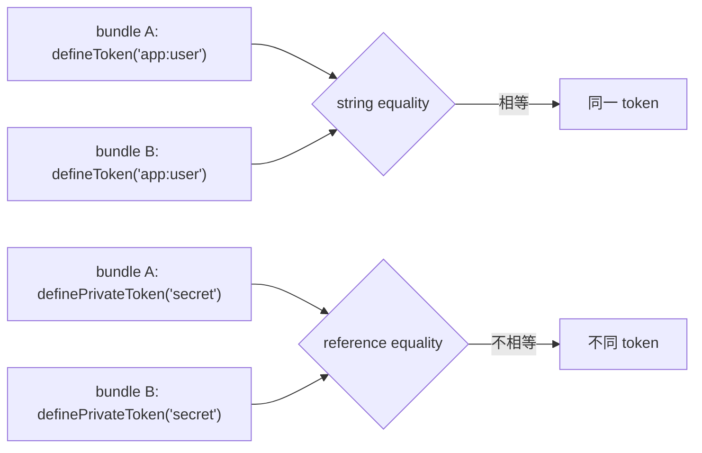

# 02b — Token 系統 (Token System)

本節定義一套 **可序列化、SSR 安全、散落可用** 的 Token 系統，同時用於 **服務解析** 與 **Keyed Session 身分**。

## 2b.1 設計目標

| 目標 | 含意 |
| :--- | :--- |
| **可序列化（Serializable）** | token 能直接落 `data-context-key` 屬性與 SSR JSON，無需編碼。 |
| **SSR 安全（SSR-safe）** | 無 module 全域可變狀態；registry 隨 Application 實例，per-request 隔離。 |
| **散落可用（Scatter-usable）** | 不同 bundle / script / realm / 文件獨立定義的 token，只要同名即等價。 |
| **統一命名空間** | service token 與 keyed session 身分共用同一命名空間。 |
| **安全（Safe）** | 強制命名空間、字元規範、黑名單、作用域與私有 token 分層防護。 |

## 2b.2 型別

```ts
// domain/model/token.ts

// 公開 token：branded string，runtime 就是 string（天然可序列化）
declare const ServiceType: unique symbol
export type ServiceToken<T> = string & { readonly [ServiceType]?: T }

// 私有 token：frozen branded 物件，引用即身分（不可序列化）
declare const PrivateServiceType: unique symbol
export interface PrivateToken<T> {
    readonly [PrivateServiceType]?: T
    readonly name: string   // 僅除錯用，不構成身分
}

// 統一 union（埠與簽名接受；keyed/序列化路徑只接受 ServiceToken）
export type Token = ServiceToken<any> | PrivateToken<any> | string
```

- 公開 token 的等價 = **字串相等**；私有 token 的等價 = **引用相等**。
- `ServiceRegistry` 宣告合併與 `ServiceToken<T>` **並存**（見 2b.8）。

## 2b.3 定義 API

```ts
// 公開：驗證式單參（Q20 A）
export function defineToken<T = unknown>(name: string): ServiceToken<T>

// 私有：不可序列化，僅同 realm
export function definePrivateToken<T = unknown>(name: string): PrivateToken<T>
```

```ts
import { defineToken, definePrivateToken } from '@sandlada/document-context'

interface User { id: string }

const userToken = defineToken<User>('app:user')          // ServiceToken<User>
const secret = definePrivateToken('app:session-secret')  // PrivateToken（不可序列化）
```

- `defineToken` 為 **純函式、冪等**：同名定義不視為錯誤（這正是跨 bundle 散落的機制，見 2b.4）。
- `definePrivateToken` 的 `name` 僅供除錯，**不做**命名空間驗證，亦不參與序列化。

## 2b.4 驗證規則（一律 `throw`）

`defineToken(name)` 於 runtime 驗證，違規一律拋 `DocumentContextError`（code `TOKEN_INVALID`）：

| 規則 | 內容 |
| :--- | :--- |
| **正規形式** | `namespace:name`，以 `:` 分割後**至少兩段**且每段非空（至少一段命名空間）。 |
| **字元集** | 僅允許 `[A-Za-z0-9._:/-]`；禁止空白與 `"` `<` `>` `&`。 |
| **長度** | ≤ 256。 |
| **黑名單** | 任一段落不得為 `__proto__` / `prototype` / `constructor`。 |
| **保留頂層命名空間** | 第一段不得為 `__system__` / `__document-context__`（保留給內部）。 |
| **重複定義** | **不視為錯誤**（`defineToken` 冪等）。 |

因字元集受限，落屬性與 JSON 時 **無需額外轉義**。

> `defineToken` 與 `mount` 的 keyed 身分正規化 **共用同一驗證器**（單一事實來源）；兩處違規一律 `TOKEN_INVALID`。

## 2b.5 等價語意



- 公開 token 跨 bundle / realm / 文件天然等價 → **無需全域 registry**。
- 私有 token 僅在同 JS realm 內以引用等價。

## 2b.6 序列化與落點

- **公開 token** → 直接使用其字串值：
    - Keyed Session：`data-context-key="app:cart"`（或 API 選項 `{ token }`）。
    - SSR payload：以 token 字串作 JSON 鍵 / payload id 後綴（`__dc_state:<token>`）。
- **私有 token** → **不可序列化**：
    - 不得作為 keyed session 身分。
    - SSR / 跨標籤路徑若遇到私有 token → 拋錯拒絕。
- keyed mount 會將 token 補寫入 `data-context-key`；最終銷毀時（值相符則）移除——見 [05-lifecycle-host.md](./05-lifecycle-host.md) §5.5。

## 2b.7 SSR 隔離與 registry 落點

- registry **不** 放 module 全域；掛在 **Application 實例**（組合根）。
- 瀏覽器：`WeakMap<Document, Map<string, WeakRef<Session>>>`（per-Document）。
- SSR：每個請求建立獨立 Application → **per-request 隔離 by construction**，零跨請求洩漏。

## 2b.8 注入多載

```ts
type SyncTarget = Session                                   // 同步投影（二等；僅 Session；見 03 §3.1.1）
type LateTarget = Session | HostPort | Element              // 晚綁定流 / Promise

// 同步多載（injectSync / injectAllSync；一等屬性見下）
// 1. ServiceRegistry 宣告合併（字串字面量，ergonomics）
injectSync<K extends keyof ServiceRegistry>(token: K): (session: SyncTarget) => ServiceRegistry[K]
// 2. 顯式 branded token
injectSync<T>(token: ServiceToken<T>): (session: SyncTarget) => T
// 3. 私有 token
injectSync<T>(token: PrivateToken<T>): (session: SyncTarget) => T
// 4. 裸字串（逃逸口，回傳 unknown）
injectSync(token: string): (session: SyncTarget) => unknown
```

- `injectSync` / `injectAllSync` 僅接受 `Session`；元素目標經 `inject$` / `inject`（Promise）採晚綁定（缺席 = pending，見 [09b-late-binding.md](./09b-late-binding.md)）。
- `provide` / `provideSync` / `inject$` / `inject` / `injectAll` / `injectAll$` / `injectAllSync` 採相同多載策略（晚綁定 API 的 target 為 `LateTarget`）。
- 對僅有 `multi` 註冊的 token，單值 `inject` / `inject$` / `injectSync` 不成立（同步拋 `UNKNOWN_SERVICE`；串流 / Promise 以錯誤收場）；改以 `injectAll` / `injectAll$` / `injectAllSync` 取用。

```ts
// ServiceRegistry 宣告合併（跨 bundle 型別安全）
declare module '@sandlada/document-context' {
    interface ServiceRegistry {
        'app:user': User
    }
}
```

## 2b.9 Keyed Session 整合

- `mount(bp, { token })` 或宿主 `data-context-key` 賦予 Session 權威身分；**keyed 身分強制為可序列化公開 token**。
- **來源優先序**：`options.token` > `data-context-key`；兩者並存且字串不等 → `KEYED_SESSION_CONFLICT`。
- **驗證**：與 `defineToken` 共用規則（違規 `TOKEN_INVALID`）。
- **幂等**：同宿主同 token 重複 `mount` 回傳快取 Session；**藍圖以首次掛載為準**。
- **身分衝突**（依 `onConflict`，預設 `throw`）：同宿主不同 token、或同 token 於兩個活躍宿主 → `throw` 拋 `KEYED_SESSION_CONFLICT`；`evict` 處置舊 Session 後掛載新者；`reset` 以舊狀態為新 Session 的 seed（供 HMR）。詳見 [05-lifecycle-host.md](./05-lifecycle-host.md) §5.5。
- **復甦**：同 token 於不同宿主且原 Session 仍在 `Suspended` TTL 內 → 復甦（沿用原藍圖，state 勝出，不重跑水合）。
- registry 鍵 = token 字串；存活於 per-Document registry（見 2b.7）；`adoptNode` 時隨 Session 遷移。
- 命名空間同時保護「服務解析」與「session 身分」兩個空間。

## 2b.10 威脅模型與對策

| 威脅 | 對策 |
| :--- | :--- |
| (a) 意外碰撞 | **強制命名空間**（執行期 `throw`）＋ 保留頂層命名空間 |
| (b) 跨請求狀態洩漏 | registry 掛 Application 實例；SSR per-request |
| (c) 偽造 / 越權 | **作用域限制**（可序列化路徑）＋ **私有 token**（不可序列化路徑） |
| (d) 原型污染 | 字元集限制 ＋ 黑名單（`__proto__`/`prototype`/`constructor`） |
| (e) 事件偽造 | **不在威脅模型內**：W3C `context-request` 為同頁公共契約，跨框架共享即接受此開放性 |
| (f) 屬性身分冒充 | 命名空間 + 衝突策略（`KEYED_SESSION_CONFLICT`）；同名即同身分為刻意設計 |

## 2b.11 不變式

1. 公開 token 於 runtime 為 string，等價為字串相等，跨 bundle / realm / 文件成立。
2. 私有 token 於 runtime 為 frozen 物件，等價為引用相等，不可序列化。
3. `defineToken` 違反任一字元 / 命名空間 / 黑名單規則一律 `throw`。
4. `defineToken` 冪等：同名重複定義不為錯誤。
5. 無強制全域 registry；身分不依賴全域可變狀態。
6. keyed session 身分必須為可序列化公開 token。
7. 字元集受限，token 可直接安全落屬性與 JSON，無需轉義。
8. keyed 身分正規化與 `defineToken` 共用同一驗證器。
