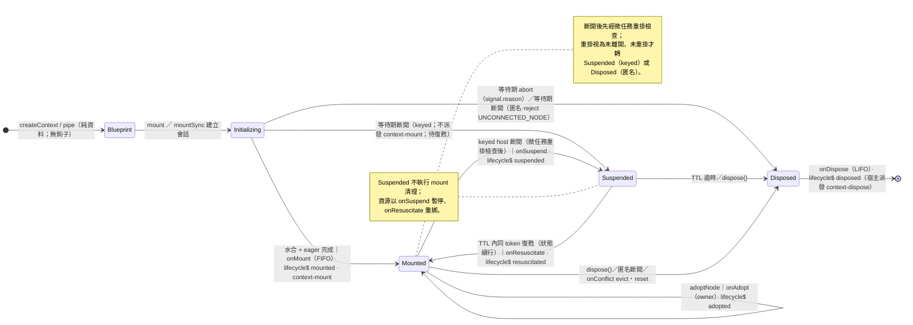
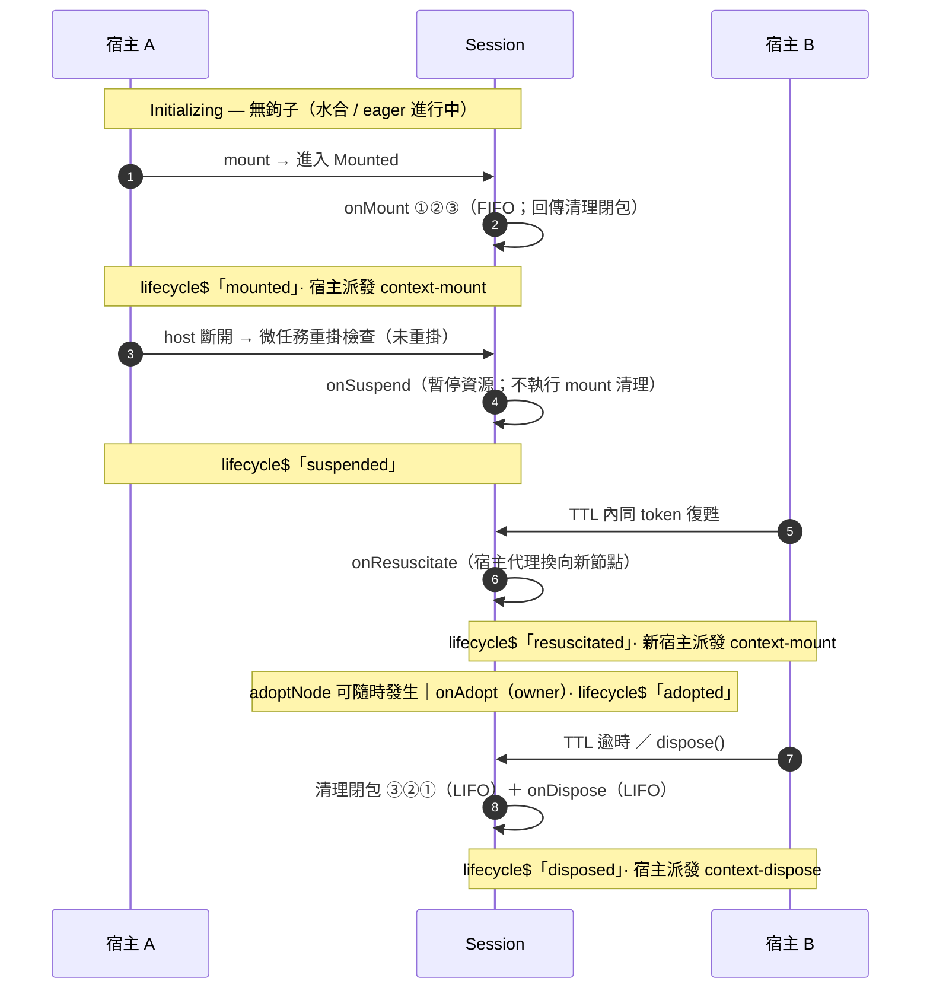

# 05 — 生命週期與宿主綁定 (Lifecycle & Host)

本節描述四維生命週期的協調，以及以純函式重寫的宿主綁定模型 `attach`。

## 5.1 四維生命週期協調矩陣

| 外部事件 | ① 物理 DOM | ② Session 狀態機 | ③ 服務解析 | ④ 狀態 / 儲存 | 系統職責 |
| :--- | :--- | :--- | :--- | :--- | :--- |
| `mount` / `mountSync`(bp)(host) | Connected | Initializing → Mounted | 註冊 providers（lazy；eager 立即實例化） | 水合 + 訂閱就緒 | `mount`（非同步默認）於水合與 eager 完成後 resolve；`mountSync` 立即回傳；DOM 組合要求宿主已連線（`UNCONNECTED_NODE`） |
| `injectSync(token)`（同步投影・二等） | 檢查 isConnected | Mounted | 實例化/快取 | 無 | 僅限已取得的 Session；值未就緒即拋（見 03 §3.1.1） |
| `inject$` / `inject`（晚綁定） | 未連線則等待 | Mounted | 待 Provider 出現 → 解析 | 無 | pending registry；`context-mount` / 觀察者喚醒（09b）；`signal` 取消（先到者勝） |
| `mount` 等待期 abort | Connected | Initializing → Disposed | 銷毀已建立者 | 丟棄水合結果 | 以 `signal.reason` 拒絕；走 dispose 清理，無殘留 |
| `mount` 等待期斷開（非 abort） | Disconnected | keyed：Initializing → Suspended；匿名：Initializing → Disposed | keyed 保留；匿名 銷毀 | keyed 保留狀態；匿名 丟棄 | 不派發 `context-mount`、不執行 `onMount`；keyed resolve 該 Session、匿名 reject `UNCONNECTED_NODE`（D-82） |
| `update(fn)` | 維持 | Mounted | 無 | 產生新快照 → 推送訂閱者 | 同步推送；儲存寫入批次見 06 §6.5 |
| host 短暫拖離 | Disconnected → (微任務重掛檢查) | Mounted 保持 | 保持 | 無（訂閱照常） | 微任務二次確認，防誤殺 |
| keyed host 置換 | Disconnected → 新 Connected | Suspended → Resuscitated | scoped 保持 | 狀態完整延續 | 同 token 復甦；沿用原藍圖，state 勝出 |
| keyed TTL 逾時 | Disconnected | Suspended → Disposed | 銷毀 scoped | store complete | 釋放資源、解除訂閱 |
| `dispose(session)` | 維持 | → Disposed | 銷毀 | store 毒化 | LIFO 清理、`abort$` 發射 |
| `adoptNode` | Adopted | Mounted 保持 | 保持 | 無 | 重綁觀察者與 registry 至新 Document |

### 5.1.1 生命週期鉤子全景（狀態 × 鉤子 × 事件）

同一張狀態機的三種標註：**觸發**（外部事實）→ **鉤子**（`on*` 運算子）→ **事件**（`lifecycle$` / 宿主 CustomEvent）。





- `Resuscitated` 是**事件與轉換名**，不是獨立停留狀態——復甦後回到 `Mounted`。
- `context-mount` 於每次**進入 `Mounted`**（首掛與復甦）派發；`context-dispose` 僅於最終 `Disposed` 派發一次。
- 匿名 Session 斷開直接 `Disposed`（不經 `Suspended`）；`Suspended` 不執行 mount 清理——資源以 `onSuspend` 暫停、`onResuscitate` 重綁。
- 等待期斷開（D-82）：不派發 `context-mount`、不執行 `onMount` / `onSuspend`；keyed → `Suspended`（Promise resolve）、匿名 → `Disposed`（Promise 拒絕 `UNCONNECTED_NODE`）。
- 鉤子順序為規範：鉤子**先於**事件；正向（`onMount` / `onSuspend` / `onResuscitate` / `onAdopt`）FIFO；清理閉包（LIFO）先於 `onDispose`（LIFO）（見 §5.2、§5.7）。
- 終結媒介：`dispose()` ≡ `Session[Symbol.dispose]`；`await using` 以 `Symbol.asyncDispose` 等待結算（見 [03-application-api.md](./03-application-api.md) §3.3）。

## 5.2 生命週期鉤子運算子

```ts
onMount((session) => {
    const chart = new ECharts(session.host.native())
    const id = setInterval(() => chart.update(selectSync((s) => s.data)(session)), 1000)
    return () => {
        clearInterval(id)
        chart.dispose()
    }
})

onDispose((session) => analytics.track('unmounted', { token: session.token }))
onSuspend((session) => pauseAnimation())
onResuscitate((session, host) => resumeAnimation(host))
onAdopt((session, owner) => console.log('adopted by', owner))
```

- **執行順序**：鉤子先於事件（進入 `Mounted`：`onMount` FIFO → 派發 `context-mount` → 推送 `lifecycle$「mounted」`；其餘狀態同構；`abort$` 例外，即時先行）。清理閉包與 `onDispose` 各自 LIFO，**先清理閉包、後 `onDispose`**。
- **Suspended 不執行 mount 清理**：資源以 `onSuspend` 暫停、`onResuscitate` 重綁；mount 清理只在最終銷毀時執行。
- **錯誤沙箱**：每個鉤子與清理閉包獨立 `try...catch`，例外送 `errors$` 且不中斷其餘流程。

**鉤子總覽**（五個 Session 鉤子 + 三個宿主轉發鉤子；事件欄對應 `LifecycleEvent` / `HostLifecycleEvent` union，見 [02-domain-model.md](./02-domain-model.md)）：

| 鉤子 | 觸發時機 | 簽名 | 順序 | 對應事件 | 備註 |
| :--- | :--- | :--- | :--- | :--- | :--- |
| `onMount(handler)` | 進入 `Mounted`（水合 + eager 完成） | `(session) => void \| (() => void)` | FIFO | `lifecycle$: mounted`；`context-mount` | 回傳清理閉包（進入 LIFO 鏈）；SSR 不執行（D-49） |
| `onSuspend(handler)` | keyed `Mounted → Suspended` | `(session) => void` | FIFO | `lifecycle$: suspended` | 只暫停、不清理；mount 清理延後至最終銷毀 |
| `onResuscitate(handler)` | `Suspended → Mounted`（TTL 內同 token 新宿主） | `(session, host: HostPort) => void` | FIFO | `lifecycle$: resuscitated`；新宿主 `context-mount` | 狀態完整延續；原生引用重讀（§5.5） |
| `onAdopt(handler)` | `adoptNode`（Session 保持 `Mounted`） | `(session, owner: unknown) => void` | FIFO | `lifecycle$: adopted` | 觀察者 / registry 遷移；跨 Document 復甦不支援 |
| `onDispose(handler)` | 最終 `Disposed` | `(session) => void \| Promise<void>` | LIFO | `lifecycle$: disposed`（串流完結）；`context-dispose` | 同步階段執行；非同步 fire-and-forget；`await using` 等待結算（D-09） |
| `attach({ onConnect })` | 宿主 `connectedCallback` 轉發（或觀察者偵測） | `() => void` | 冪等收斂 | `HostLifecycleEvent: connect` | 純函式；雙通道後到者 no-op（§5.4） |
| `attach({ onDisconnect })` | 宿主 `disconnectedCallback` 轉發 | `() => void` | 冪等收斂 | `HostLifecycleEvent: disconnect` | 微任務重掛檢查先於任何銷毀（§5.7 #3） |
| `attach({ onAdopt })` | 宿主 `adoptedCallback` 轉發 | `(owner: unknown) => void` | 冪等收斂 | `HostLifecycleEvent: adopt` | 宿主轉發層；Session 語意層為 `onAdopt` |

## 5.3 原生標準媒介

`Session` 自帶 `abort$`（以及對應的底層 `abortSignal`）。任何非同步任務只需以 `takeUntil(session.abort$)` 或傳遞 `AbortSignal` 即可獲得自動取消。

```ts
provide('user', async (session) => {
    const response = await fetch('/api/user', { signal: session.abortSignal })
    return response.json()
})
```

## 5.4 宿主綁定 `attach`（參考 Lit 生命週期回調設計）

> **重要**：本庫 **不引入 LitJS 依賴**，也 **不引入 `ReactiveController` 這個詞**。我們僅 **參考** Lit 組件的生命週期回調設計（connect / disconnect / adopt 三段式），並以 **純函式** 形式提供。

Lit 的 `ReactiveController` 提供 `hostConnected` / `hostDisconnected` 等回調；本庫以回傳鉤子物件的高階函式對應之：

```ts
import { attach } from '@sandlada/document-context'

// 回傳的鉤子由宿主在自身的 connectedCallback / disconnectedCallback / adoptedCallback 中轉發
const hooks = attach({
    onConnect: () => console.log('host connected'),
    onDisconnect: () => console.log('host disconnected'),
    onAdopt: (owner) => console.log('host adopted', owner)
})(session)

// 宿主（例如 Custom Element）：
class MyElement extends HTMLElement {
    connectedCallback() { hooks.connect() }
    disconnectedCallback() { hooks.disconnect() }
    adoptedCallback(_old, _new, owner) { hooks.adopt(owner) }
}
```

設計要點：

- **純函式、無 class、無 `this`**：`attach(config)(session)` 回傳 `{ connect, disconnect, adopt }`。
- **宿主主導**：本庫不插入任何全域 `MutationObserver` 依賴來臆測宿主生命週期；由宿主明確轉發（也可由 `infrastructure/dom` 的集中觀察者代為偵測，見 [09-infrastructure.md](./09-infrastructure.md)）。
- **可選的生命週期回調**：`onConnect` / `onDisconnect` / `onAdopt` 皆為可選。
- **與中央觀察者並存**：宿主轉發與觀察者偵測是同一事實的兩條通道；鉤子冪等收斂（後到者 no-op），跨通道順序不保證（狀態轉換本身冪等）。

## 5.5 Keyed Session 與復甦

- **身分來源與正規化**：`mount(bp, { token })` > 宿主 `data-context-key`；兩者並存且字串不等 → `KEYED_SESSION_CONFLICT`。token 以與 `defineToken` 共用的驗證器檢查（違規 `TOKEN_INVALID`；keyed 身分強制為可序列化公開 token）。`mount` 與 `mountSync` 適用同一組 keyed / TTL / 復甦 / `onConflict` 規則。
- **屬性維護**：keyed mount 會將 token 補寫入宿主 `data-context-key`；`Suspended` 期間保留；最終 `Disposed` 時，若屬性值等於會話 token 則移除（避免殘留身分宣稱）。
- **幂等**：同宿主同 token 重複 `mount` 回傳快取 Session；**藍圖以首次掛載為準**。匿名 Session 無跨宿主復甦；同宿主重複掛載同樣回傳快取。
- **身分衝突**（依 `onConflict`，預設 `throw`）：

| 情境 | 處理 |
| :--- | :--- |
| 同宿主已有 token A，再次掛載 token B | `throw` → `KEYED_SESSION_CONFLICT`；`evict` → 處置舊 Session 後掛載新者（直接 `dispose`；不經 `Suspended`、不執行 `onSuspend`）；`reset` → 舊 Session 銷毀，其**當前狀態**作為新 Session 的 seed（供 HMR） |
| 同 token 同時活躍於兩個已連線宿主 | 一律 `KEYED_SESSION_CONFLICT`（不允許雙活躍身分） |
| 同 token、不同宿主、原 Session 仍在 `Suspended` TTL 內 | 復甦（見下） |

- **復甦**：沿用原 Session 的藍圖與身分；狀態完整延續（state 勝出，不重跑水合）。使用者自建的 DOM 綁定請於 `onResuscitate` 後重讀 `native()` 並重綁（見 [08-projection.md](./08-projection.md)）。`suspensionTtlMs` 預設 50；`0` = 不進 Suspended 立即銷毀；`Infinity` = 永不自動銷毀（進階）。
- **registry**：身分存活於 per-Document registry（`WeakMap<Document, Map<string, WeakRef<Session>>>`），`FinalizationRegistry` 作兜底；`adoptNode` 時 Session 與其 registry 條目遷移至新 Document；跨 Document 復甦不支援（請重新掛載）。
- **TTL 計時**：背景分頁的計時器可能被瀏覽器節流，TTL 只保證「不早於」設定時間觸發。

## 5.6 不使用集中觀察者時的行為

若宿主未轉發生命週期、且未啟用 `infrastructure/dom` 的集中觀察者：

- 匿名 Session 不會自動隨節點脫離而銷毀，需顯式 `dispose(session)` 或以 `using` / `await using`（TC39 Explicit Resource Management）管理。
- 啟用集中觀察者（預設於 DOM 組合根）可獲得自動 GC 與復甦。

## 5.7 不變式

1. 鉤子先於事件；正向生命週期鉤子（`onMount` / `onSuspend` / `onResuscitate` / `onAdopt`）FIFO；清理閉包（LIFO）先於 `onDispose`（LIFO）。
2. 鉤子例外隔離，絕不中斷銷毀流程。
3. 微任務重掛檢查先於任何 keyed Session 銷毀。
4. `attach` 回傳的鉤子可安全重複呼叫（冪等）；雙通道並存時後到者為 no-op。
5. 復甦以「狀態完整延續（state 勝出）」，不重跑水合；沿用原 Session 原藍圖。
6. 藍圖以首次掛載為準；身分衝突依 `onConflict`。
7. 等待期斷開（D-82）：keyed → `Suspended`、匿名 → `Disposed`；兩者皆不派發 `context-mount`、不執行 `onMount`。
